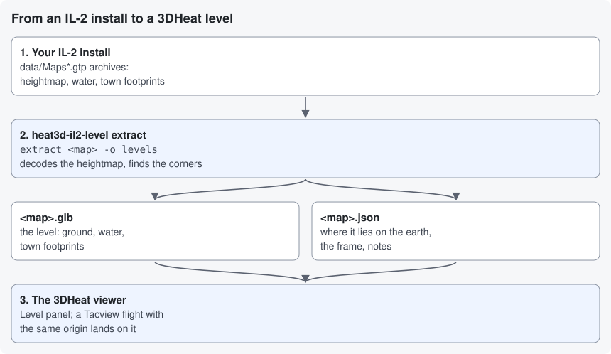

# 3DHeat IL-2: IL-2 Sturmovik maps as 3D levels

**What is it?** A small program that turns the maps of IL-2 Sturmovik: Great
Battles, read from your own install, into 3D models - levels - you can fly
over in the [3DHeat](https://github.com/Holdi601/3DHeat) viewer: the hills,
rivers, lakes, sea and towns, placed where they lie on the earth.

**Why would I use it?** To see your IL-2 flights over the game's own map. A
flight recorded with Tacview and converted by the 3DHeat Watcher lands on the
level with no placement step.

**Example:** `heat3d-il2-level extract <map> -o levels` ->
`levels/<map>/<map>.glb` (the level) + `levels/<map>/<map>.json` (where it
lies on the earth). A heightmap, used below, is a grid of heights, like a
relief map.



**Documentation:** [holdi601.github.io/3DHeat-Ext-IL2](https://holdi601.github.io/3DHeat-Ext-IL2/), a page per
command with step-by-step use and example output. Part of
[3DHeat](https://github.com/Holdi601/3DHeat) ([documentation](https://holdi601.github.io/3DHeat/)).

Each game reader is its own small project with its own licence file, releases
and issue tracker, so it can be installed, updated, maintained - or withdrawn
on a rights holder's request - on its own, without affecting the viewer or the
other tools.

## The standalone program

No Python needed: download the file for your system from the
[latest release](https://github.com/Holdi601/3DHeat-Ext-IL2/releases/latest)
(`heat3d-il2-<version>-windows-x64.zip` for Windows,
`heat3d-il2-<version>-linux-x64.tar.gz` for IL-2 under Proton on Linux and
Steam Deck), check it against `SHA256SUMS`, unpack it and start `heat3d-il2`.
Its window finds your IL-2 installs, says what is missing, lists the maps
that are new or changed since the last extraction and extracts the ones you
pick into the 3DHeat levels folder, and asks before it updates itself.
`heat3d-il2 --help` lists its commands (every command below runs through it
too). The 3DHeat app's Extractors panel can install and update it for you.
See [The standalone program](https://holdi601.github.io/3DHeat-Ext-IL2/#the-standalone-program-no-python-needed).

The window walks through four steps (find the game, choose, work, done) in the 3DHeat look, dark or light. On Windows the program opens only its window, with no console window; in a terminal it prints as usual, and `heat3d-il2-cli.cmd` in the same folder makes the terminal wait for it and pass on its exit code.

## Quick start for new users (Python)

You need: Windows, [Python](https://www.python.org/downloads/) 3.10 or later
("Add python.exe to PATH" ticked in its installer), IL-2 Sturmovik: Great
Battles installed through Steam (found by itself), and about 30 MB of disk
space a map. No Git is needed.

1. Install the tool (one line, in PowerShell or a command prompt), and
   optionally numba, which decodes 20 to 50 times faster:

   ```bash
   python -m pip install https://github.com/Holdi601/3DHeat-Ext-IL2/archive/refs/tags/v0.2.0.zip
   python -m pip install numba
   ```

2. List the maps and export one, or all (an install outside Steam needs
   `--game "<IL-2 folder>"`):

   ```bash
   heat3d-il2-level list
   heat3d-il2-level extract landscape_stalin_s -o levels
   heat3d-il2-level extract --all -o levels
   ```

3. Each map goes into its own folder: `levels\landscape_stalin_s\landscape_stalin_s.glb`
   (the level, about 30 MB, in seconds with numba) and `landscape_stalin_s.json`
   beside it (where it lies on the earth). `extract` prints
   `ok <glb> <n> triangles (enu frame)` per map.
4. Open it in the [3DHeat viewer](https://github.com/Holdi601/3DHeat#quick-start):
   download the viewer (**Code -> Download ZIP**, unpack) and double-click
   `start.bat`; it offers to install [Node.js](https://nodejs.org/) when it is
   missing and opens Chrome or Edge at `http://127.0.0.1:5273`. There,
   **Background / level -> 3D model...** and pick the `.glb`.

When a new release is out, the tool says so when it starts, shows its notes
and asks: update now, later, or skip this version. It updates without asking
only when you chose that: `--auto-update` (this run), the standalone window's
*Update automatically*, or `HEAT3D_AUTO_UPDATE=1`. `python -m heat3d_ext_il2.update`
updates on request; `HEAT3D_NO_UPDATE=1` switches the check off.

## Install from a checkout

New to the command line? Read [Before you start](https://holdi601.github.io/3DHeat-Ext-IL2/before-you-start.html) first.

1. Install Python 3.10 or later, and IL-2 Sturmovik: Great Battles.
2. `git clone https://github.com/Holdi601/3DHeat-Ext-IL2` (or download the
   ZIP) and open a terminal in that folder.
3. Install the command and list your maps:

```bash
python -m pip install -e .                 # installs the heat3d-il2-level command
python -m pip install -e .[fast]           # optional: with numba, decoding 20 to 50 times faster
heat3d-il2-level list                      # every map found, with its latitude/longitude box
```

You should see one line per map - its name, its game, its heightmap and
where it lies - and a last line counting the maps.


## Commands

```bash
heat3d-il2-level list [--game FOLDER ...]                    # the maps found
heat3d-il2-level extract <map> -o levels                     # one map (names as `list` prints them)
heat3d-il2-level extract "<family>_*" -o levels              # several maps: wildcards, in quotes
heat3d-il2-level extract --all -o levels                     # every map; seasons sharing a heightmap are written once
heat3d-il2-level extract <map> --origin <lat> <lon> -o levels  # in the flat map of a recording with that origin
python -m heat3d_ext_il2 ...                                 # the same, without the command installed
```

The installs are found through Steam; `--game <folder>` (repeatable) or
`HEAT3D_IL2_GAME` say where they are otherwise. `extract` prints
`ok <glb> <n> triangles (<frame> frame)` or `failed <map>: <why>` per map
(set `HEAT3D_DEBUG` for the full traceback). Exit status: 0 done; 1 any map
failed (the others are still written); 2 no install or no map found.

| `extract` option | Does |
|---|---|
| `<map> ...` / `--all` | map names as `list` prints them (wildcards allowed) / every map |
| `-o`, `--out FOLDER` | output folder; each map goes in `<out>/<map>/` (required) |
| `--game FOLDER` | an IL-2 folder, repeatable (also for `list`) |
| `--max-grid N` | heightmap samples a side at most (default 1024) |
| `--frame enu` / `--frame game` | the frame (below; default `enu`) |
| `--origin LAT LON` | origin of the `enu` frame (a recording's `geo`; default the map's centre) |
| `--no-water`, `--no-towns` | leave the water / the town footprints out |
| `--skip-existing` | leave maps whose `.glb` exists |

Every option, as the program prints it: [Command reference](https://holdi601.github.io/3DHeat-Ext-IL2/cli-reference.html).

## Unit models and the unit list

```bash
heat3d-il2-level models --levels <levels folder>    # every aircraft, vehicle, gun and ship as a local model pack
heat3d-il2-level catalog --levels <levels folder>   # the units, with the real vehicle each one is
heat3d-il2-level --check                            # what is found and what is missing
```

`models` writes `<levels>\model-packs\il2\` (one `.glb` per unit and
`model-pack.json`); the 3DHeat viewer then draws each unit of a recording as
its own model at its true size, with turning propellers, landing gear that
folds away in flight and a tank's turret and gun following the data.
`catalog` writes `<levels>\il2\catalog.json`: each unit's real vehicle name
(`Bf 109 G-6`, `Il-2 mod.1943`) and the names other games give it, so other
games' units of the same vehicle can be drawn with these models and the other
way round. Both stay on your machine. Details: [Unit models](https://holdi601.github.io/3DHeat-Ext-IL2/models.html).

## What comes out

`<out>/<map>/<map>.glb` (a glTF binary level) and `<map>.json` beside it. Levels are
not match files: the viewer's one-file-a-match container
([One file a match (.3dheat)](https://holdi601.github.io/3DHeat/container.html))
holds the telemetry you load on top. The glb is written to
`<map>.glb.part` and renamed when complete.

| Part | What it is |
|---|---|
| `ground:<map>` | the terrain heightmap as a grid, at most `--max-grid` samples a side (default 1024: about 2 million triangles) |
| `water:<map>` | rivers, lakes and sea: flat quads at the water's height, one per grid cell enough of whose heightmap samples are under water (a third with the map's water mask, half without) |
| `ground:<map> towns` | the built-up footprints of towns and villages, draped 1.5 m over the ground |

The JSON holds the map's **corners and latitude/longitude box** (`corners`,
`extent`), how they were found (`georeference`), the height settings
(`heightMul`, `SeaLevel`), the play area in the game's metres (`playArea`), the
frame and its origin (`frame`, `geo`), triangle counts and any `notes`.

**Coordinates.** Two frames, `--frame`:

- `enu` (default): metres east, altitude above sea level, north of an origin on
  the WGS-84 tangent plane: the flat map the 3DHeat Watcher puts an IL-2 Tacview
  recording in (x east, y altitude, z north, drawn with z mirrored). The glb
  stores (east, altitude, -north). Convert with `--origin <lat> <lon>` set to a
  recording's `geo` (its session's reference point) and the recording lands on
  the level with no placement step; without it the map's centre is the origin,
  and the JSON's `geo` says which.
- `game`: the game's own metres as mission files have them: x north from the
  south edge, y the game's height, z east from the west edge (right-handed as it
  is, so glb = (x, y, z)). Maps that cannot be placed on the earth are written in
  this frame whatever was asked, with a note.

## What is read, and how well

| Part | Status |
|---|---|
| Archives (`data/*.gtp`, Great Battles) | the file table (`S16R`, `STRMFAT?`, `DIR!`/`FILE` records) and the entries (`STRMFILE` header, data stored as is); every `Maps*.gtp` of the test install |
| `height.hini` | `height_map`, `water_map`, `heightMul`, `SeaLevel`, the play limits and `MapNW/NE/SE/SW`; every one of the test install |
| Heightmaps (`height.dat`) | the codec below; every sector of the maps decoded in full while working it out uses its bitstream exactly (at most the byte padding left over), the rest checked by header. Checked bit-exactly against the uncompressed `distlod.raw` files the game ships beside their `distlod.dat`, and against a map's own distant-LOD heightmap (correlation 0.999) |
| Heights | metres = raw x heightMul / 256 - SeaLevel x heightMul. A map's sea decodes to exactly the height its hini comments give; another's border to its `bounds_level` |
| Placement | bilinear between the hini's four corners, row 0 north, column 0 west. Checked on a map against known towns, coasts and seas (town heights within about 10 m of the real ones, the seas below sea level). The corners are a quadrilateral, not the game's own projection, so expect some hundreds of metres of error in the middle of a large map. One map family's hini carries the corners of another map (they span a fraction of its real size); this is detected, and that family is placed instead by a landmark fit: towns and airfields of the game's own location databases (`*.ldfbin`) against their real positions, rms of a couple of kilometres (towns against the airfields named after them, and coordinates of the real places to about a kilometre); the JSON lists every landmark and its residual |
| Water mask (`water.wtr`: four pyramid levels of tiles, each tile a table of 400 m blocks, each block land, full or partly water with its shape in a bit stream) | the container is read on every map (no byte left over on the files decoded in full); the shape inside a partly-water block is **not decoded**. Full blocks are water; in partly-water blocks a sample is water where the water map (`height_w.dat`, same codec as the heightmap) is above the ground, or, next to a lake, where the ground is no higher than the lake; land blocks are dry. That removes the marsh the water map alone reports as water. Rivers narrower than the output grid come out broken into pieces |
| Town footprints (the decal meshes `textures.tini` lists: `towns.mesh`, `cities.mesh`, `city_*.mesh`, `roads_fields.mesh`, ...: 25.6 km tiles of flat textured triangles) | read on every map; the faces whose texture is a town, village or industrial ground are kept. Checked against the real towns on a few maps (a town on both banks of a river, a confluence). They are footprints: the game places the buildings at run time, and the files hold no buildings |
| Airfields, bridges, buildings | **not read**: airfields are mission objects, buildings come from the game's own placement |
| Forests (`forest_map.wtr`) | its blocks read the same way, but nearly every block is "partly forest", so without the bit stream there is no usable forest mask; not drawn |
| The ground's textures | not read |

### The heightmap codec

Worked out from the data files alone; no game code was read or disassembled.
Little-endian:

```text
u32 width, u32 height, u32 sectorsX, u32 sectorsY, u32 sectorSize, f32 cellSize
u32 offset[sectorsX * sectorsY]            from the start of the file, row-major, top row first
sector: u16 count (bytes that follow), u16 mode ((log2 sectorSize) << 4 | LW, LW = 4),
        then a bitstream read MSB first:
  PRE   2 * (log2(sectorSize) - 5) bits, always 0 so far
  LIT   the first sample: sign (1), n (LW bits), magnitude (n + 1 bits)
  then until the sector is full:
    0 LIT       next = previous + LIT
    1 RUN LIT   the previous sample repeats RUN times (k: 3 bits, m: k + 1 bits, RUN = m + 1),
                then (unless the sector is full) next = previous + LIT
  values are 16-bit: read them modulo 65536
```

Partial sectors at the right and bottom edges are padded and cropped. The same
codec holds the water map and the distant-LOD heightmap.

### Landmark fits

Where a map's corners cannot be used, `landmarks.py` fits an affine map from the
game's metres to the earth by least squares: game positions from the user's own
files (mission `Airfield` blocks, the career location databases), real positions
from tables of the places' published coordinates in the code. The JSON's
`georeference` carries the matrix, the origin, every landmark with its residual
and the rms.

## Speed

Decoding is pure Python unless numba is installed (`python -m pip install -e .[fast]`):
a mid-sized map takes about 15 s without it and about a second with it; the
largest map, several hundred million samples, about 7 s with it (the first
run also compiles). Memory stays at one row of sectors plus the output grid.

## A game whose archives have no file table

IL-2 Series: Korea keeps no readable file table in its archives (the names
are hashed in a block at the end of each archive), and its settings files are
not stored readable. `list` shows its map with the game `Korea`. So:

- its heightmap and water map are found by their header (the `height.dat`
  layout, sectors of 128 samples; a very large grid at a fine cell size);
- it is placed on the earth by fitting the airfields its missions place
  (`data/Missions/**/*.Mission`, read on your machine) to the real airfields'
  published coordinates (`korea.py`): residuals of tens to a few hundred
  metres. The JSON lists each landmark and its residual;
- heightMul and SeaLevel are estimated: ships in the missions sit on the sea,
  so their height over the water map's commonest (sea) value gives the scale.
  Heights come out plausible (the sea below sea level, coastal towns at a few
  metres), not checked further. The JSON marks them estimated.


## The 3DHeat tools

| Tool | What it does | Code | Docs |
|---|---|---|---|
| 3DHeat viewer | shows the data: heatmaps, race analysis, match review | [3DHeat](https://github.com/Holdi601/3DHeat) | [docs](https://holdi601.github.io/3DHeat/) |
| GameFiles | levels and courses from a game's own files | [3DHeat-GameFiles](https://github.com/Holdi601/3DHeat-GameFiles) | [docs](https://holdi601.github.io/3DHeat-GameFiles/) |
| GameCapture | lap telemetry, and levels rebuilt from gameplay video | [3DHeat-GameCapture](https://github.com/Holdi601/3DHeat-GameCapture) | [docs](https://holdi601.github.io/3DHeat-GameCapture/) |
| Unreal Exporter | an Unreal Editor plugin: a level as one `.glb` | [3DHeat-UnrealExporter](https://github.com/Holdi601/3DHeat-UnrealExporter) | [docs](https://holdi601.github.io/3DHeat-UnrealExporter/) |
| CS2 | Counter-Strike 2 demos and maps | [3DHeat-CS2](https://github.com/Holdi601/3DHeat-CS2) | [docs](https://holdi601.github.io/3DHeat-CS2/) |
| Watcher | records what games publish while you play | [3DHeat-Watcher](https://github.com/Holdi601/3DHeat-Watcher) | [docs](https://holdi601.github.io/3DHeat-Watcher/) |
| Ext-WarThunder | War Thunder replays | [3DHeat-Ext-WarThunder](https://github.com/Holdi601/3DHeat-Ext-WarThunder) | [docs](https://holdi601.github.io/3DHeat-Ext-WarThunder/) |
| Ext-WoT | World of Tanks replays | [3DHeat-Ext-WoT](https://github.com/Holdi601/3DHeat-Ext-WoT) | [docs](https://holdi601.github.io/3DHeat-Ext-WoT/) |
| Ext-WoWs | World of Warships replays | [3DHeat-Ext-WoWs](https://github.com/Holdi601/3DHeat-Ext-WoWs) | [docs](https://holdi601.github.io/3DHeat-Ext-WoWs/) |
| Ext-Squad | Squad server demos | [3DHeat-Ext-Squad](https://github.com/Holdi601/3DHeat-Ext-Squad) | [docs](https://holdi601.github.io/3DHeat-Ext-Squad/) |
| Ext-DCS | DCS World maps as 3D levels | [3DHeat-Ext-DCS](https://github.com/Holdi601/3DHeat-Ext-DCS) | [docs](https://holdi601.github.io/3DHeat-Ext-DCS/) |
| Ext-IL2 | IL-2 Sturmovik maps as 3D levels | [3DHeat-Ext-IL2](https://github.com/Holdi601/3DHeat-Ext-IL2) | [docs](https://holdi601.github.io/3DHeat-Ext-IL2/) |
| Ext-Dota | the Dota 2 map from your own install as a 3D level | [3DHeat-Ext-Dota](https://github.com/Holdi601/3DHeat-Ext-Dota) | [docs](https://holdi601.github.io/3DHeat-Ext-Dota/) |
| Ext-DotaReplay | Dota 2 replays | [3DHeat-Ext-DotaReplay](https://github.com/Holdi601/3DHeat-Ext-DotaReplay) | [docs](https://holdi601.github.io/3DHeat-Ext-DotaReplay/) |
| Ext-Riot | League of Legends and VALORANT replays (what they carry unencrypted) | [3DHeat-Ext-Riot](https://github.com/Holdi601/3DHeat-Ext-Riot) | [docs](https://holdi601.github.io/3DHeat-Ext-Riot/) |
| Ext-Forza | Forza courses, races and cars from your own install | [3DHeat-Ext-Forza](https://github.com/Holdi601/3DHeat-Ext-Forza) | [docs](https://holdi601.github.io/3DHeat-Ext-Forza/) |
| Ext-Battlefield | Battlefield levels (Frostbite) as 3D levels | [3DHeat-Ext-Battlefield](https://github.com/Holdi601/3DHeat-Ext-Battlefield) | [docs](https://holdi601.github.io/3DHeat-Ext-Battlefield/) |
| Ext-BeamNG | BeamNG.drive courses | [3DHeat-Ext-BeamNG](https://github.com/Holdi601/3DHeat-Ext-BeamNG) | [docs](https://holdi601.github.io/3DHeat-Ext-BeamNG/) |
| Ext-ACRally | Assetto Corsa Rally stages as courses | [3DHeat-Ext-ACRally](https://github.com/Holdi601/3DHeat-Ext-ACRally) | [docs](https://holdi601.github.io/3DHeat-Ext-ACRally/) |
| Ext-Reforger | Arma Reforger worlds (Enfusion) as 3D levels | [3DHeat-Ext-Reforger](https://github.com/Holdi601/3DHeat-Ext-Reforger) | [docs](https://holdi601.github.io/3DHeat-Ext-Reforger/) |
| Ext-R6 | Rainbow Six Siege match replays | [3DHeat-Ext-R6](https://github.com/Holdi601/3DHeat-Ext-R6) | [docs](https://holdi601.github.io/3DHeat-Ext-R6/) |

## The terms

This tool reads the archives of your own IL-2 Sturmovik: Great Battles
installation on your computer and never changes them.

Nothing from the game is shipped or redistributed: no game files, no game
code, no DLLs; the tests build every file they read. The levels it writes stay
on your machine.

3DHeat IL-2 is not affiliated with or endorsed by 1C Game Studios / 777
Studios. IL-2 Sturmovik and related names and trademarks belong to their
owners.

Rights holders: open an issue at
[github.com/Holdi601/3DHeat-Ext-IL2/issues](https://github.com/Holdi601/3DHeat-Ext-IL2/issues) -
we respond quickly and remove anything on request.

## Tests

```bash
python -m pytest -q
```

`tests/synth.py` builds archives, heightmaps (an encoder for the codec above),
`height.hini` files and archives without a file table in code.

## Licence

MIT - see [`LICENSE`](LICENSE). Uses numpy (BSD-3-Clause) and, optionally,
numba (BSD-2-Clause). `heat3d_update` is the 3DHeat tools' shared updater.
