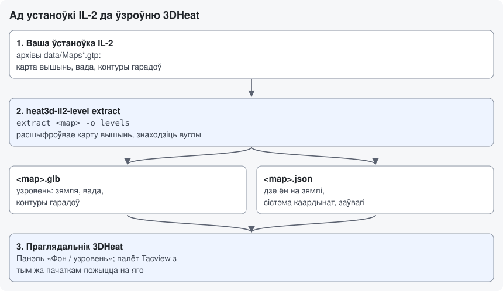

# 3DHeat IL-2 {#dheat-il-2}

**Што гэта?** Маленькая праграма, якая ператварае карты **IL-2 Sturmovik:
Great Battles**, прачытаныя з **вашай уласнай усталёўкі**, у 3D-мадэлі - узроўні, -
над якімі можна лятаць у праглядальніку [3DHeat](https://github.com/Holdi601/3DHeat)
([дакументацыя](https://holdi601.github.io/3DHeat/)): пагоркі, рэкі,
азёры, мора і гарады, размешчаныя там, дзе яны ляжаць на зямлі. Другая гульня IL-2,
чые архівы хаваюць табліцу файлаў, чытаецца настолькі, наколькі яны дазваляюць
([падрабязнасці](archives-without-table.md)).

**Навошта гэта мне?** Каб бачыць свае палёты IL-2 над уласнай картай гульні.

**Прыклад:** `heat3d-il2-level extract <map> -o levels` ->
`levels/<map>/<map>.glb` (узровень) + `<map>.json` (дзе ён ляжыць на
зямлі). Карта вышынь (heightmap) — гэта сетка вышынь, як рэльефная карта; запіс Tacview —
гэта файл палёту, які піша Tacview.

Для чаго гэта карысна:

- **Палёты на ўласнай карце гульні.** Запіс IL-2 Tacview, сканвертаваны
  3DHeat Watcher з тым жа пачаткам адліку, ложыцца на ўзровень без этапу
  размяшчэння.
- **Усе карты адразу.** `extract --all` піша кожную знойдзеную карту; сезоны, што
  дзеляць адну карту вышынь, пішуцца адзін раз.
- **Дзе на зямлі.** `.json` кожнага ўзроўню нясе яго вуглы і скрынку
  шыраты/даўгаты, і як яны былі знойдзены.



## Хуткі старт {#quick-start}

Упершыню ў камандным радку? Спачатку прачытайце [Перад пачаткам](before-you-start.md).
Выконвайце гэта ў папцы, якую вы атрымалі праз `git clone` або распакавалі:

```bash
python -m pip install -e .                         # installs the heat3d-il2-level command
python -m pip install -e .[fast]                            # with numba: decoding 20 to 50 times faster
heat3d-il2-level list                              # every map found, with its latitude/longitude box
heat3d-il2-level extract <map> -o levels           # one map (names as `list` prints them, wildcards allowed)
heat3d-il2-level extract --all -o levels           # every map
```

З `list` вы ўбачыце радок на кожную карту, а з `extract` — `ok ...`.
Потым загрузіце `levels/<map>/<map>.glb` на панэлі «Фон / узровень» праглядальніка
([Узроўні](https://holdi601.github.io/3DHeat/levels.html)).

Узроўні, якія ён піша, пабудаваны з даных гульні: яны застаюцца **на вашым
кампутары**; ніколі не публікуйце іх ([Умовы](terms.md)).

## Старонкі {#pages}

| Старонка | Пра што яна |
|---|---|
| [Перад пачаткам](before-you-start.md) | Python, тэрмінал, першы запуск |
| [Пошук карт: list](list.md) | дзе знаходзяцца ўсталёўкі, што друкуе `list` |
| [Пабудова ўзроўняў: extract](extract.md) | кожная опцыя, крок за крокам, прыклады |
| [Файлы ўзроўню і сістэмы каардынат](output.md) | часткі `.glb`, `.json`, сістэмы `enu` і `game` |
| [Як чытаюцца файлы](reading.md) | архівы, кодэк карты вышынь, вада, гарады, падгонка па арыенцірах |
| [Архівы без табліцы файлаў](archives-without-table.md) | другая гульня, якая чытаецца настолькі, наколькі дазваляюць яе архівы |
| [Хуткасць, тэсты, умовы](terms.md) | numba, тэсты, умовы гульні, ліцэнзія |
| [Даведнік каманд](../cli-reference.md) | кожная опцыя, створаная з кода |
| [Падтрымка гэтай дакументацыі](maintaining.md) | спіс для выпуску |

## Звязанае {#related}

- Праглядальнік 3DHeat: [github.com/Holdi601/3DHeat](https://github.com/Holdi601/3DHeat),
  дакументацыя на [holdi601.github.io/3DHeat](https://holdi601.github.io/3DHeat/).
- Тэлеметрыя для гэтых узроўняў: [3DHeat Watcher](https://holdi601.github.io/3DHeat-Watcher/)
  сканвертуе запісы IL-2 Tacview; фарматы файлаў праглядальніка, у тым ліку яго
  кантэйнер «адзін файл на матч», апісаны ў
  [Адзін файл на матч (.3dheat)](https://holdi601.github.io/3DHeat/container.html).

## Інструменты 3DHeat {#the-3dheat-tools}

| Інструмент | Што ён робіць | Код | Дакументацыя |
|---|---|---|---|
| Праглядальнік 3DHeat | паказвае даныя: цеплавыя карты, аналіз гонак, разбор матчаў | [3DHeat](https://github.com/Holdi601/3DHeat) | [дакументацыя](https://holdi601.github.io/3DHeat/) |
| GameFiles | узроўні і трасы з уласных файлаў гульні | [3DHeat-GameFiles](https://github.com/Holdi601/3DHeat-GameFiles) | [дакументацыя](https://holdi601.github.io/3DHeat-GameFiles/) |
| GameCapture | тэлеметрыя кругоў і ўзроўні, узноўленыя з відэа гульні | [3DHeat-GameCapture](https://github.com/Holdi601/3DHeat-GameCapture) | [дакументацыя](https://holdi601.github.io/3DHeat-GameCapture/) |
| Unreal Exporter | убудова Unreal Editor: узровень як адзін `.glb` | [3DHeat-UnrealExporter](https://github.com/Holdi601/3DHeat-UnrealExporter) | [дакументацыя](https://holdi601.github.io/3DHeat-UnrealExporter/) |
| CS2 | дэма і карты Counter-Strike 2 | [3DHeat-CS2](https://github.com/Holdi601/3DHeat-CS2) | [дакументацыя](https://holdi601.github.io/3DHeat-CS2/) |
| Watcher | запісвае тое, што гульні публікуюць, пакуль вы гуляеце | [3DHeat-Watcher](https://github.com/Holdi601/3DHeat-Watcher) | [дакументацыя](https://holdi601.github.io/3DHeat-Watcher/) |
| Ext-WarThunder | рэплеі War Thunder | [3DHeat-Ext-WarThunder](https://github.com/Holdi601/3DHeat-Ext-WarThunder) | [дакументацыя](https://holdi601.github.io/3DHeat-Ext-WarThunder/) |
| Ext-WoT | рэплеі World of Tanks | [3DHeat-Ext-WoT](https://github.com/Holdi601/3DHeat-Ext-WoT) | [дакументацыя](https://holdi601.github.io/3DHeat-Ext-WoT/) |
| Ext-WoWs | рэплеі World of Warships | [3DHeat-Ext-WoWs](https://github.com/Holdi601/3DHeat-Ext-WoWs) | [дакументацыя](https://holdi601.github.io/3DHeat-Ext-WoWs/) |
| Ext-Squad | дэма сервераў Squad | [3DHeat-Ext-Squad](https://github.com/Holdi601/3DHeat-Ext-Squad) | [дакументацыя](https://holdi601.github.io/3DHeat-Ext-Squad/) |
| Ext-DCS | карты DCS World як 3D-узроўні | [3DHeat-Ext-DCS](https://github.com/Holdi601/3DHeat-Ext-DCS) | [дакументацыя](https://holdi601.github.io/3DHeat-Ext-DCS/) |
| Ext-IL2 | карты IL-2 Sturmovik як 3D-узроўні | [3DHeat-Ext-IL2](https://github.com/Holdi601/3DHeat-Ext-IL2) | [дакументацыя](https://holdi601.github.io/3DHeat-Ext-IL2/) |
