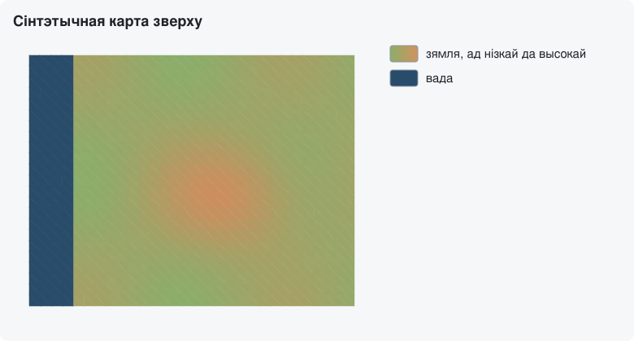

# Файлы ўзроўню і сістэмы каардынат {#the-level-files-and-frames}

`<out>/<map>/<map>.glb` (узровень: 3D-мадэль зямлі) і побач `<map>.json`. Glb пішацца ў
`<map>.glb.part` і перайменоўваецца, калі гатовы.

| Частка | Што гэта |
|---|---|
| `ground:<map>` | карта вышынь рэльефу як сетка, не больш за `--max-grid` адзнак на бок (па змаўчанні 1024: каля 2 мільёнаў трохвугольнікаў) |
| `water:<map>` | рэкі, азёры і мора: плоскія чатырохкутнікі на вышыні вады, па адным на ячэйку сеткі, у якой дастаткова адзнак карты вышынь пад вадой (трэць — з маскай вады карты, палова — без яе) |
| `ground:<map> towns` | забудаваныя контуры гарадоў і вёсак, накінутыя на 1,5 м над зямлёй |

JSON змяшчае **вуглы карты і скрынку шыраты/даўгаты** (`corners`,
`extent`), як яны былі знойдзены (`georeference`), налады вышыні
(`heightMul`, `SeaLevel`), зону гульні ў метрах гульні (`playArea`), сістэму
каардынат і яе пачатак (`frame`, `geo`), колькасці трохвугольнікаў і ўсе `notes`.

## Сістэмы каардынат {#frames}

Дзве сістэмы, `--frame`:

- `enu` (па змаўчанні): метры на ўсход, вышыня над узроўнем мора, на поўнач ад пачатку на
  датычнай плоскасці WGS-84: плоская карта, у якую 3DHeat Watcher змяшчае запіс IL-2 Tacview
  (x на ўсход, y вышыня, z на поўнач, малюецца з люстраным z). Glb
  захоўвае (усход, вышыня, -поўнач). Пераўтварайце з `--origin <lat> <lon>`, роўным
  `geo` запісу (апорная кропка яго сесіі), і запіс ляжыць на
  ўзроўні без этапу размяшчэння; без гэтага пачатак — цэнтр карты,
  а `geo` у JSON кажа, які менавіта.
- `game`: уласныя метры гульні, як у файлах місій: x на поўнач ад
  паўднёвага краю, y вышыня гульні, z на ўсход ад заходняга краю (правая сістэма, як
  ёсць, таму glb = (x, y, z)). Карты, якія нельга змясціць на зямлю, пішуцца ў
  гэтай сістэме, што б ні прасілі, з заўвагай.

Узровень — гэта двайковы glTF з імянованымі часткамі, як і кожны ўзровень 3DHeat; старонка праглядальніка
[Узроўні](https://holdi601.github.io/3DHeat/levels.html) кажа, як ён іх загружае.
