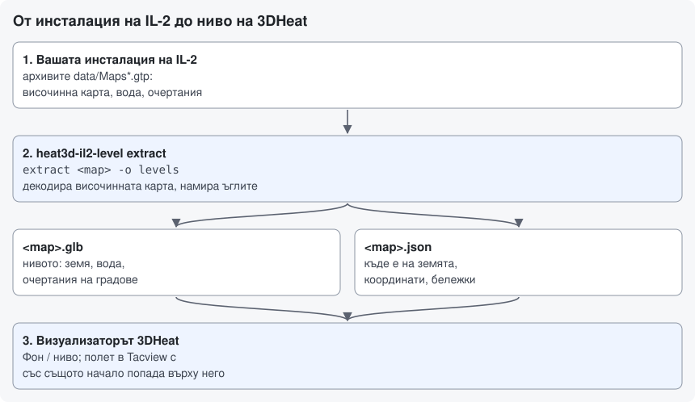

# 3DHeat IL-2 {#dheat-il-2}

**Какво е?** Малка програма, която превръща картите на **IL-2 Sturmovik:
Great Battles**, прочетени от **вашата собствена инсталация**, в триизмерни модели - нива -,
над които можете да летите във визуализатора [3DHeat](https://github.com/Holdi601/3DHeat) ([документация](https://holdi601.github.io/3DHeat/)): хълмовете, реките,
езерата, морето и градовете, поставени там, където са на земята. Втора игра на IL-2, чиито архиви
скриват таблицата си с файлове, се чете доколкото архивите позволяват ([подробности](archives-without-table.md)).

**Защо да я използвам?** За да видите полетите си в IL-2 върху собствената карта на играта.

**Пример:** `heat3d-il2-level extract <map> -o levels` ->
`levels/<map>/<map>.glb` (нивото) + `<map>.json` (къде лежи на земята). Височинната карта е мрежа от височини, като релефна карта; записът на Tacview е файл на полет, който записва Tacview.

За какво е полезна:

- **Полети върху собствената карта на играта.** Запис на IL-2 Tacview, преобразуван от 3DHeat Watcher със същата начална
  точка, попада върху нивото без стъпка за поставяне.
- **Всички карти наведнъж.** `extract --all` записва всяка намерена карта; сезоните, които споделят една височинна карта, се записват веднъж.
- **Къде е на земята.** `.json` на всяко ниво носи ъглите си и кутията по географска ширина и дължина и как са намерени.



## Бърз старт {#quick-start}

Нов ли сте в командния ред? Първо прочетете [Преди да започнете](before-you-start.md).
Пуснете тези команди в папката, в която сте клонирали или разархивирали инструмента:

```bash
python -m pip install -e .                         # инсталира командата heat3d-il2-level
python -m pip install -e .[fast]                            # с numba: декодиране 20 до 50 пъти по-бързо
heat3d-il2-level list                              # всяка намерена карта, с нейната кутия по географска ширина и дължина
heat3d-il2-level extract <map> -o levels           # една карта (имената, както ги извежда `list`, с маски)
heat3d-il2-level extract --all -o levels           # всички карти
```

От `list` трябва да видите ред за всяка карта, а от `extract` - `ok ...`.
После заредете `levels/<map>/<map>.glb` в панела Фон / ниво на визуализатора
([Нива](https://holdi601.github.io/3DHeat/levels.html)).

Нивата, които се записват, са изградени от данните на играта и остават **на вашата машина**;
никога не ги публикувайте ([Условия](terms.md)).

## Страници {#pages}

| Страница | Какво съдържа |
|---|---|
| [Преди да започнете](before-you-start.md) | Python, терминал, първо пускане |
| [Намиране на карти: list](list.md) | къде се намират инсталациите, какво извежда `list` |
| [Изграждане на нива: extract](extract.md) | всяка опция, стъпка по стъпка, примери |
| [Файловете на нивото и координатните системи](output.md) | частите `.glb`, `.json`, координатните системи `enu` и `game` |
| [Как се четат файловете](reading.md) | архиви, кодекът на височинната карта, вода, градове, нагаждане по ориентири |
| [Архиви без таблица с файлове](archives-without-table.md) | втората игра, прочетена доколкото позволяват архивите ѝ |
| [Скорост, тестове, условия](terms.md) | numba, тестовете, условията на играта, лицензът |
| [Справка за командите](../cli-reference.md) | всяка опция, генерирана от кода |
| [Поддръжка на тези документи](maintaining.md) | списъкът за издаване |

## Свързано {#related}

- Визуализаторът 3DHeat: [github.com/Holdi601/3DHeat](https://github.com/Holdi601/3DHeat),
  документацията е на [holdi601.github.io/3DHeat](https://holdi601.github.io/3DHeat/).
- Телеметрия за тези нива: [3DHeat Watcher](https://holdi601.github.io/3DHeat-Watcher/)
  преобразува записите на IL-2 Tacview; файловите формати на визуализатора, включително контейнера с един файл на мач,
  са описани в [Един файл на мач (.3dheat)](https://holdi601.github.io/3DHeat/container.html).

## Инструментите на 3DHeat {#the-3dheat-tools}

| Инструмент | Какво прави | Код | Документация |
|---|---|---|---|
| визуализатор 3DHeat | показва данните: топлинни карти, анализ на състезания, преглед на мача | [3DHeat](https://github.com/Holdi601/3DHeat) | [документация](https://holdi601.github.io/3DHeat/) |
| GameFiles | нива и трасета от собствените файлове на играта | [3DHeat-GameFiles](https://github.com/Holdi601/3DHeat-GameFiles) | [документация](https://holdi601.github.io/3DHeat-GameFiles/) |
| GameCapture | телеметрия от обиколки и нива, възстановени от видеозаписи на игра | [3DHeat-GameCapture](https://github.com/Holdi601/3DHeat-GameCapture) | [документация](https://holdi601.github.io/3DHeat-GameCapture/) |
| Unreal Exporter | приставка за Unreal Editor: ниво като един `.glb` | [3DHeat-UnrealExporter](https://github.com/Holdi601/3DHeat-UnrealExporter) | [документация](https://holdi601.github.io/3DHeat-UnrealExporter/) |
| CS2 | демота и карти на Counter-Strike 2 | [3DHeat-CS2](https://github.com/Holdi601/3DHeat-CS2) | [документация](https://holdi601.github.io/3DHeat-CS2/) |
| Watcher | записва какво публикуват игрите, докато играете | [3DHeat-Watcher](https://github.com/Holdi601/3DHeat-Watcher) | [документация](https://holdi601.github.io/3DHeat-Watcher/) |
| Ext-WarThunder | повторения на War Thunder | [3DHeat-Ext-WarThunder](https://github.com/Holdi601/3DHeat-Ext-WarThunder) | [документация](https://holdi601.github.io/3DHeat-Ext-WarThunder/) |
| Ext-WoT | повторения на World of Tanks | [3DHeat-Ext-WoT](https://github.com/Holdi601/3DHeat-Ext-WoT) | [документация](https://holdi601.github.io/3DHeat-Ext-WoT/) |
| Ext-WoWs | повторения на World of Warships | [3DHeat-Ext-WoWs](https://github.com/Holdi601/3DHeat-Ext-WoWs) | [документация](https://holdi601.github.io/3DHeat-Ext-WoWs/) |
| Ext-Squad | демота от сървъри на Squad | [3DHeat-Ext-Squad](https://github.com/Holdi601/3DHeat-Ext-Squad) | [документация](https://holdi601.github.io/3DHeat-Ext-Squad/) |
| Ext-DCS | карти на DCS World като 3D нива | [3DHeat-Ext-DCS](https://github.com/Holdi601/3DHeat-Ext-DCS) | [документация](https://holdi601.github.io/3DHeat-Ext-DCS/) |
| Ext-IL2 | карти на IL-2 Sturmovik като 3D нива | [3DHeat-Ext-IL2](https://github.com/Holdi601/3DHeat-Ext-IL2) | [документация](https://holdi601.github.io/3DHeat-Ext-IL2/) |
