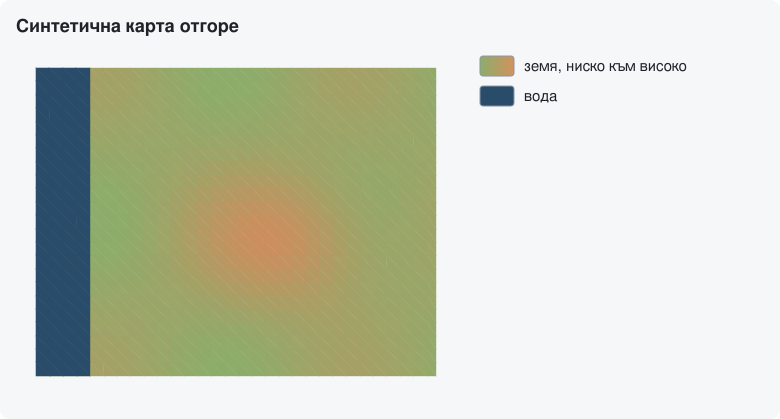

# Файловете на нивото и координатните системи {#the-level-files-and-frames}

`<out>/<map>/<map>.glb` (нивото: триизмерен модел на земята) и `<map>.json`
до него. Glb се записва в
`<map>.glb.part` и се преименува, когато е готов.

| Част | Какво е |
|---|---|
| `ground:<map>` | височинната карта на терена като мрежа, най-много `--max-grid` проби по страна (по подразбиране 1024: около 2 милиона триъгълника) |
| `water:<map>` | реки, езера и море: плоски четириъгълници на нивото на водата, по един за всяка клетка на мрежата, чиито проби от височинната карта са достатъчно под водата (една трета с маската на водата на картата, половината без нея) |
| `ground:<map> towns` | изградените очертания на градовете и селата, положени 1,5 m над земята |

JSON съдържа **ъглите и кутията по географска ширина и дължина** на картата (`corners`,
`extent`), как са намерени (`georeference`), настройките на височината (
`heightMul`, `SeaLevel`), полето за игра в метрите на играта (`playArea`), координатната система и нейното начало (`frame`, `geo`), броя триъгълници и всички `notes`.

## Координатни системи {#frames}

Две координатни системи, `--frame`:

- `enu` (по подразбиране): метри на изток, надморска височина над морското ниво, на север от начало върху допирателната равнина на WGS-84: плоската карта, в която 3DHeat Watcher поставя запис на Tacview от IL-2 (x на изток, y височина, z на север, чертано със z огледално). Glb
  съхранява (изток, височина, -север). Преобразувайте с `--origin <lat> <lon>`, зададено на `geo` на запис (референтната точка на неговата сесия), и записът попада върху нивото без стъпка за поставяне; без него центърът на картата е началото, а `geo` в JSON казва коя е.
- `game`: собствените метри на играта, както ги имат файловете на мисиите: x на север от южния край, y - височината на играта, z на изток от западния край (дясно-ориентирана, както е; значи glb = (x, y, z)). Картите, които не могат да се поставят на земята, се записват в тази координатна система, каквото и да е поискано, с бележка.

Нивото е двоичен glTF с именувани части, както всяко ниво на 3DHeat; страницата [Нива](https://holdi601.github.io/3DHeat/levels.html) на визуализатора казва как се зареждат.
