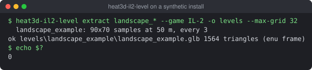

# Gradnja nivoa: `extract` {#building-levels-extract}

```text
heat3d-il2-level extract (<map> ... | --all) -o <folder> [--game FOLDER ...]
                 [--max-grid N] [--frame enu|game] [--origin LAT LON]
                 [--no-water] [--no-towns] [--skip-existing]
```

## Korak po korak {#step-by-step}

Komandna linija ti je nova? Prvo pročitaj [Prije nego počneš](before-you-start.md).

1. Nađi ime mape pomoću [`list`](list.md).
2. Pokreni `heat3d-il2-level extract <map> -o levels`. Imena mogu koristiti zamjenske znakove,
   u navodnicima (`"<family>_*"`); `--all` uzima svaku mapu.
3. Da snimak legne na nivo bez koraka postavljanja, navedi njegovo ishodište:
   `--origin <lat> <lon>` postavljeno na `geo` snimka (referentnu tačku
   njegove sesije). Bez toga je ishodište središte mape, a
   `geo` u `.json` kaže koje.
4. Naredba ispisuje red po mapi dok je dekodira, zatim
   `ok <glb> <triangles> (<frame> frame)` ili `failed <map>: <why>`.
5. Učitaj `<folder>/<map>/<map>.glb` u panelu Pozadina / nivo preglednika.



U vlastitim metrima igre, bez vode:


Drugo pokretanje nad već napisanim mapama:


## Opcije {#options}

| Opcija | Zadano | Radi |
|---|---|---|
| `maps` | - | imena mapa kako ih ispisuje `list`; dozvoljeni su zamjenski znakovi |
| `--all` | isključeno | svaka mapa; sezone koje dijele visinsku i vodenu mapu pišu se jednom |
| `-o`, `--out` | obavezno | izlazni folder; svaka mapa ide u `<out>/<map>/` |
| `--game FOLDER` | pronađeno | IL-2 folder (ponavljajuće) |
| `--max-grid N` | `1024` | najviše uzoraka visinske mape po strani (1024: oko 2 miliona trouglova); mapa se uzorkuje na svakih *k* uzoraka da stane |
| `--frame` `enu` ili `game` | `enu` | `enu`: metri istočno, visina, sjeverno od `--origin`, kao Watcherove Tacview tabele; `game`: vlastiti metri igre (x sjever, y gore, z istok). Mapa koja se ne može postaviti na Zemlju piše se u `game` šta god da je traženo |
| `--origin LAT LON` | središte mape | ishodište okvira `enu` (`geo` snimka) |
| `--no-water` | isključeno | izostavi vodu |
| `--no-towns` | isključeno | izostavi tragove gradova |
| `--skip-existing` | isključeno | preskoči mape čiji `.glb` već postoji |

Sve opcije, onako kako ih program ispisuje: [Referenca naredbi](../cli-reference.md).

Postavi `HEAT3D_DEBUG` da se ispiše puni traceback neuspjele mape. `.glb` se
piše u `<map>.glb.part` i preimenuje kad je gotov.

Izlazni status: 0 svaka mapa napisana, 1 ijedna propala (ostale se svejedno
pišu), 2 nije pronađena instalacija ili nijedna mapa nije odgovarala.

## Primjeri {#examples}

```bash
heat3d-il2-level extract <map> -o levels                         # one map, enu frame round its centre
heat3d-il2-level extract <map> --origin <lat> <lon> -o levels    # in the flat map of a recording with that geo
heat3d-il2-level extract "<family>_*" --max-grid 2048 -o levels  # finer, several maps
heat3d-il2-level extract --all --skip-existing -o levels         # every map, only the new ones
heat3d-il2-level extract <map> --frame game -o levels            # the game's own metres, as mission files have them
```

Šta je u datotekama: [Datoteke nivoa i okviri](output.md).
