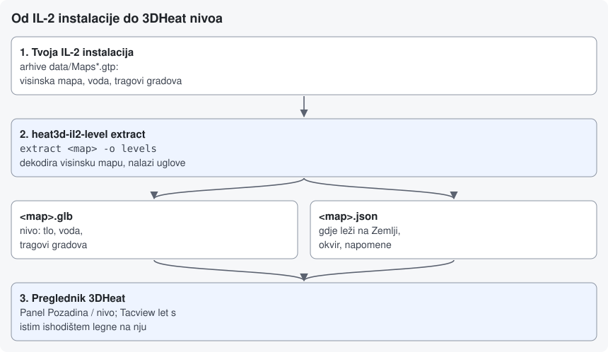

# 3DHeat IL-2 {#dheat-il-2}

**Šta je to?** Mali program koji mape igre **IL-2 Sturmovik:
Great Battles**, pročitane iz **tvoje vlastite instalacije**, pretvara u 3D modele - nivoe -
iznad kojih možeš letjeti u pregledniku [3DHeat](https://github.com/Holdi601/3DHeat)
([dokumentacija](https://holdi601.github.io/3DHeat/)): brda, rijeke,
jezera, more i gradove, postavljene tamo gdje leže na Zemlji. Druga IL-2 igra
čije arhive kriju tabelu datoteka čita se koliko arhive dozvoljavaju
([detalji](archives-without-table.md)).

**Zašto bih ga koristio?** Da vidiš svoje IL-2 letove nad vlastitom mapom igre.

**Primjer:** `heat3d-il2-level extract <map> -o levels` ->
`levels/<map>/<map>.glb` (nivo) + `<map>.json` (gdje leži na
Zemlji). Visinska mapa je mreža visina, kao reljefna karta; Tacview
snimak je datoteka leta koju piše Tacview.

Za šta je koristan:

- **Letovi na vlastitoj mapi igre.** IL-2 Tacview snimak, pretvoren pomoću
  3DHeat Watchera s istim ishodištem, legne na nivo bez koraka
  postavljanja.
- **Sve mape odjednom.** `extract --all` piše svaku pronađenu mapu; sezone koje
  dijele visinsku mapu pišu se jednom.
- **Gdje na Zemlji.** `.json` svakog nivoa nosi njegove uglove i
  okvir geografske širine/dužine, te kako su pronađeni.



## Brzi početak {#quick-start}

Komandna linija ti je nova? Prvo pročitaj [Prije nego počneš](before-you-start.md).
Ovo pokreni u folderu koji si klonirao ili raspakovao:

```bash
python -m pip install -e .                         # installs the heat3d-il2-level command
python -m pip install -e .[fast]                            # with numba: decoding 20 to 50 times faster
heat3d-il2-level list                              # every map found, with its latitude/longitude box
heat3d-il2-level extract <map> -o levels           # one map (names as `list` prints them, wildcards allowed)
heat3d-il2-level extract --all -o levels           # every map
```

Trebao bi vidjeti red po mapi iz `list` i `ok ...` iz `extract`.
Zatim učitaj `levels/<map>/<map>.glb` u panelu Pozadina / nivo preglednika
([Nivoi](https://holdi601.github.io/3DHeat/levels.html)).

Nivoi koje piše izgrađeni su od podataka igre: ostaju **na tvom
računaru**; nikad ih ne objavljuj ([Uvjeti](terms.md)).

## Stranice {#pages}

| Stranica | Šta pokriva |
|---|---|
| [Prije nego počneš](before-you-start.md) | Python, terminal, prvo pokretanje |
| [Pronalaženje mapa: list](list.md) | gdje se instalacije nalaze, šta `list` ispisuje |
| [Gradnja nivoa: extract](extract.md) | sve opcije, korak po korak, primjeri |
| [Datoteke nivoa i okviri](output.md) | dijelovi `.glb`, `.json`, okviri `enu` i `game` |
| [Kako se datoteke čitaju](reading.md) | arhive, kodek visinske mape, voda, gradovi, prilagođavanje orijentirima |
| [Arhive bez tabele datoteka](archives-without-table.md) | druga igra, čitana koliko njene arhive dozvoljavaju |
| [Brzina, testovi, uvjeti](terms.md) | numba, testovi, uvjeti igre, licenca |
| [Referenca naredbi](../cli-reference.md) | sve opcije, generirane iz koda |
| [Održavanje ove dokumentacije](maintaining.md) | lista za provjeru pri izdanju |

## Povezano {#related}

- Preglednik 3DHeat: [github.com/Holdi601/3DHeat](https://github.com/Holdi601/3DHeat),
  dokumentacija na [holdi601.github.io/3DHeat](https://holdi601.github.io/3DHeat/).
- Telemetrija za ove nivoe: [3DHeat Watcher](https://holdi601.github.io/3DHeat-Watcher/)
  pretvara IL-2 Tacview snimke; formati datoteka preglednika, uključujući njegov
  spremnik s jednom datotekom po meču, opisani su u
  [Jedna datoteka po meču (.3dheat)](https://holdi601.github.io/3DHeat/container.html).

## 3DHeat alati {#the-3dheat-tools}

| Alat | Šta radi | Kod | Dokumentacija |
|---|---|---|---|
| 3DHeat preglednik | prikazuje podatke: toplotne mape, analizu utrka, pregled mečeva | [3DHeat](https://github.com/Holdi601/3DHeat) | [dokumentacija](https://holdi601.github.io/3DHeat/) |
| GameFiles | nivoi i staze iz vlastitih datoteka igre | [3DHeat-GameFiles](https://github.com/Holdi601/3DHeat-GameFiles) | [dokumentacija](https://holdi601.github.io/3DHeat-GameFiles/) |
| GameCapture | telemetrija krugova i nivoi rekonstruirani iz video snimka igranja | [3DHeat-GameCapture](https://github.com/Holdi601/3DHeat-GameCapture) | [dokumentacija](https://holdi601.github.io/3DHeat-GameCapture/) |
| Unreal Exporter | dodatak za Unreal Editor: nivo kao jedan `.glb` | [3DHeat-UnrealExporter](https://github.com/Holdi601/3DHeat-UnrealExporter) | [dokumentacija](https://holdi601.github.io/3DHeat-UnrealExporter/) |
| CS2 | Counter-Strike 2 demoi i mape | [3DHeat-CS2](https://github.com/Holdi601/3DHeat-CS2) | [dokumentacija](https://holdi601.github.io/3DHeat-CS2/) |
| Watcher | bilježi ono što igre objavljuju dok igraš | [3DHeat-Watcher](https://github.com/Holdi601/3DHeat-Watcher) | [dokumentacija](https://holdi601.github.io/3DHeat-Watcher/) |
| Ext-WarThunder | War Thunder snimci | [3DHeat-Ext-WarThunder](https://github.com/Holdi601/3DHeat-Ext-WarThunder) | [dokumentacija](https://holdi601.github.io/3DHeat-Ext-WarThunder/) |
| Ext-WoT | World of Tanks snimci | [3DHeat-Ext-WoT](https://github.com/Holdi601/3DHeat-Ext-WoT) | [dokumentacija](https://holdi601.github.io/3DHeat-Ext-WoT/) |
| Ext-WoWs | World of Warships snimci | [3DHeat-Ext-WoWs](https://github.com/Holdi601/3DHeat-Ext-WoWs) | [dokumentacija](https://holdi601.github.io/3DHeat-Ext-WoWs/) |
| Ext-Squad | Squad serverski demoi | [3DHeat-Ext-Squad](https://github.com/Holdi601/3DHeat-Ext-Squad) | [dokumentacija](https://holdi601.github.io/3DHeat-Ext-Squad/) |
| Ext-DCS | DCS World mape kao 3D nivoi | [3DHeat-Ext-DCS](https://github.com/Holdi601/3DHeat-Ext-DCS) | [dokumentacija](https://holdi601.github.io/3DHeat-Ext-DCS/) |
| Ext-IL2 | IL-2 Sturmovik mape kao 3D nivoi | [3DHeat-Ext-IL2](https://github.com/Holdi601/3DHeat-Ext-IL2) | [dokumentacija](https://holdi601.github.io/3DHeat-Ext-IL2/) |
