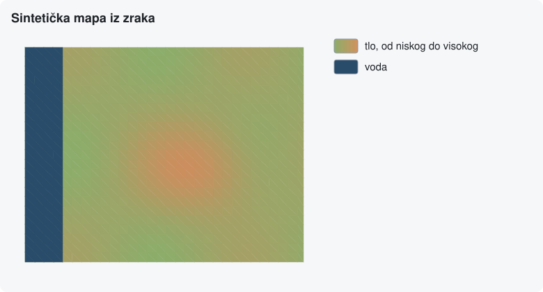

# Datoteke nivoa i okviri {#the-level-files-and-frames}

`<out>/<map>/<map>.glb` (nivo: 3D model tla) i `<map>.json`
pored njega. Glb se piše u
`<map>.glb.part` i preimenuje kad je gotov.

| Dio | Šta je to |
|---|---|
| `ground:<map>` | visinska mapa terena kao mreža, najviše `--max-grid` uzoraka po strani (zadano 1024: oko 2 miliona trouglova) |
| `water:<map>` | rijeke, jezera i more: ravni četverouglovi na visini vode, po jedan za svaku ćeliju mreže u kojoj je dovoljno uzoraka visinske mape pod vodom (trećina uz masku vode mape, polovina bez nje) |
| `ground:<map> towns` | izgrađeni tragovi gradova i sela, položeni 1,5 m iznad tla |

JSON drži **uglove i okvir geografske širine/dužine** mape (`corners`,
`extent`), kako su pronađeni (`georeference`), postavke visine
(`heightMul`, `SeaLevel`), područje igre u metrima igre (`playArea`),
okvir i njegovo ishodište (`frame`, `geo`), brojeve trouglova i sve `notes`.

## Okviri {#frames}

Dva okvira, `--frame`:

- `enu` (zadano): metri istočno, visina iznad nivoa mora, sjeverno od ishodišta na
  WGS-84 tangentnoj ravni: ravna mapa u koju 3DHeat Watcher stavlja IL-2 Tacview
  snimak (x istok, y visina, z sjever, crtano sa zrcaljenim z). Glb
  pohranjuje (istok, visina, -sjever). Pretvori pomoću `--origin <lat> <lon>` postavljenog na
  `geo` snimka (referentnu tačku njegove sesije) i snimak legne na
  nivo bez koraka postavljanja; bez toga je ishodište središte mape,
  a `geo` u JSON-u kaže koje.
- `game`: vlastiti metri igre kakve imaju datoteke misija: x sjever od
  južne ivice, y visina igre, z istok od zapadne ivice (desnoruki kakav
  jeste, pa je glb = (x, y, z)). Mape koje se ne mogu postaviti na Zemlju pišu se u
  ovom okviru šta god da je traženo, uz napomenu.

Nivo je glTF binarna datoteka s imenovanim dijelovima, kao i svaki 3DHeat nivo; stranica preglednika
[Nivoi](https://holdi601.github.io/3DHeat/levels.html) kaže kako ih učitava.
