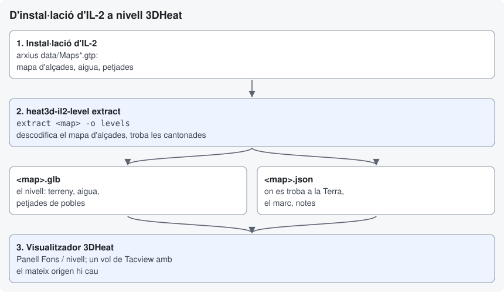

# 3DHeat IL-2 {#dheat-il-2}

**Què és?** Un petit programa que converteix els mapes de **IL-2 Sturmovik:
Great Battles**, llegits de la **teva pròpia instal·lació**, en models 3D —nivells—
sobre els quals es pot volar al visualitzador [3DHeat](https://github.com/Holdi601/3DHeat)
([documentació](https://holdi601.github.io/3DHeat/)): els turons, els rius,
els llacs, el mar i els pobles, col·locats on es troben a la Terra. Un segon joc
d'IL-2, els arxius del qual amaguen la seva taula de fitxers, es llegeix fins on ho
permeten ([detalls](archives-without-table.md)).

**Per a què el faria servir?** Per veure els teus vols d'IL-2 sobre el mapa propi del joc.

**Exemple:** `heat3d-il2-level extract <mapa> -o levels` ->
`levels/<mapa>/<mapa>.glb` (el nivell) + `<mapa>.json` (on es troba a la
Terra). Un mapa d'alçades és una quadrícula d'altures, com un mapa de relleu; una
gravació de Tacview és un fitxer d'un vol que escriu Tacview.

Per a què serveix:

- **Vols sobre el mapa propi del joc.** Una gravació de Tacview d'IL-2, convertida pel
  Watcher de 3DHeat amb el mateix origen, cau sobre el nivell sense cap pas de col·locació.
- **Tots els mapes alhora.** `extract --all` escriu cada mapa trobat; les temporades que
  comparteixen un mapa d'alçades s'escriuen una sola vegada.
- **On es troba a la Terra.** El `.json` de cada nivell porta les seves cantonades i la
  caixa de latitud/longitud, i com es van trobar.



## Inici ràpid {#quick-start}

Si ets nou amb la línia d'ordres, llegeix primer [Abans de començar](before-you-start.md).
Executa això a la carpeta on has clonat o descomprimit l'eina:

```bash
python -m pip install -e .                         # instal·la l'ordre heat3d-il2-level
python -m pip install -e .[fast]                            # amb numba: descodificació de 20 a 50 vegades més ràpida
heat3d-il2-level list                              # cada mapa trobat, amb la seva caixa de latitud/longitud
heat3d-il2-level extract <mapa> -o levels          # un mapa (els noms tal com els imprimeix `list`, es permeten comodins)
heat3d-il2-level extract --all -o levels           # cada mapa
```

Hauries de veure una línia per mapa des de `list`, i `ok ...` des de `extract`.
Després carrega `levels/<mapa>/<mapa>.glb` al panell Fons / nivell del visualitzador
([Nivells](https://holdi601.github.io/3DHeat/levels.html)).

Els nivells que escrius estan construïts a partir de les dades del joc: es queden a la **teva
màquina**; no els publiquis mai ([Condicions](terms.md)).

Cada lector de joc és un petit projecte propi, amb el seu fitxer de llicència, les seves versions i el seu gestor d'incidències, de manera que es pot instal·lar, actualitzar, mantenir - o retirar a petició d'un titular de drets - per separat, sense afectar el visor ni les altres eines.

## Pàgines {#pages}

| Pàgina | Què cobreix |
|---|---|
| [Abans de començar](before-you-start.md) | Python, una terminal, una primera execució |
| [Trobar mapes: list](list.md) | on es troben les instal·lacions, què imprimeix `list` |
| [Construir nivells: extract](extract.md) | cada opció, pas a pas, exemples |
| [Els fitxers del nivell i els marcs](output.md) | les parts `.glb`, el `.json`, els marcs `enu` i `game` |
| [Com es llegeixen els fitxers](reading.md) | arxius, el còdec del mapa d'alçades, aigua, pobles, ajustos per punts de referència |
| [Arxius sense taula de fitxers](archives-without-table.md) | el segon joc, llegit fins on permeten els seus arxius |
| [Velocitat, proves, condicions](terms.md) | numba, les proves, què es llegeix i què no s'inclou, la llicència |
| [Referència de l'ordre](../cli-reference.md) | cada opció, generada a partir del codi |
| [Mantenir aquesta documentació](maintaining.md) | la llista de comprovació de publicació |

## Relacionat {#related}

- El visualitzador de 3DHeat: [github.com/Holdi601/3DHeat](https://github.com/Holdi601/3DHeat),
  documentació a [holdi601.github.io/3DHeat](https://holdi601.github.io/3DHeat/).
- Telemetria per a aquests nivells: el [3DHeat Watcher](https://holdi601.github.io/3DHeat-Watcher/)
  converteix les gravacions de Tacview d'IL-2; els formats de fitxer del visualitzador, inclòs el seu
  contenidor d'un fitxer per partida, es descriuen a
  [Un fitxer per partida (.3dheat)](https://holdi601.github.io/3DHeat/container.html).

## Les eines de 3DHeat {#the-3dheat-tools}

| Eina | Què fa | Codi | Documentació |
|---|---|---|---|
| Visualitzador 3DHeat | mostra les dades: mapes de calor, anàlisi de curses, revisió de partides | [3DHeat](https://github.com/Holdi601/3DHeat) | [documentació](https://holdi601.github.io/3DHeat/) |
| GameFiles | nivells i circuits dels fitxers propis d'un joc | [3DHeat-GameFiles](https://github.com/Holdi601/3DHeat-GameFiles) | [documentació](https://holdi601.github.io/3DHeat-GameFiles/) |
| GameCapture | telemetria de voltes, i nivells reconstruïts a partir de vídeo de joc | [3DHeat-GameCapture](https://github.com/Holdi601/3DHeat-GameCapture) | [documentació](https://holdi601.github.io/3DHeat-GameCapture/) |
| Unreal Exporter | un connector per a l'editor d'Unreal: un nivell com un sol `.glb` | [3DHeat-UnrealExporter](https://github.com/Holdi601/3DHeat-UnrealExporter) | [documentació](https://holdi601.github.io/3DHeat-UnrealExporter/) |
| CS2 | demos i mapes de Counter-Strike 2 | [3DHeat-CS2](https://github.com/Holdi601/3DHeat-CS2) | [documentació](https://holdi601.github.io/3DHeat-CS2/) |
| Watcher | registra el que publiquen els jocs mentre hi jugues | [3DHeat-Watcher](https://github.com/Holdi601/3DHeat-Watcher) | [documentació](https://holdi601.github.io/3DHeat-Watcher/) |
| Ext-WarThunder | repeticions de War Thunder | [3DHeat-Ext-WarThunder](https://github.com/Holdi601/3DHeat-Ext-WarThunder) | [documentació](https://holdi601.github.io/3DHeat-Ext-WarThunder/) |
| Ext-WoT | repeticions de World of Tanks | [3DHeat-Ext-WoT](https://github.com/Holdi601/3DHeat-Ext-WoT) | [documentació](https://holdi601.github.io/3DHeat-Ext-WoT/) |
| Ext-WoWs | repeticions de World of Warships | [3DHeat-Ext-WoWs](https://github.com/Holdi601/3DHeat-Ext-WoWs) | [documentació](https://holdi601.github.io/3DHeat-Ext-WoWs/) |
| Ext-Squad | demos de servidors de Squad | [3DHeat-Ext-Squad](https://github.com/Holdi601/3DHeat-Ext-Squad) | [documentació](https://holdi601.github.io/3DHeat-Ext-Squad/) |
| Ext-DCS | mapes de DCS World com a nivells 3D | [3DHeat-Ext-DCS](https://github.com/Holdi601/3DHeat-Ext-DCS) | [documentació](https://holdi601.github.io/3DHeat-Ext-DCS/) |
| Ext-IL2 | mapes d'IL-2 Sturmovik com a nivells 3D | [3DHeat-Ext-IL2](https://github.com/Holdi601/3DHeat-Ext-IL2) | [documentació](https://holdi601.github.io/3DHeat-Ext-IL2/) |
