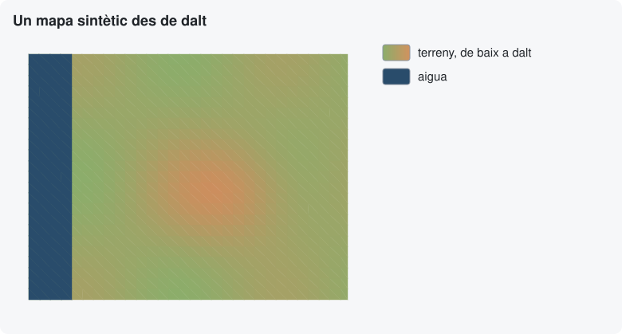

# Els fitxers del nivell i els marcs {#the-level-files-and-frames}

`<sortida>/<mapa>/<mapa>.glb` (el nivell: un model 3D del terreny) i `<mapa>.json`
al costat. El glb s'escriu a
`<mapa>.glb.part` i es reanomena quan està acabat.

| Part | Què és |
|---|---|
| `ground:<mapa>` | el mapa d'alçades del terreny com a quadrícula, com a màxim `--max-grid` mostres per costat (per defecte 1024: uns 2 milions de triangles) |
| `water:<mapa>` | rius, llacs i mar: quadrats plans a l'altura de l'aigua, un per cada cel·la de la quadrícula amb prou mostres del mapa d'alçades sota l'aigua (un terç amb la màscara d'aigua del mapa, la meitat sense) |
| `ground:<mapa> towns` | les petjades edificades de pobles i viles, penjades 1,5 m sobre el terreny |

El JSON conté les **cantonades i la caixa de latitud/longitud** del mapa (`corners`,
`extent`), com es van trobar (`georeference`), els paràmetres d'altura
(`heightMul`, `SeaLevel`), l'àrea de joc en metres del joc (`playArea`), el marc i el seu
origen (`frame`, `geo`), els recomptes de triangles i les `notes` que hi hagi.

## Marcs {#frames}

Dos marcs, `--frame`:

- `enu` (per defecte): metres a l'est, altitud sobre el nivell del mar, i nord respecte d'un origen
  en el pla tangent WGS-84: el mapa pla on el Watcher de 3DHeat col·loca una gravació de Tacview
  d'IL-2 (x est, y altitud, z nord, dibuixat amb z reflectida). El glb
  guarda (est, altitud, -nord). Converteix-ho amb `--origin <lat> <lon>` amb el `geo` d'una
  gravació (el punt de referència de la seva sessió) i la gravació cau sobre el
  nivell sense cap pas de col·locació; sense això, el centre del mapa és l'origen, i el
  `geo` del JSON indica quin és.
- `game`: els metres propis del joc, tal com els tenen els fitxers de missió: x nord des de la
  vora sud, y l'altura del joc, z est des de la vora oest (dextrògir tal com és, de manera que
  glb = (x, y, z)). Els mapes que no es poden col·locar a la Terra s'escriuen en aquest
  marc sigui el que sigui el que s'hagi demanat, amb una nota.

El nivell és un glTF binari amb parts amb nom, com ho és tot nivell de 3DHeat; la pàgina
[Nivells](https://holdi601.github.io/3DHeat/levels.html) del visualitzador explica com els carrega.
