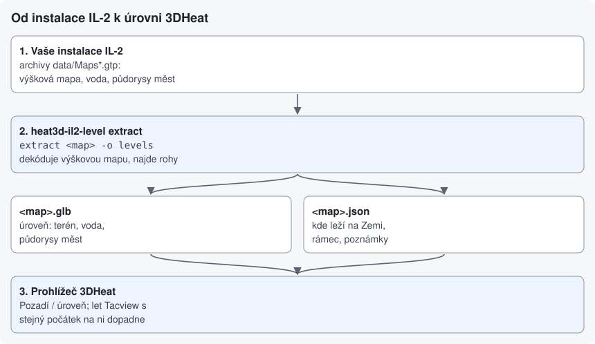

# 3DHeat IL-2 {#dheat-il-2}

**Co to je?** Malý program, který promění mapy hry **IL-2 Sturmovik: Great Battles**, načtené
z **vaší vlastní instalace**, na 3D modely – úrovně – nad kterými můžete létat v prohlížeči
[3DHeat](https://github.com/Holdi601/3DHeat)
([dokumentace](https://holdi601.github.io/3DHeat/)): kopce, řeky, jezera, moře a města,
umístěné tam, kde leží na Zemi. Druhá hra IL-2, jejíž archivy skrývají tabulku souborů, se čte
jen tak daleko, jak to archivy dovolují ([podrobnosti](archives-without-table.md)).

**Proč ho používat?** Abyste viděli své lety v IL-2 nad mapou samotné hry.

**Příklad:** `heat3d-il2-level extract <map> -o levels` ->
`levels/<map>/<map>.glb` (úroveň) + `<map>.json` (kde leží na Zemi). Výšková mapa je mřížka
výšek, jako reliéfní mapa; záznam Tacview je soubor letu, který zapisuje Tacview.

K čemu se to hodí:

- **Lety nad mapou samotné hry.** Záznam IL-2 Tacview, převedený nástrojem 3DHeat Watcher
  se stejným počátkem, dopadne na úroveň bez kroku umísťování.
- **Všechny mapy najednou.** `extract --all` zapíše každou nalezenou mapu; ročníky, které sdílejí
  výškovou mapu, se zapíšou jednou.
- **Kde na Zemi.** `.json` každé úrovně nese její rohy a rámec zeměpisné šířky a délky
  a to, jak byly nalezeny.



## Rychlý start {#quick-start}

Nikdy jste nepracovali s příkazovým řádkem? Nejdřív si přečtěte [Než začnete](before-you-start.md).
Spusťte tyto příkazy ve složce, do které jste nástroj naklonovali nebo rozbalili:

```bash
python -m pip install -e .                         # installs the heat3d-il2-level command
python -m pip install -e .[fast]                            # with numba: decoding 20 to 50 times faster
heat3d-il2-level list                              # every map found, with its latitude/longitude box
heat3d-il2-level extract <map> -o levels           # one map (names as `list` prints them, wildcards allowed)
heat3d-il2-level extract --all -o levels           # every map
```

Z `list` uvidíte řádek na každou mapu a z `extract` řádek `ok ...`.
Potom načtěte `levels/<map>/<map>.glb` do panelu Pozadí / úroveň v prohlížeči
([Úrovně](https://holdi601.github.io/3DHeat/levels.html)).

Úrovně, které nástroj zapisuje, jsou postaveny z dat hry, takže zůstávají **na vašem počítači**;
nikdy je nezveřejňujte ([Podmínky](terms.md)).

## Stránky {#pages}

| Stránka | Co obsahuje |
|---|---|
| [Než začnete](before-you-start.md) | Python, terminál, první spuštění |
| [Hledání map: list](list.md) | kde se instalace hledají, co `list` vypisuje |
| [Sestavení úrovní: extract](extract.md) | každá možnost, krok za krokem, příklady |
| [Soubory úrovní a rámce](output.md) | části `.glb`, `.json`, rámce `enu` a `game` |
| [Jak se soubory čtou](reading.md) | archivy, kodek výškové mapy, voda, města, přizpůsobení orientačním bodům |
| [Archivy bez tabulky souborů](archives-without-table.md) | druhá hra, čtená tak daleko, jak její archivy dovolují |
| [Rychlost, testy, podmínky](terms.md) | numba, testy, podmínky hry, licence |
| [Přehled příkazů](../cli-reference.md) | každá možnost, vygenerováno z kódu |
| [Údržba těchto dokumentů](maintaining.md) | kontrolní seznam pro vydání |

## Související {#related}

- Prohlížeč 3DHeat: [github.com/Holdi601/3DHeat](https://github.com/Holdi601/3DHeat),
  dokumentace na [holdi601.github.io/3DHeat](https://holdi601.github.io/3DHeat/).
- Telemetrie pro tyto úrovně: [3DHeat Watcher](https://holdi601.github.io/3DHeat-Watcher/)
  převádí záznamy IL-2 Tacview; formáty souborů prohlížeče, včetně jeho kontejneru
  jednoho souboru na zápas, jsou popsány na stránce
  [Jeden soubor na zápas (.3dheat)](https://holdi601.github.io/3DHeat/container.html).

## Nástroje 3DHeat {#the-3dheat-tools}

| Nástroj | Co dělá | Kód | Dokumentace |
|---|---|---|---|
| prohlížeč 3DHeat | zobrazuje data: teplotní mapy, analýzu závodů, přehled zápasu | [3DHeat](https://github.com/Holdi601/3DHeat) | [dokumentace](https://holdi601.github.io/3DHeat/) |
| GameFiles | úrovně a tratě ze souborů samotné hry | [3DHeat-GameFiles](https://github.com/Holdi601/3DHeat-GameFiles) | [dokumentace](https://holdi601.github.io/3DHeat-GameFiles/) |
| GameCapture | telemetrie kol a úrovně postavené z videa hry | [3DHeat-GameCapture](https://github.com/Holdi601/3DHeat-GameCapture) | [dokumentace](https://holdi601.github.io/3DHeat-GameCapture/) |
| Unreal Exporter | zásuvný modul pro Unreal Editor: úroveň jako jeden `.glb` | [3DHeat-UnrealExporter](https://github.com/Holdi601/3DHeat-UnrealExporter) | [dokumentace](https://holdi601.github.io/3DHeat-UnrealExporter/) |
| CS2 | dema a mapy Counter-Strike 2 | [3DHeat-CS2](https://github.com/Holdi601/3DHeat-CS2) | [dokumentace](https://holdi601.github.io/3DHeat-CS2/) |
| Watcher | zaznamenává, co hry zveřejňují, když hrajete | [3DHeat-Watcher](https://github.com/Holdi601/3DHeat-Watcher) | [dokumentace](https://holdi601.github.io/3DHeat-Watcher/) |
| Ext-WarThunder | replaye War Thunder | [3DHeat-Ext-WarThunder](https://github.com/Holdi601/3DHeat-Ext-WarThunder) | [dokumentace](https://holdi601.github.io/3DHeat-Ext-WarThunder/) |
| Ext-WoT | replaye World of Tanks | [3DHeat-Ext-WoT](https://github.com/Holdi601/3DHeat-Ext-WoT) | [dokumentace](https://holdi601.github.io/3DHeat-Ext-WoT/) |
| Ext-WoWs | replaye World of Warships | [3DHeat-Ext-WoWs](https://github.com/Holdi601/3DHeat-Ext-WoWs) | [dokumentace](https://holdi601.github.io/3DHeat-Ext-WoWs/) |
| Ext-Squad | dema serverů Squad | [3DHeat-Ext-Squad](https://github.com/Holdi601/3DHeat-Ext-Squad) | [dokumentace](https://holdi601.github.io/3DHeat-Ext-Squad/) |
| Ext-DCS | mapy DCS World jako 3D úrovně | [3DHeat-Ext-DCS](https://github.com/Holdi601/3DHeat-Ext-DCS) | [dokumentace](https://holdi601.github.io/3DHeat-Ext-DCS/) |
| Ext-IL2 | mapy IL-2 Sturmovik jako 3D úrovně | [3DHeat-Ext-IL2](https://github.com/Holdi601/3DHeat-Ext-IL2) | [dokumentace](https://holdi601.github.io/3DHeat-Ext-IL2/) |
