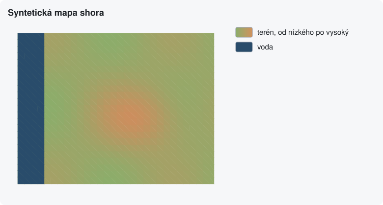

# Soubory úrovní a rámce {#the-level-files-and-frames}

`<out>/<map>/<map>.glb` (úroveň: 3D model terénu) a vedle něj `<map>.json`.
Soubor glb se zapisuje do `<map>.glb.part` a po dokončení se přejmenuje.

| Část | Co je to |
|---|---|
| `ground:<map>` | výšková mapa terénu jako mřížka, nejvýše `--max-grid` vzorků na stranu (výchozí 1024: asi 2 miliony trojúhelníků) |
| `water:<map>` | řeky, jezera a moře: ploché čtverce ve výšce hladiny, jeden na každou buňku mřížky, jejíž dost vzorků výškové mapy leží pod vodou (třetina s maskou vody mapy, polovina bez ní) |
| `ground:<map> towns` | půdorysy měst a vesnic, položené 1,5 m nad terénem |

Soubor JSON obsahuje **rohy mapy a box zeměpisné šířky a délky** (`corners`,
`extent`), jak byly nalezeny (`georeference`), nastavení výšek (`heightMul`, `SeaLevel`),
herní oblast v metrech hry (`playArea`), rámec a jeho počátek (`frame`, `geo`), počty
trojúhelníků a případné poznámky (`notes`).

## Rámce {#frames}

Dva rámce, `--frame`:

- `enu` (výchozí): metry na východ, nadmořská výška nad hladinou moře, metry na sever od počátku
  na tečné rovině WGS-84: plochá mapa, do které Watcher 3DHeat umísťuje záznam IL-2 Tacview
  (x na východ, y výška, z na sever, kresleno se zrcadlenou osou z). Glb ukládá
  (východ, výška, -sever). Nastavte `--origin <lat> <lon>` podle `geo` záznamu
  (referenční bod jeho relace) a záznam dopadne na úroveň bez kroku umísťování; bez něj je
  počátkem střed mapy a `geo` v JSONu říká, který to je.
- `game`: vlastní metry hry, jak je mají soubory misí: x na sever od jižního okraje, y výška
  hry, z na východ od západního okraje (pravotočivě tak, jak je, takže glb = (x, y, z)). Mapy,
  které nelze umístit na Zemi, se zapisují v tomto rámci bez ohledu na to, co bylo požadováno,
  s poznámkou.

Úroveň je binární glTF s pojmenovanými částmi, jako každá úroveň 3DHeat; stránka prohlížeče
[Úrovně](https://holdi601.github.io/3DHeat/levels.html) popisuje, jak je načítá.
