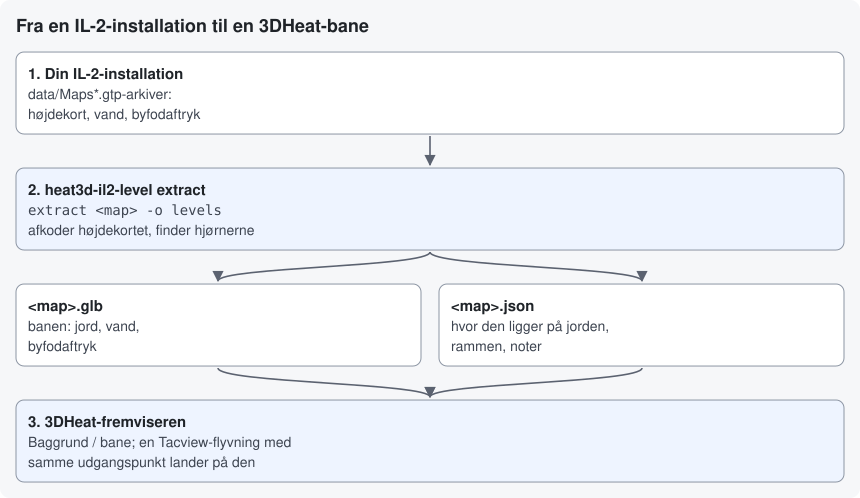

# 3DHeat IL-2 {#dheat-il-2}

**Hvad er det?** Et lille program, der laver kortene i **IL-2 Sturmovik:
Great Battles**, læst fra **din egen installation**, om til 3D-modeller - baner -
du kan flyve over i [3DHeat](https://github.com/Holdi601/3DHeat)-vieweren
([dokumentation](https://holdi601.github.io/3DHeat/)): bakkerne, floderne,
søerne, havet og byerne, placeret der, hvor de ligger på jorden. Et andet IL-2-spil,
hvis arkiver skjuler deres filtabel, læses så langt, arkiverne tillader
([detaljer](archives-without-table.md)).

**Hvorfor skulle jeg bruge det?** For at se dine IL-2-flyvninger over spillets eget kort.

**Eksempel:** `heat3d-il2-level extract <map> -o levels` ->
`levels/<map>/<map>.glb` (banen) + `<map>.json` (hvor den ligger på
jorden). Et højdekort er et gitter af højder, som et relieffkort; en Tacview-
optagelse er en fil med en flyvning, som Tacview skriver.

Det er nyttigt til:

- **Flyvninger på spillets eget kort.** En IL-2 Tacview-optagelse, konverteret af
  3DHeat Watcher med samme udgangspunkt, lander på banen uden noget placeringstrin.
- **Alle kort på én gang.** `extract --all` skriver hvert kort, der findes; årstider, der
  deler et højdekort, skrives én gang.
- **Hvor på jorden.** Hver banes `.json` bærer dens hjørner og boksen i
  breddegrad/længdegrad, og hvordan de blev fundet.



## Hurtig start {#quick-start}

Ny til kommandolinjen? Læs [Før du går i gang](before-you-start.md) først.
Kør disse i den mappe, du klonede eller pakkede ud i:

```bash
python -m pip install -e .                         # installs the heat3d-il2-level command
python -m pip install -e .[fast]                            # with numba: decoding 20 to 50 times faster
heat3d-il2-level list                              # every map found, with its latitude/longitude box
heat3d-il2-level extract <map> -o levels           # one map (names as `list` prints them, wildcards allowed)
heat3d-il2-level extract --all -o levels           # every map
```

Du bør se en linje pr. kort fra `list`, og `ok ...` fra `extract`.
Indlæs derefter `levels/<map>/<map>.glb` i viewerens Baggrund / bane-panel
([Baner](https://holdi601.github.io/3DHeat/levels.html)).

De baner, den skriver, er bygget af spillets data: de bliver **på din maskine**;
offentliggør dem aldrig ([Vilkår](terms.md)).

Hver spillæser er sit eget lille projekt med egen licensfil, egne udgivelser og egen issue-tracker, så den kan installeres, opdateres, vedligeholdes - eller trækkes tilbage på en rettighedshavers anmodning - for sig selv, uden at det påvirker vieweren eller de andre værktøjer.

## Sider {#pages}

| Side | Hvad den dækker |
|---|---|
| [Før du går i gang](before-you-start.md) | Python, en terminal, en første kørsel |
| [Find kort: list](list.md) | hvor installationerne findes, hvad `list` udskriver |
| [Byg baner: extract](extract.md) | alle valgmuligheder, trin for trin, eksempler |
| [Banefilerne og rammerne](output.md) | `.glb`-delene, `.json`, koordinatrammerne `enu` og `game` |
| [Sådan læses filerne](reading.md) | arkiver, højdekortets kodek, vand, byer, landemærketilpasning |
| [Arkiver uden filtabel](archives-without-table.md) | det andet spil, læst så langt dets arkiver tillader |
| [Hastighed, tests, vilkår](terms.md) | numba, testene, hvad der læses og hvad der ikke følger med, licensen |
| [Kommandoreference](../cli-reference.md) | alle valgmuligheder, genereret ud fra koden |
| [Vedligeholdelse af disse dokumenter](maintaining.md) | tjeklisten til udgivelser |

## Relateret {#related}

- 3DHeat-vieweren: [github.com/Holdi601/3DHeat](https://github.com/Holdi601/3DHeat),
  dokumentation på [holdi601.github.io/3DHeat](https://holdi601.github.io/3DHeat/).
- Telemetri til disse baner: [3DHeat Watcher](https://holdi601.github.io/3DHeat-Watcher/)
  konverterer IL-2 Tacview-optagelser; viewerens filformater, inklusive dens
  container med én fil pr. kamp, beskrives i
  [Én fil pr. kamp (.3dheat)](https://holdi601.github.io/3DHeat/container.html).

## 3DHeat-værktøjerne {#the-3dheat-tools}

| Værktøj | Hvad det gør | Kode | Dokumentation |
|---|---|---|---|
| 3DHeat-viewer | viser data: varmekort, løbsanalyse, kampgennemgang | [3DHeat](https://github.com/Holdi601/3DHeat) | [dokumentation](https://holdi601.github.io/3DHeat/) |
| GameFiles | baner og løb fra et spils egne filer | [3DHeat-GameFiles](https://github.com/Holdi601/3DHeat-GameFiles) | [dokumentation](https://holdi601.github.io/3DHeat-GameFiles/) |
| GameCapture | telemetri fra omgange, og baner genskabt ud fra spilvideo | [3DHeat-GameCapture](https://github.com/Holdi601/3DHeat-GameCapture) | [dokumentation](https://holdi601.github.io/3DHeat-GameCapture/) |
| Unreal Exporter | et plugin til Unreal Editor: en bane som én `.glb` | [3DHeat-UnrealExporter](https://github.com/Holdi601/3DHeat-UnrealExporter) | [dokumentation](https://holdi601.github.io/3DHeat-UnrealExporter/) |
| CS2 | Counter-Strike 2-demoer og baner | [3DHeat-CS2](https://github.com/Holdi601/3DHeat-CS2) | [dokumentation](https://holdi601.github.io/3DHeat-CS2/) |
| Watcher | optager det, spil udgiver, mens du spiller | [3DHeat-Watcher](https://github.com/Holdi601/3DHeat-Watcher) | [dokumentation](https://holdi601.github.io/3DHeat-Watcher/) |
| Ext-WarThunder | War Thunder-replays | [3DHeat-Ext-WarThunder](https://github.com/Holdi601/3DHeat-Ext-WarThunder) | [dokumentation](https://holdi601.github.io/3DHeat-Ext-WarThunder/) |
| Ext-WoT | World of Tanks-replays | [3DHeat-Ext-WoT](https://github.com/Holdi601/3DHeat-Ext-WoT) | [dokumentation](https://holdi601.github.io/3DHeat-Ext-WoT/) |
| Ext-WoWs | World of Warships-replays | [3DHeat-Ext-WoWs](https://github.com/Holdi601/3DHeat-Ext-WoWs) | [dokumentation](https://holdi601.github.io/3DHeat-Ext-WoWs/) |
| Ext-Squad | Squad-serverdemoer | [3DHeat-Ext-Squad](https://github.com/Holdi601/3DHeat-Ext-Squad) | [dokumentation](https://holdi601.github.io/3DHeat-Ext-Squad/) |
| Ext-DCS | DCS World-kort som 3D-baner | [3DHeat-Ext-DCS](https://github.com/Holdi601/3DHeat-Ext-DCS) | [dokumentation](https://holdi601.github.io/3DHeat-Ext-DCS/) |
| Ext-IL2 | IL-2 Sturmovik-kort som 3D-baner | [3DHeat-Ext-IL2](https://github.com/Holdi601/3DHeat-Ext-IL2) | [dokumentation](https://holdi601.github.io/3DHeat-Ext-IL2/) |
