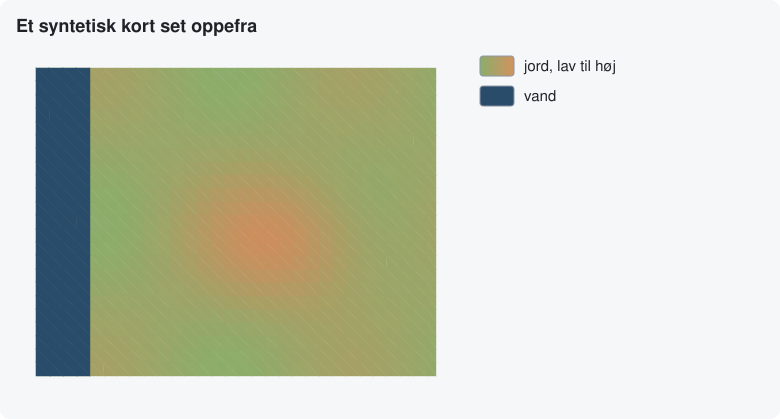

# Banefilerne og rammerne {#the-level-files-and-frames}

`<out>/<map>/<map>.glb` (banen: en 3D-model af jorden) og `<map>.json`
ved siden af. glb-filen skrives til
`<map>.glb.part` og omdøbes, når den er færdig.

| Del | Hvad det er |
|---|---|
| `ground:<map>` | terrænets højdekort som et gitter, højst `--max-grid` prøver pr. side (standard 1024: cirka 2 millioner trekanter) |
| `water:<map>` | floder, søer og hav: flade firkanter i vandets højde, én pr. gittercelle, hvis tilstrækkeligt mange af højdekortets prøver ligger under vand (en tredjedel med kortets vandmaske, halvdelen uden) |
| `ground:<map> towns` | byernes og landsbyernes bebyggede fodaftryk, lagt 1,5 m over jorden |

JSON'en holder kortets **hjørner og breddegrad/længdegrad-boks** (`corners`,
`extent`), hvordan de blev fundet (`georeference`), højdeindstillingerne
(`heightMul`, `SeaLevel`), spilleområdet i spillets meter (`playArea`), rammen
og dens udgangspunkt (`frame`, `geo`), trekanttællinger og eventuelle `notes`.

## Rammer {#frames}

To rammer, `--frame`:

- `enu` (standard): meter øst, højde over havet, nord for et udgangspunkt på
  WGS-84-tangentplanet: det flade kort, 3DHeat Watcher lægger en IL-2 Tacview-
  optagelse i (x øst, y højde, z nord, tegnet med z spejlet). glb'en
  gemmer (øst, højde, -nord). Konvertér med `--origin <lat> <lon>` sat til en
  optagelses `geo` (dens sessions referencepunkt), og optagelsen lander på
  banen uden noget placeringstrin; uden det er kortets midte udgangspunktet,
  og JSON'ens `geo` siger, hvilket.
- `game`: spillets egne meter, sådan som missionsfilerne har dem: x nord fra sydkanten, y spillets
  højde, z øst fra vestkanten (højrehåndet, som den er, så glb = (x, y, z)). Kort, der
  ikke kan placeres på jorden, skrives i denne ramme, uanset hvad der blev bedt om, med en note.

Banen er en glTF-binærfil med navngivne dele, som alle 3DHeat-baner er; viewerens
side [Baner](https://holdi601.github.io/3DHeat/levels.html) forklarer, hvordan den indlæses.
