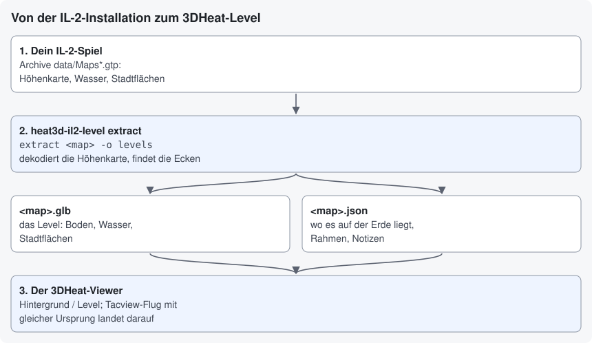

# 3DHeat IL-2 {#dheat-il-2}

**Was ist das?** Ein kleines Programm, das die Karten von **IL-2 Sturmovik: Great Battles**, aus
**deiner eigenen Installation** gelesen, in 3D-Modelle verwandelt – Level –, über die du im
[3DHeat](https://github.com/Holdi601/3DHeat)-Viewer ([Dokumentation](https://holdi601.github.io/3DHeat/))
fliegen kannst: die Hügel, Flüsse, Seen, das Meer und die Städte, dort platziert, wo sie auf der Erde
liegen. Ein zweites IL-2-Spiel, dessen Archive ihre Dateitabelle verstecken, wird so weit gelesen, wie
die Archive es erlauben ([Details](archives-without-table.md)).

**Wozu braucht man das?** Um deine IL-2-Flüge über der eigenen Karte des Spiels zu sehen.

**Beispiel:** `heat3d-il2-level extract <map> -o levels` ->
`levels/<map>/<map>.glb` (das Level) + `<map>.json` (wo es auf der Erde liegt). Eine Höhenkarte ist ein
Raster aus Höhen, wie eine Reliefkarte; eine Tacview-Aufnahme ist eine Datei eines Flugs, die Tacview schreibt.

Wofür es nützlich ist:

- **Flüge auf der eigenen Karte des Spiels.** Eine IL-2-Tacview-Aufnahme, vom 3DHeat Watcher mit
  demselben Ursprung umgewandelt, landet ohne Platzierungsschritt auf dem Level.
- **Jede Karte auf einmal.** `extract --all` schreibt jede gefundene Karte; Saisons, die eine
  Höhenkarte teilen, werden einmal geschrieben.
- **Wo auf der Erde.** Die `.json` jedes Levels enthält seine Ecken und seinen Breiten-/Längengrad-Bereich
  sowie, wie sie gefunden wurden.



## Schnellstart {#quick-start}

Noch nie in der Kommandozeile gearbeitet? Lies zuerst [Bevor du anfängst](before-you-start.md).
Führe diese Befehle in dem Ordner aus, in den du das Werkzeug geklont oder entpackt hast:

```bash
python -m pip install -e .                         # installiert den Befehl heat3d-il2-level
python -m pip install -e .[fast]                            # mit numba: Dekodieren 20- bis 50-mal schneller
heat3d-il2-level list                              # jede gefundene Karte, mit ihrem Breiten-/Längengrad-Bereich
heat3d-il2-level extract <map> -o levels           # eine Karte (Namen wie `list` sie ausgibt, Platzhalter erlaubt)
heat3d-il2-level extract --all -o levels           # jede Karte
```

Du solltest eine Zeile pro Karte von `list` sehen und `ok ...` von `extract`. Lade dann
`levels/<map>/<map>.glb` im Panel „Hintergrund / Level“ des Viewers
([Levels](https://holdi601.github.io/3DHeat/levels.html)).

Die Level, die es schreibt, werden aus den Daten des Spiels gebaut: sie bleiben **auf deinem Rechner**;
veröffentliche sie niemals ([Bedingungen](terms.md)).

## Seiten {#pages}

| Seite | Was sie behandelt |
|---|---|
| [Bevor du anfängst](before-you-start.md) | Python, ein Terminal, ein erster Lauf |
| [Karten finden: list](list.md) | wo die Installationen gefunden werden, was `list` ausgibt |
| [Level bauen: extract](extract.md) | jede Option, Schritt für Schritt, Beispiele |
| [Die Level-Dateien und Rahmen](output.md) | die `.glb`-Teile, die `.json`, die Rahmen `enu` und `game` |
| [Wie die Dateien gelesen werden](reading.md) | Archive, der Codec der Höhenkarte, Wasser, Städte, Anpassung über Orientierungspunkte |
| [Archive ohne Dateitabelle](archives-without-table.md) | das zweite Spiel, so weit gelesen, wie seine Archive es zulassen |
| [Geschwindigkeit, Tests, Bedingungen](terms.md) | numba, die Tests, die Bedingungen des Spiels, die Lizenz |
| [Befehlsreferenz](../cli-reference.md) | jede Option, aus dem Code erzeugt |
| [Diese Doku pflegen](maintaining.md) | die Checkliste für jedes Release |

## Verwandt {#related}

- Der 3DHeat-Viewer: [github.com/Holdi601/3DHeat](https://github.com/Holdi601/3DHeat),
  Dokumentation unter [holdi601.github.io/3DHeat](https://holdi601.github.io/3DHeat/).
- Telemetrie für diese Level: der [3DHeat Watcher](https://holdi601.github.io/3DHeat-Watcher/) wandelt
  IL-2-Tacview-Aufnahmen um; die Dateiformate des Viewers, einschließlich seines Containers mit einer
  Datei pro Match, beschreibt [Eine Datei pro Match (.3dheat)](https://holdi601.github.io/3DHeat/container.html).

## Die 3DHeat-Werkzeuge {#the-3dheat-tools}

| Werkzeug | Was es tut | Code | Doku |
|---|---|---|---|
| 3DHeat viewer | zeigt die Daten: Heatmaps, Rennanalyse, Match-Auswertung | [3DHeat](https://github.com/Holdi601/3DHeat) | [Doku](https://holdi601.github.io/3DHeat/) |
| GameFiles | Level und Strecken aus den eigenen Dateien eines Spiels | [3DHeat-GameFiles](https://github.com/Holdi601/3DHeat-GameFiles) | [Doku](https://holdi601.github.io/3DHeat-GameFiles/) |
| GameCapture | Rundentelemetrie und Level, aus Gameplay-Video rekonstruiert | [3DHeat-GameCapture](https://github.com/Holdi601/3DHeat-GameCapture) | [Doku](https://holdi601.github.io/3DHeat-GameCapture/) |
| Unreal Exporter | ein Plugin für den Unreal Editor: ein Level als eine `.glb` | [3DHeat-UnrealExporter](https://github.com/Holdi601/3DHeat-UnrealExporter) | [Doku](https://holdi601.github.io/3DHeat-UnrealExporter/) |
| CS2 | Counter-Strike-2-Demos und -Karten | [3DHeat-CS2](https://github.com/Holdi601/3DHeat-CS2) | [Doku](https://holdi601.github.io/3DHeat-CS2/) |
| Watcher | zeichnet auf, was Spiele veröffentlichen, während du spielst | [3DHeat-Watcher](https://github.com/Holdi601/3DHeat-Watcher) | [Doku](https://holdi601.github.io/3DHeat-Watcher/) |
| Ext-WarThunder | War-Thunder-Replays | [3DHeat-Ext-WarThunder](https://github.com/Holdi601/3DHeat-Ext-WarThunder) | [Doku](https://holdi601.github.io/3DHeat-Ext-WarThunder/) |
| Ext-WoT | World-of-Tanks-Replays | [3DHeat-Ext-WoT](https://github.com/Holdi601/3DHeat-Ext-WoT) | [Doku](https://holdi601.github.io/3DHeat-Ext-WoT/) |
| Ext-WoWs | World-of-Warships-Replays | [3DHeat-Ext-WoWs](https://github.com/Holdi601/3DHeat-Ext-WoWs) | [Doku](https://holdi601.github.io/3DHeat-Ext-WoWs/) |
| Ext-Squad | Squad-Serverdemos | [3DHeat-Ext-Squad](https://github.com/Holdi601/3DHeat-Ext-Squad) | [Doku](https://holdi601.github.io/3DHeat-Ext-Squad/) |
| Ext-DCS | DCS-World-Karten als 3D-Level | [3DHeat-Ext-DCS](https://github.com/Holdi601/3DHeat-Ext-DCS) | [Doku](https://holdi601.github.io/3DHeat-Ext-DCS/) |
| Ext-IL2 | IL-2-Sturmovik-Karten als 3D-Level | [3DHeat-Ext-IL2](https://github.com/Holdi601/3DHeat-Ext-IL2) | [Doku](https://holdi601.github.io/3DHeat-Ext-IL2/) |
