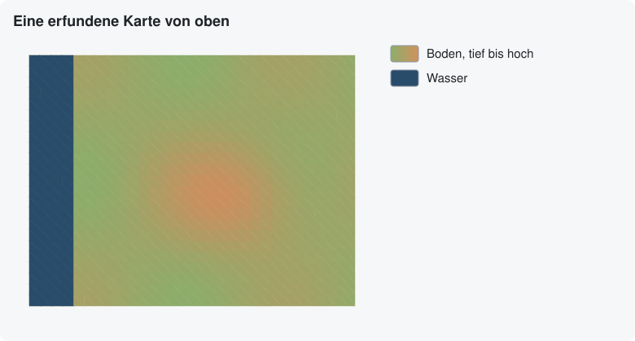

# Die Level-Dateien und Rahmen {#the-level-files-and-frames}

`<out>/<map>/<map>.glb` (das Level: ein 3D-Modell des Bodens) und `<map>.json` daneben. Die glb wird nach
`<map>.glb.part` geschrieben und umbenannt, wenn sie fertig ist.

| Teil | Was es ist |
|---|---|
| `ground:<map>` | das Gelände als Höhenkarten-Raster, höchstens `--max-grid` Samples pro Seite (Standard 1024: etwa 2 Millionen Dreiecke) |
| `water:<map>` | Flüsse, Seen und Meer: flache Vierecke auf der Höhe des Wassers, eines pro Rasterzelle, wenn genug ihrer Höhenkarten-Samples unter Wasser liegen (ein Drittel mit der Wassermaske der Karte, die Hälfte ohne) |
| `ground:<map> towns` | die bebauten Grundrisse von Städten und Dörfern, 1,5 m über dem Boden aufgelegt |

Die JSON-Datei enthält die **Ecken und den Breiten-/Längengrad-Bereich** der Karte (`corners`, `extent`),
wie sie gefunden wurden (`georeference`), die Einstellungen der Höhe (`heightMul`, `SeaLevel`), den
Spielbereich in den Metern des Spiels (`playArea`), den Rahmen und seinen Ursprung (`frame`, `geo`),
die Dreieckszahlen und alle `notes`.

## Rahmen {#frames}

Zwei Rahmen, `--frame`:

- `enu` (Standard): Meter nach Osten, Höhe über dem Meeresspiegel, Meter nach Norden von einem Ursprung
  auf der WGS-84-Tangentialebene: die flache Karte, in die der 3DHeat Watcher eine IL-2-Tacview-Aufnahme
  legt (x Osten, y Höhe, z Norden, mit gespiegeltem z gezeichnet). Die glb speichert (Osten, Höhe,
  -Norden). Umrechnen mit `--origin <lat> <lon>`, gesetzt auf das `geo` einer Aufnahme (ihr Referenzpunkt
  der Sitzung), dann landet die Aufnahme ohne Platzierungsschritt auf dem Level; ohne diese Angabe ist die
  Mitte der Karte der Ursprung, und das `geo` der JSON-Datei sagt, welcher es ist.
- `game`: die eigenen Meter des Spiels, so wie Missionsdateien sie haben: x Norden von der Südkante, y die
  Höhe des Spiels, z Osten von der Westkante (rechtshändig, wie sie ist, also glb = (x, y, z)). Karten,
  die nicht auf der Erde platziert werden können, werden unabhängig von der Wahl in diesem Rahmen
  geschrieben, mit einer Notiz.

Das Level ist eine glTF-Binärdatei mit benannten Teilen, wie jedes 3DHeat-Level; die Seite
[Levels](https://holdi601.github.io/3DHeat/levels.html) des Viewers sagt, wie er sie lädt.
