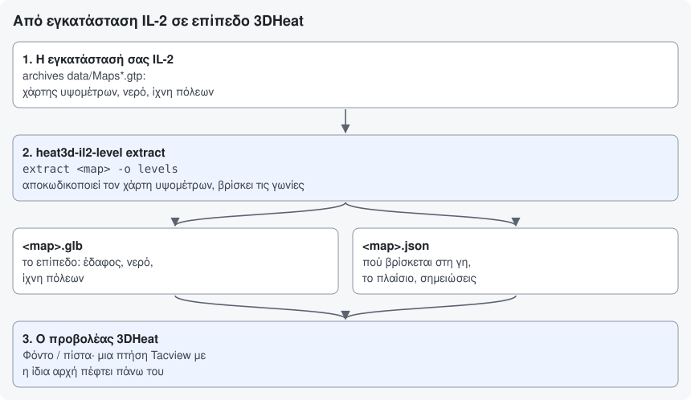

# 3DHeat IL-2 {#dheat-il-2}

**Τι είναι;** Ένα μικρό πρόγραμμα που μετατρέπει τους χάρτες του **IL-2 Sturmovik:
Great Battles**, διαβασμένους από **τη δική σας εγκατάσταση**, σε τρισδιάστατα μοντέλα - επίπεδα -
πάνω από τα οποία μπορείτε να πετάξετε στον προβολέα [3DHeat](https://github.com/Holdi601/3DHeat)
([τεκμηρίωση](https://holdi601.github.io/3DHeat/)): τους λόφους, τα ποτάμια,
τις λίμνες, τη θάλασσα και τις πόλεις, τοποθετημένα εκεί που βρίσκονται στη γη. Ένα δεύτερο παιχνίδι IL-2
του οποίου τα archives κρύβουν τον πίνακα αρχείων τους διαβάζεται όσο το επιτρέπουν
([λεπτομέρειες](archives-without-table.md)).

**Γιατί να το χρησιμοποιήσω;** Για να δείτε τις πτήσεις σας στο IL-2 πάνω από τον ίδιο τον χάρτη του παιχνιδιού.

**Παράδειγμα:** `heat3d-il2-level extract <map> -o levels` ->
`levels/<map>/<map>.glb` (το επίπεδο) + `<map>.json` (πού βρίσκεται στη
γη). Ο χάρτης υψομέτρων (heightmap) είναι ένα πλέγμα υψών, σαν ανάγλυφος χάρτης· μια
εγγραφή Tacview είναι ένα αρχείο μιας πτήσης που γράφει το Tacview.

Σε τι είναι χρήσιμο:

- **Πτήσεις στον ίδιο τον χάρτη του παιχνιδιού.** Μια εγγραφή Tacview του IL-2, που έχει μετατραπεί
  από τον Watcher του 3DHeat με την ίδια αρχή, πέφτει πάνω στο επίπεδο χωρίς βήμα τοποθέτησης.
- **Όλοι οι χάρτες μαζί.** Το `extract --all` γράφει κάθε χάρτη που βρέθηκε· οι εποχές που
  μοιράζονται έναν χάρτη υψομέτρων γράφονται μία φορά.
- **Πού στη γη.** Το `.json` κάθε επιπέδου φέρει τις γωνίες του και το πλαίσιο
  γεωγραφικού πλάτους/μήκους, και πώς βρέθηκαν.



## Γρήγορη εκκίνηση {#quick-start}

Δεν έχετε ξαναδουλέψει με τη γραμμή εντολών; Διαβάστε πρώτα το [Πριν ξεκινήσετε](before-you-start.md).
Τρέξτε αυτά στον φάκελο που κάνατε clone ή αποσυμπιέσατε:

```bash
python -m pip install -e .                         # installs the heat3d-il2-level command
python -m pip install -e .[fast]                            # with numba: decoding 20 to 50 times faster
heat3d-il2-level list                              # every map found, with its latitude/longitude box
heat3d-il2-level extract <map> -o levels           # one map (names as `list` prints them, wildcards allowed)
heat3d-il2-level extract --all -o levels           # every map
```

Πρέπει να δείτε μία γραμμή ανά χάρτη από το `list`, και `ok ...` από το `extract`.
Μετά φορτώστε το `levels/<map>/<map>.glb` στο πάνελ «Φόντο / πίστα» του προβολέα
([Επίπεδα](https://holdi601.github.io/3DHeat/levels.html)).

Τα επίπεδα που γράφει είναι φτιαγμένα από τα δεδομένα του παιχνιδιού: μένουν **στον
υπολογιστή σας**· μην τα δημοσιεύετε ποτέ ([Όροι](terms.md)).

Κάθε αναγνώστης παιχνιδιού είναι ένα δικό του μικρό έργο, με δικό του αρχείο άδειας, δικές του εκδόσεις και δικό του σύστημα αναφορών, ώστε να μπορεί να εγκατασταθεί, να ενημερωθεί, να συντηρηθεί - ή να αποσυρθεί κατόπιν αιτήματος δικαιούχου - μόνος του, χωρίς να επηρεάζει το πρόγραμμα προβολής ή τα άλλα εργαλεία.

## Σελίδες {#pages}

| Σελίδα | Τι καλύπτει |
|---|---|
| [Πριν ξεκινήσετε](before-you-start.md) | η Python, ένα τερματικό, μια πρώτη εκτέλεση |
| [Εύρεση χαρτών: list](list.md) | πού βρίσκονται οι εγκαταστάσεις, τι τυπώνει το `list` |
| [Δημιουργία επιπέδων: extract](extract.md) | κάθε επιλογή, βήμα προς βήμα, παραδείγματα |
| [Τα αρχεία επιπέδου και τα πλαίσια](output.md) | τα μέρη του `.glb`, το `.json`, τα πλαίσια `enu` και `game` |
| [Πώς διαβάζονται τα αρχεία](reading.md) | archives, ο κωδικοποιητής του χάρτη υψομέτρων, νερό, πόλεις, προσαρμογές οροσήμων |
| [Αρχεία χωρίς πίνακα αρχείων](archives-without-table.md) | το δεύτερο παιχνίδι, διαβασμένο όσο το επιτρέπουν τα archives του |
| [Ταχύτητα, δοκιμές, όροι](terms.md) | numba, τα τεστ, τι διαβάζεται και τι δεν συνοδεύει το εργαλείο, η άδεια |
| [Αναφορά εντολών](../cli-reference.md) | κάθε επιλογή, παραγόμενη από τον κώδικα |
| [Συντήρηση αυτών των σελίδων](maintaining.md) | η λίστα ελέγχου κυκλοφορίας |

## Σχετικά {#related}

- Ο προβολέας 3DHeat: [github.com/Holdi601/3DHeat](https://github.com/Holdi601/3DHeat),
  τεκμηρίωση στο [holdi601.github.io/3DHeat](https://holdi601.github.io/3DHeat/).
- Τηλεμετρία για αυτά τα επίπεδα: ο [3DHeat Watcher](https://holdi601.github.io/3DHeat-Watcher/)
  μετατρέπει εγγραφές Tacview του IL-2· τα αρχεία του προβολέα, μαζί με το κοντέινερ ενός αγώνα σε ένα αρχείο,
  περιγράφονται στο
  [Ένα αρχείο ανά αγώνα (.3dheat)](https://holdi601.github.io/3DHeat/container.html).

## Τα εργαλεία του 3DHeat {#the-3dheat-tools}

| Εργαλείο | Τι κάνει | Κώδικας | Τεκμηρίωση |
|---|---|---|---|
| προβολέας 3DHeat | δείχνει τα δεδομένα: θερμικούς χάρτες, ανάλυση αγώνα, επισκόπηση αγώνα | [3DHeat](https://github.com/Holdi601/3DHeat) | [τεκμηρίωση](https://holdi601.github.io/3DHeat/) |
| GameFiles | πίστες και διαδρομές από τα αρχεία ενός παιχνιδιού | [3DHeat-GameFiles](https://github.com/Holdi601/3DHeat-GameFiles) | [τεκμηρίωση](https://holdi601.github.io/3DHeat-GameFiles/) |
| GameCapture | τηλεμετρία γύρων, και πίστες ανακατασκευασμένες από βίντεο παιχνιδιού | [3DHeat-GameCapture](https://github.com/Holdi601/3DHeat-GameCapture) | [τεκμηρίωση](https://holdi601.github.io/3DHeat-GameCapture/) |
| Unreal Exporter | ένα πρόσθετο για το Unreal Editor: ένα επίπεδο ως ένα `.glb` | [3DHeat-UnrealExporter](https://github.com/Holdi601/3DHeat-UnrealExporter) | [τεκμηρίωση](https://holdi601.github.io/3DHeat-UnrealExporter/) |
| CS2 | demo και χάρτες του Counter-Strike 2 | [3DHeat-CS2](https://github.com/Holdi601/3DHeat-CS2) | [τεκμηρίωση](https://holdi601.github.io/3DHeat-CS2/) |
| Watcher | καταγράφει όσα δημοσιεύουν τα παιχνίδια όσο παίζετε | [3DHeat-Watcher](https://github.com/Holdi601/3DHeat-Watcher) | [τεκμηρίωση](https://holdi601.github.io/3DHeat-Watcher/) |
| Ext-WarThunder | replay του War Thunder | [3DHeat-Ext-WarThunder](https://github.com/Holdi601/3DHeat-Ext-WarThunder) | [τεκμηρίωση](https://holdi601.github.io/3DHeat-Ext-WarThunder/) |
| Ext-WoT | replay του World of Tanks | [3DHeat-Ext-WoT](https://github.com/Holdi601/3DHeat-Ext-WoT) | [τεκμηρίωση](https://holdi601.github.io/3DHeat-Ext-WoT/) |
| Ext-WoWs | replay του World of Warships | [3DHeat-Ext-WoWs](https://github.com/Holdi601/3DHeat-Ext-WoWs) | [τεκμηρίωση](https://holdi601.github.io/3DHeat-Ext-WoWs/) |
| Ext-Squad | demo από servers του Squad | [3DHeat-Ext-Squad](https://github.com/Holdi601/3DHeat-Ext-Squad) | [τεκμηρίωση](https://holdi601.github.io/3DHeat-Ext-Squad/) |
| Ext-DCS | χάρτες του DCS World ως τρισδιάστατα επίπεδα | [3DHeat-Ext-DCS](https://github.com/Holdi601/3DHeat-Ext-DCS) | [τεκμηρίωση](https://holdi601.github.io/3DHeat-Ext-DCS/) |
| Ext-IL2 | χάρτες του IL-2 Sturmovik ως τρισδιάστατα επίπεδα | [3DHeat-Ext-IL2](https://github.com/Holdi601/3DHeat-Ext-IL2) | [τεκμηρίωση](https://holdi601.github.io/3DHeat-Ext-IL2/) |
