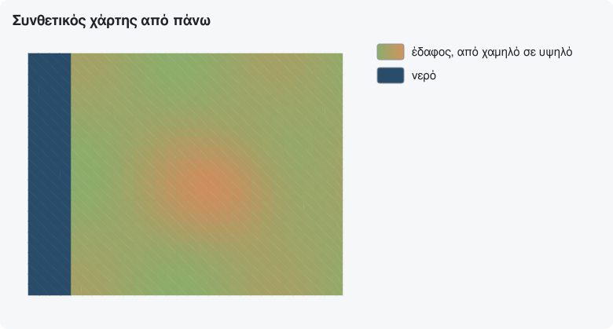

# Τα αρχεία επιπέδου και τα πλαίσια {#the-level-files-and-frames}

`<out>/<map>/<map>.glb` (το επίπεδο: ένα τρισδιάστατο μοντέλο του εδάφους) και δίπλα του το `<map>.json`.
Το glb γράφεται στο
`<map>.glb.part` και μετονομάζεται όταν ολοκληρωθεί.

| Μέρος | Τι είναι |
|---|---|
| `ground:<map>` | ο χάρτης υψομέτρων του εδάφους ως πλέγμα, το πολύ `--max-grid` δείγματα ανά πλευρά (προεπιλογή 1024: περίπου 2 εκατομμύρια τρίγωνα) |
| `water:<map>` | ποτάμια, λίμνες και θάλασσα: επίπεδα τετράγωνα στο ύψος του νερού, ένα για κάθε κελί του πλέγματος του οποίου αρκετά δείγματα του χάρτη υψομέτρων είναι κάτω από το νερό (ένα τρίτο με τη μάσκα νερού του χάρτη, το μισό χωρίς) |
| `ground:<map> towns` | τα ίχνη της δόμησης των πόλεων και των χωριών, απλωμένα 1,5 m πάνω από το έδαφος |

Το JSON περιέχει τις **γωνίες και το πλαίσιο γεωγραφικού πλάτους/μήκους** του χάρτη (`corners`,
`extent`), πώς βρέθηκαν (`georeference`), τις ρυθμίσεις ύψους
(`heightMul`, `SeaLevel`), την περιοχή παιχνιδιού σε μέτρα του παιχνιδιού (`playArea`), το
πλαίσιο και την αρχή του (`frame`, `geo`), τον αριθμό τριγώνων και τυχόν `notes`.

## Πλαίσια {#frames}

Δύο πλαίσια, `--frame`:

- `enu` (προεπιλογή): μέτρα ανατολικά, υψόμετρο πάνω από τη στάθμη της θάλασσας, βόρεια μιας αρχής στο
  εφαπτόμενο επίπεδο WGS-84: ο επίπεδος χάρτης στον οποίο ο Watcher του 3DHeat βάζει μια εγγραφή Tacview
  του IL-2 (x ανατολή, y υψόμετρο, z βορράς, σχεδιασμένο με το z κατοπτρισμένο). Το glb
  αποθηκεύει (ανατολή, υψόμετρο, -βορράς). Μετατρέψτε με `--origin <lat> <lon>` ίσο με το `geo` μιας
  εγγραφής (το σημείο αναφοράς της συνεδρίας της) και η εγγραφή πέφτει πάνω στο
  επίπεδο χωρίς βήμα τοποθέτησης· χωρίς αυτό, αρχή είναι το κέντρο του χάρτη,
  και το `geo` του JSON λέει ποιο είναι.
- `game`: τα μέτρα του ίδιου του παιχνιδιού όπως τα έχουν τα αρχεία αποστολών: x βορράς από τη
  νότια άκρη, y το ύψος του παιχνιδιού, z ανατολή από τη δυτική άκρη (δεξιόστροφο όπως
  είναι, άρα glb = (x, y, z)). Οι χάρτες που δεν μπορούν να τοποθετηθούν στη γη γράφονται σε
  αυτό το πλαίσιο ό,τι κι αν ζητηθεί, με μια σημείωση.

Το επίπεδο είναι ένα δυαδικό glTF με ονομασμένα μέρη, όπως κάθε επίπεδο του 3DHeat· η σελίδα
[Επίπεδα](https://holdi601.github.io/3DHeat/levels.html) του προβολέα λέει πώς τα φορτώνει.
