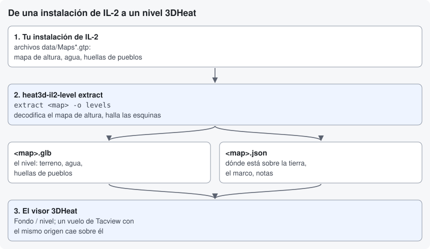

# 3DHeat IL-2 {#dheat-il-2}

**¿Qué es?** Un pequeño programa que convierte los mapas de **IL-2 Sturmovik: Great Battles**, leídos
desde **tu propia instalación**, en modelos 3D (niveles) sobre los que puedes volar en el visor
[3DHeat](https://github.com/Holdi601/3DHeat) ([documentación](https://holdi601.github.io/3DHeat/)):
las colinas, ríos, lagos, el mar y los pueblos, colocados donde están sobre la tierra. Un segundo juego
de IL-2 cuyos archivos ocultan su tabla de archivos se lee hasta donde lo permiten
([detalles](archives-without-table.md)).

**¿Para qué lo usaría?** Para ver tus vuelos de IL-2 sobre el propio mapa del juego.

**Ejemplo:** `heat3d-il2-level extract <map> -o levels` ->
`levels/<map>/<map>.glb` (el nivel) + `<map>.json` (dónde está sobre la tierra). Un mapa de altura es
una cuadrícula de alturas, como un mapa de relieve; una grabación de Tacview es un archivo de un vuelo
que escribe Tacview.

Para qué sirve:

- **Vuelos sobre el mapa propio del juego.** Una grabación de Tacview de IL-2, convertida por
  3DHeat Watcher con el mismo origen, cae sobre el nivel sin paso de colocación.
- **Todos los mapas a la vez.** `extract --all` escribe cada mapa encontrado; las temporadas que
  comparten un mapa de altura se escriben una vez.
- **Dónde está sobre la tierra.** El `.json` de cada nivel lleva sus esquinas y su caja de
  latitud/longitud, y cómo se encontraron.



## Inicio rápido {#quick-start}

¿Nuevo en la línea de comandos? Lee primero [Antes de empezar](before-you-start.md).
Ejecuta estos comandos en la carpeta que clonaste o descomprimiste:

```bash
python -m pip install -e .                         # instala el comando heat3d-il2-level
python -m pip install -e .[fast]                            # con numba: decodificación de 20 a 50 veces más rápida
heat3d-il2-level list                              # cada mapa encontrado, con su caja de latitud/longitud
heat3d-il2-level extract <map> -o levels           # un mapa (nombres como los imprime `list`, con comodines)
heat3d-il2-level extract --all -o levels           # cada mapa
```

Verás una línea por mapa con `list`, y `ok ...` con `extract`.
Después carga `levels/<map>/<map>.glb` en el panel Fondo / nivel del visor
([Niveles](https://holdi601.github.io/3DHeat/levels.html)).

Los niveles que escribe se construyen con los datos del juego: se quedan **en tu equipo**;
nunca los publiques ([Condiciones](terms.md)).

## Páginas {#pages}

| Página | Qué cubre |
|---|---|
| [Antes de empezar](before-you-start.md) | Python, una terminal, una primera ejecución |
| [Buscar mapas: list](list.md) | dónde se encuentran las instalaciones, qué imprime `list` |
| [Construir niveles: extract](extract.md) | cada opción, paso a paso, ejemplos |
| [Los archivos del nivel y los marcos](output.md) | las partes `.glb`, el `.json`, los marcos `enu` y `game` |
| [Cómo se leen los archivos](reading.md) | archivos, el códec del mapa de altura, agua, pueblos, ajustes por puntos de referencia |
| [Archivos sin tabla de archivos](archives-without-table.md) | el segundo juego, leído hasta donde permiten sus archivos |
| [Velocidad, pruebas y condiciones](terms.md) | numba, las pruebas, las condiciones del juego, la licencia |
| [Referencia de comandos](../cli-reference.md) | cada opción, generada desde el código |
| [Mantenimiento de estas páginas](maintaining.md) | la lista de comprobación de cada versión |

## Relacionado {#related}

- El visor 3DHeat: [github.com/Holdi601/3DHeat](https://github.com/Holdi601/3DHeat),
  documentación en [holdi601.github.io/3DHeat](https://holdi601.github.io/3DHeat/).
- Telemetría para estos niveles: [3DHeat Watcher](https://holdi601.github.io/3DHeat-Watcher/)
  convierte las grabaciones de Tacview de IL-2; los formatos de archivo del visor, incluido su
  contenedor de un archivo por partida, se describen en
  [Un archivo por partida (.3dheat)](https://holdi601.github.io/3DHeat/container.html).

## Las herramientas de 3DHeat {#the-3dheat-tools}

| Herramienta | Qué hace | Código | Documentación |
|---|---|---|---|
| Visor 3DHeat | muestra los datos: mapas de calor, análisis de carrera, revisión de partidas | [3DHeat](https://github.com/Holdi601/3DHeat) | [docs](https://holdi601.github.io/3DHeat/) |
| GameFiles | niveles y circuitos a partir de los archivos propios de un juego | [3DHeat-GameFiles](https://github.com/Holdi601/3DHeat-GameFiles) | [docs](https://holdi601.github.io/3DHeat-GameFiles/) |
| GameCapture | telemetría de vueltas, y niveles reconstruidos a partir de vídeo de juego | [3DHeat-GameCapture](https://github.com/Holdi601/3DHeat-GameCapture) | [docs](https://holdi601.github.io/3DHeat-GameCapture/) |
| Unreal Exporter | un plugin del editor de Unreal: un nivel como un solo `.glb` | [3DHeat-UnrealExporter](https://github.com/Holdi601/3DHeat-UnrealExporter) | [docs](https://holdi601.github.io/3DHeat-UnrealExporter/) |
| CS2 | demos y mapas de Counter-Strike 2 | [3DHeat-CS2](https://github.com/Holdi601/3DHeat-CS2) | [docs](https://holdi601.github.io/3DHeat-CS2/) |
| Watcher | registra lo que publican los juegos mientras juegas | [3DHeat-Watcher](https://github.com/Holdi601/3DHeat-Watcher) | [docs](https://holdi601.github.io/3DHeat-Watcher/) |
| Ext-WarThunder | repeticiones de War Thunder | [3DHeat-Ext-WarThunder](https://github.com/Holdi601/3DHeat-Ext-WarThunder) | [docs](https://holdi601.github.io/3DHeat-Ext-WarThunder/) |
| Ext-WoT | repeticiones de World of Tanks | [3DHeat-Ext-WoT](https://github.com/Holdi601/3DHeat-Ext-WoT) | [docs](https://holdi601.github.io/3DHeat-Ext-WoT/) |
| Ext-WoWs | repeticiones de World of Warships | [3DHeat-Ext-WoWs](https://github.com/Holdi601/3DHeat-Ext-WoWs) | [docs](https://holdi601.github.io/3DHeat-Ext-WoWs/) |
| Ext-Squad | demos de servidores de Squad | [3DHeat-Ext-Squad](https://github.com/Holdi601/3DHeat-Ext-Squad) | [docs](https://holdi601.github.io/3DHeat-Ext-Squad/) |
| Ext-DCS | mapas de DCS World como niveles 3D | [3DHeat-Ext-DCS](https://github.com/Holdi601/3DHeat-Ext-DCS) | [docs](https://holdi601.github.io/3DHeat-Ext-DCS/) |
| Ext-IL2 | mapas de IL-2 Sturmovik como niveles 3D | [3DHeat-Ext-IL2](https://github.com/Holdi601/3DHeat-Ext-IL2) | [docs](https://holdi601.github.io/3DHeat-Ext-IL2/) |
| Ext-Dota | el mapa de Dota 2 de tu propia instalación como nivel 3D | [3DHeat-Ext-Dota](https://github.com/Holdi601/3DHeat-Ext-Dota) | [docs](https://holdi601.github.io/3DHeat-Ext-Dota/) |
| Ext-DotaReplay | repeticiones de Dota 2 | [3DHeat-Ext-DotaReplay](https://github.com/Holdi601/3DHeat-Ext-DotaReplay) | [docs](https://holdi601.github.io/3DHeat-Ext-DotaReplay/) |
| Ext-Riot | repeticiones de League of Legends y VALORANT (lo que contienen sin cifrar) | [3DHeat-Ext-Riot](https://github.com/Holdi601/3DHeat-Ext-Riot) | [docs](https://holdi601.github.io/3DHeat-Ext-Riot/) |
| Ext-Forza | recorridos, carreras y coches de Forza de tu propia instalación | [3DHeat-Ext-Forza](https://github.com/Holdi601/3DHeat-Ext-Forza) | [docs](https://holdi601.github.io/3DHeat-Ext-Forza/) |
| Ext-Battlefield | niveles de Battlefield (Frostbite) como niveles 3D | [3DHeat-Ext-Battlefield](https://github.com/Holdi601/3DHeat-Ext-Battlefield) | [docs](https://holdi601.github.io/3DHeat-Ext-Battlefield/) |
| Ext-BeamNG | recorridos de BeamNG.drive | [3DHeat-Ext-BeamNG](https://github.com/Holdi601/3DHeat-Ext-BeamNG) | [docs](https://holdi601.github.io/3DHeat-Ext-BeamNG/) |
| Ext-ACRally | etapas de Assetto Corsa Rally como recorridos | [3DHeat-Ext-ACRally](https://github.com/Holdi601/3DHeat-Ext-ACRally) | [docs](https://holdi601.github.io/3DHeat-Ext-ACRally/) |
| Ext-Reforger | mundos de Arma Reforger (Enfusion) como niveles 3D | [3DHeat-Ext-Reforger](https://github.com/Holdi601/3DHeat-Ext-Reforger) | [docs](https://holdi601.github.io/3DHeat-Ext-Reforger/) |
| Ext-R6 | repeticiones de partidas de Rainbow Six Siege | [3DHeat-Ext-R6](https://github.com/Holdi601/3DHeat-Ext-R6) | [docs](https://holdi601.github.io/3DHeat-Ext-R6/) |
