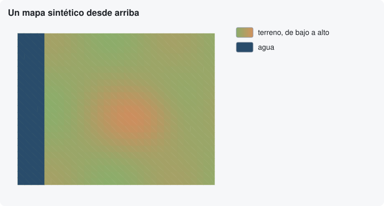

# Los archivos del nivel y los marcos {#the-level-files-and-frames}

`<out>/<map>/<map>.glb` (el nivel: un modelo 3D del terreno) y `<map>.json` junto a él. El glb se
escribe en `<map>.glb.part` y se renombra cuando termina.

| Parte | Qué es |
|---|---|
| `ground:<map>` | el mapa de altura del terreno como cuadrícula, con un máximo de `--max-grid` muestras por lado (por defecto 1024: unos 2 millones de triángulos) |
| `water:<map>` | ríos, lagos y mar: cuadriláteros planos a la altura del agua, uno por celda de la cuadrícula con suficientes muestras del mapa de altura bajo el agua (un tercio con la máscara de agua del mapa, la mitad sin ella) |
| `ground:<map> towns` | las huellas de las zonas urbanas de pueblos y aldeas, colocadas 1,5 m sobre el terreno |

El JSON contiene las **esquinas y la caja de latitud/longitud** del mapa (`corners`, `extent`), cómo
se encontraron (`georeference`), los ajustes de altura (`heightMul`, `SeaLevel`), el área de juego en
los metros del juego (`playArea`), el marco y su origen (`frame`, `geo`), los recuentos de triángulos
y cualquier `notes`.

## Marcos {#frames}

Dos marcos, `--frame`:

- `enu` (por defecto): metros al este, altitud sobre el nivel del mar, y norte de un origen sobre el
  plano tangente WGS-84: el mapa plano en el que el 3DHeat Watcher coloca una grabación de Tacview de
  IL-2 (x este, y altitud, z norte, dibujado con z invertida). El glb guarda (este, altitud, -norte).
  Conviértelo con `--origin <lat> <lon>` puesto al `geo` de una grabación (el punto de referencia de su
  sesión) y la grabación cae sobre el nivel sin paso de colocación; sin esto, el centro del mapa es el
  origen, y el `geo` del JSON dice cuál es.
- `game`: los metros propios del juego, tal como los tienen los archivos de misión: x norte desde el
  borde sur, y la altura del juego, z este desde el borde oeste (de mano derecha tal cual, así que glb =
  (x, y, z)). Los mapas que no se pueden colocar sobre la tierra se escriben en este marco aunque se pida
  otra cosa, con una nota.

El nivel es un binario glTF con partes con nombre, como todo nivel de 3DHeat; la página
[Niveles](https://holdi601.github.io/3DHeat/levels.html) del visor explica cómo los carga.
