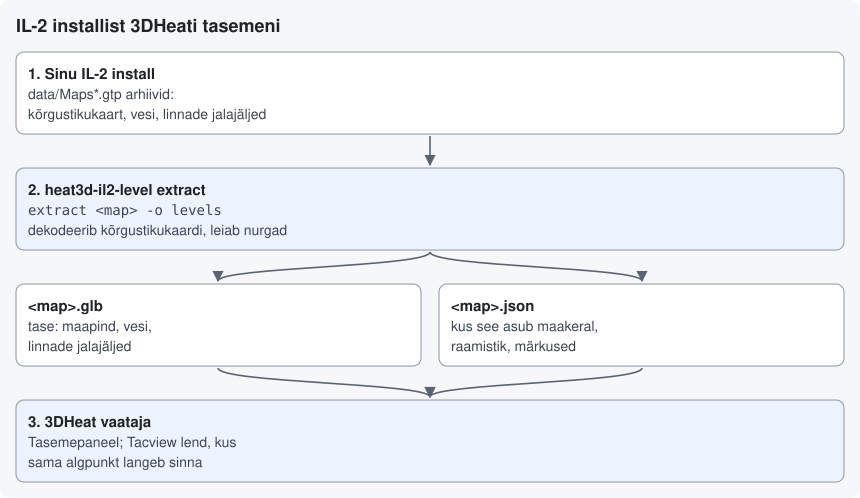

# 3DHeat IL-2 {#dheat-il-2}

**Mis see on?** Väike programm, mis muudab **IL-2 Sturmovik: Great Battles'i** kaardid,
loetuna **sinu enda installist**, 3D-mudeliteks — tasemeteks —, mille kohal saab lennata
[3DHeat](https://github.com/Holdi601/3DHeat) vaataja
([dokumentatsioon](https://holdi601.github.io/3DHeat/)): mäed, jõed,
järved, meri ja linnad, paigutatuna sinna, kus nad maakeral asuvad. Teine IL-2 mäng,
mille arhiivid peidavad oma failitabeli, loetakse nii kaugele, kui arhiivid lubavad
([üksikasjad](archives-without-table.md)).

**Miks ma seda kasutaksin?** Et näha oma IL-2 lende mängu enda kaardil.

**Näide:** `heat3d-il2-level extract <map> -o levels` ->
`levels/<map>/<map>.glb` (tase) + `<map>.json` (kus see asub maakeral). Kõrgustikukaart on kõrguste ruudustik, nagu reljeefikaart; Tacview lindistus on lennu fail, mille kirjutab Tacview.

Milleks see kasulik on:

- **Lennud mängu enda kaardil.** IL-2 Tacview lindistus, mille 3DHeat Watcher teisendab sama algpunktiga, langeb tasemele ilma paigutussammuta.
- **Kõik kaardid korraga.** `extract --all` kirjutab kõik leitud kaardid; hooajad, mis jagavad sama kõrgustikukaarti, kirjutatakse üks kord.
- **Kus maakeral.** Iga taseme `.json` kannab oma nurki ja laiuskraadi/pikkuskraadi kasti ning seda, kuidas need leiti.



## Kiire algus {#quick-start}

Pole sul käsurealt kogemust? Loe esmalt [Enne alustamist](before-you-start.md).
Käivita need kaustas, kuhu kloonisid või lahti pakkisid:

```bash
python -m pip install -e .                         # paigaldab käsu heat3d-il2-level
python -m pip install -e .[fast]                            # numba'ga: dekodeerimine 20 kuni 50 korda kiirem
heat3d-il2-level list                              # kõik leitud kaardid koos laiuskraadi/pikkuskraadi kastiga
heat3d-il2-level extract <map> -o levels           # üks kaart (nimed, nii nagu `list` prindib, metamärgid lubatud)
heat3d-il2-level extract --all -o levels           # iga kaart
```

`list` prindib rea kaardi kohta ja `extract` prindib `ok ...`.
Seejärel laadi `levels/<map>/<map>.glb` vaataja paneelis **Taust / tase**
([Tasemed](https://holdi601.github.io/3DHeat/levels.html)).

Tasemed, mida see kirjutab, on tehtud mängu andmetest, nii et need jäävad **sinu masinasse**;
ära kunagi avalda neid ([Tingimused](terms.md)).

## Lehed {#pages}

| Leht | Mida see käsitleb |
|---|---|
| [Enne alustamist](before-you-start.md) | Python, terminal, esimene käivitus |
| [Kaartide leidmine: list](list.md) | kust installid leitakse, mida `list` prindib |
| [Tasemete ehitamine: extract](extract.md) | iga valik, samm-sammult, näited |
| [Tasemefailid ja raamistikud](output.md) | `.glb` osad, `.json`, `enu` ja `game` raamistikud |
| [Kuidas faile loetakse](reading.md) | arhiivid, kõrgustikukaardi kodek, vesi, linnad, maamärkide sobitused |
| [Arhiivid ilma failitabelita](archives-without-table.md) | teine mäng, loetud nii kaugele, kui arhiivid lubavad |
| [Kiirus, testid, tingimused](terms.md) | numba, testid, mängu tingimused, litsents |
| [Käsu viide](../cli-reference.md) | iga valik, koodist genereeritud |
| [Nende dokumentide hooldamine](maintaining.md) | väljalaske kontrollnimekiri |

## Seotud {#related}

- 3DHeat vaataja: [github.com/Holdi601/3DHeat](https://github.com/Holdi601/3DHeat),
  dokumentatsioon aadressil [holdi601.github.io/3DHeat](https://holdi601.github.io/3DHeat/).
- Telemeetria nendele tasemetele: [3DHeat Watcher](https://holdi601.github.io/3DHeat-Watcher/)
  teisendab IL-2 Tacview lindistusi; vaataja failivormingud, sealhulgas tema üks-fail-mängu kohta mõeldud
  konteiner, on kirjeldatud lehel
  [Üks fail mängu kohta (.3dheat)](https://holdi601.github.io/3DHeat/container.html).

## 3DHeati tööriistad {#the-3dheat-tools}

| Tööriist | Mida see teeb | Kood | Dokumentatsioon |
|---|---|---|---|
| 3DHeat vaataja | näitab andmeid: soojuskaardid, võistlusanalüüs, mängu ülevaade | [3DHeat](https://github.com/Holdi601/3DHeat) | [dokumentatsioon](https://holdi601.github.io/3DHeat/) |
| GameFiles | tasemed ja rajad mängu enda failidest | [3DHeat-GameFiles](https://github.com/Holdi601/3DHeat-GameFiles) | [dokumentatsioon](https://holdi601.github.io/3DHeat-GameFiles/) |
| GameCapture | ringi telemeetria ja mängu videost taastatud tasemed | [3DHeat-GameCapture](https://github.com/Holdi601/3DHeat-GameCapture) | [dokumentatsioon](https://holdi601.github.io/3DHeat-GameCapture/) |
| Unreal Exporter | Unreal Editori plugin: tase ühe `.glb` failina | [3DHeat-UnrealExporter](https://github.com/Holdi601/3DHeat-UnrealExporter) | [dokumentatsioon](https://holdi601.github.io/3DHeat-UnrealExporter/) |
| CS2 | Counter-Strike 2 demod ja kaardid | [3DHeat-CS2](https://github.com/Holdi601/3DHeat-CS2) | [dokumentatsioon](https://holdi601.github.io/3DHeat-CS2/) |
| Watcher | salvestab, mida mängud avaldavad, kui sa mängid | [3DHeat-Watcher](https://github.com/Holdi601/3DHeat-Watcher) | [dokumentatsioon](https://holdi601.github.io/3DHeat-Watcher/) |
| Ext-WarThunder | War Thunderi kordused | [3DHeat-Ext-WarThunder](https://github.com/Holdi601/3DHeat-Ext-WarThunder) | [dokumentatsioon](https://holdi601.github.io/3DHeat-Ext-WarThunder/) |
| Ext-WoT | World of Tanksi kordused | [3DHeat-Ext-WoT](https://github.com/Holdi601/3DHeat-Ext-WoT) | [dokumentatsioon](https://holdi601.github.io/3DHeat-Ext-WoT/) |
| Ext-WoWs | World of Warshipsi kordused | [3DHeat-Ext-WoWs](https://github.com/Holdi601/3DHeat-Ext-WoWs) | [dokumentatsioon](https://holdi601.github.io/3DHeat-Ext-WoWs/) |
| Ext-Squad | Squadi serverdemod | [3DHeat-Ext-Squad](https://github.com/Holdi601/3DHeat-Ext-Squad) | [dokumentatsioon](https://holdi601.github.io/3DHeat-Ext-Squad/) |
| Ext-DCS | DCS World'i kaardid 3D-tasemetena | [3DHeat-Ext-DCS](https://github.com/Holdi601/3DHeat-Ext-DCS) | [dokumentatsioon](https://holdi601.github.io/3DHeat-Ext-DCS/) |
| Ext-IL2 | IL-2 Sturmovik'i kaardid 3D-tasemetena | [3DHeat-Ext-IL2](https://github.com/Holdi601/3DHeat-Ext-IL2) | [dokumentatsioon](https://holdi601.github.io/3DHeat-Ext-IL2/) |
