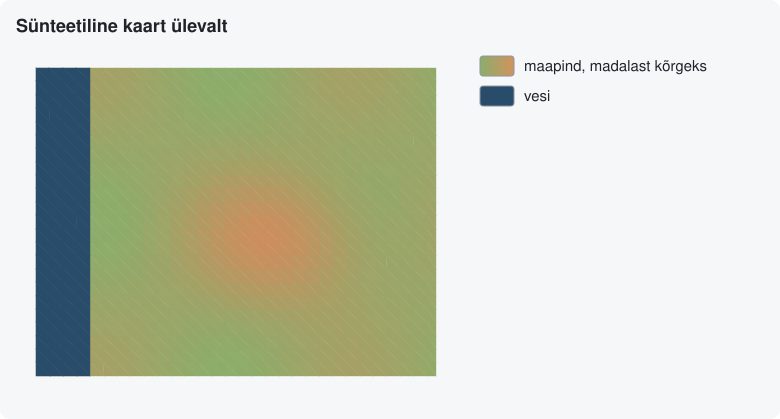

# Tasemefailid ja raamistikud {#the-level-files-and-frames}

`<out>/<map>/<map>.glb` (tase: maapinna 3D-mudel) ja selle kõrval `<map>.json`.
glb kirjutatakse faili
`<map>.glb.part` ja nimetatakse ümber, kui see on valmis.

| Osa | Mis see on |
|---|---|
| `ground:<map>` | maastiku kõrgustikukaart ruudustikuna, külje kohta kõige rohkem `--max-grid` proovi (vaikimisi 1024: umbes 2 miljonit kolmnurka) |
| `water:<map>` | jõed, järved ja meri: lamedad ruudud vee kõrgusel, üks iga ruudustiku lahtri kohta, kui piisavalt tema kõrgustikukaardi proove on vee all (kolmandik koos kaardi veemaskiga, pool ilma selleta) |
| `ground:<map> towns` | linnade ja külade ehitatud alad, 1,5 m maapinna kohal |

JSON hoiab kaardi **nurki ja laiuskraadi/pikkuskraadi kasti** (`corners`,
`extent`), seda, kuidas need leiti (`georeference`), kõrguse seadeid
(`heightMul`, `SeaLevel`), mänguala mängu meetrites (`playArea`), raamistikku ja tema
algpunkti (`frame`, `geo`), kolmnurkade arvu ja kõiki `notes`.

## Raamistikud {#frames}

Kaks raamistikku, `--frame`:

- `enu` (vaikimisi): meetrit ida, kõrgus merepinnast, põhi algpunktist WGS-84 puutujatasandil: tasane kaart, kuhu 3DHeat Watcher paneb IL-2 Tacview lindistuse (x ida, y kõrgus, z põhi, joonistatud z peegeldatuna). glb hoiab (ida, kõrgus, -põhi). Teisenda `--origin <lat> <lon>`-ga, mis on lindistuse `geo` (tema seansi viitepunkt), ja lindistus langeb tasemele ilma paigutussammuta; ilma selleta on kaardi keskpunkt algpunkt, ja JSON-i `geo` ütleb, mis see on.
- `game`: mängu enda meetrid, nagu missioonifailidel: x põhja lõunaservast, y mängu kõrgus, z ida läänservast (parempoolne nagu on, nii et glb = (x, y, z)). Kaardid, mida ei saa maakerale paigutada, kirjutatakse sellesse raamistikku, olenemata sellest, mida küsiti, märkusega.

Tase on glTF-binaarfail nimetatud osadega, nagu iga 3DHeati tase; vaataja
[Tasemed](https://holdi601.github.io/3DHeat/levels.html) leht ütleb, kuidas need laaditakse.
