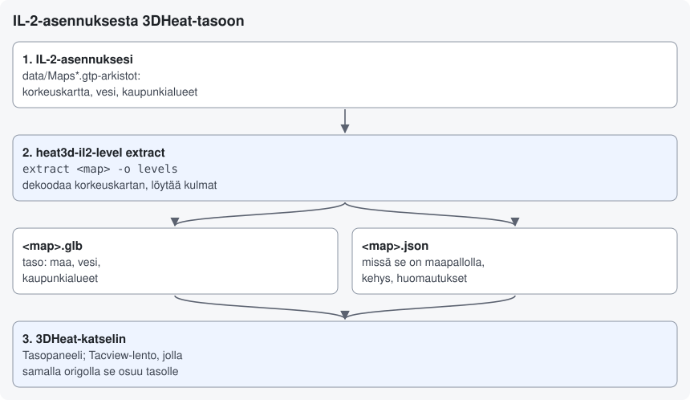

# 3DHeat IL-2 {#dheat-il-2}

**Mitä se on?** Pieni ohjelma, joka muuttaa **IL-2 Sturmovik: Great Battles** -pelin
kartat – luetut **omasta asennuksestasi** – 3D-malleiksi eli kentiksi, joiden yli voi
lentää [3DHeat](https://github.com/Holdi601/3DHeat)-katselimessa
([dokumentaatio](https://holdi601.github.io/3DHeat/)): mäet, joet, järvet, meri ja
kaupungit sijoitettuina sinne, missä ne maapallolla sijaitsevat. Toinen IL-2-peli, jonka
arkistot piilottavat tiedostotaulukkonsa, luetaan niin pitkälle kuin arkistot sallivat
([tiedot](archives-without-table.md)).

**Miksi käyttäisin sitä?** Nähdäksesi IL-2-lentosi pelin oman kartan päällä.

**Esimerkki:** `heat3d-il2-level extract <map> -o levels` ->
`levels/<map>/<map>.glb` (kenttä) + `<map>.json` (missä se on maapallolla). Korkeuskartta on
korkeuksien ruudukko, kuin reliefikartta; Tacview-tallenne on tiedosto lennosta, jonka Tacview kirjoittaa.

Tästä on hyötyä:

- **Lennot pelin omalla kartalla.** IL-2:n Tacview-tallenne, jonka 3DHeat Watcher muuntaa samalla
  origolla, asettuu kentälle ilman sijoittelua.
- **Kaikki kartat kerralla.** `extract --all` kirjoittaa jokaisen löydetyn kartan; vuodenajat, jotka
  jakavat saman korkeuskartan, kirjoitetaan kerran.
- **Missä maapallolla.** Jokaisen kentän `.json` kantaa sen kulmat ja leveys- ja pituusasteen
  laatikon sekä sen, miten ne löydettiin.



## Pikaohje {#quick-start}

Uusi komentorivin kanssa? Lue ensin [Ennen aloittamista](before-you-start.md).
Suorita nämä kansiossa, johon kloonasit tai purit työkalun:

```bash
python -m pip install -e .                         # asentaa komennon heat3d-il2-level
python -m pip install -e .[fast]                            # numban kanssa: dekoodaus 20–50 kertaa nopeammin
heat3d-il2-level list                              # jokainen löydetty kartta leveys- ja pituusasteen laatikkoineen
heat3d-il2-level extract <map> -o levels           # yksi kartta (nimet kuten `list` ne tulostaa, jokerimerkit sallittu)
heat3d-il2-level extract --all -o levels           # jokainen kartta
```

Näet `list`-komennosta rivin kartaa kohden, ja `extract`-komennosta rivin `ok ...`.
Lataa sitten `levels/<map>/<map>.glb` katselimen Tausta / kenttä -paneeliin
([Kentät](https://holdi601.github.io/3DHeat/levels.html)).

Kentät, jotka se kirjoittaa, on rakennettu pelin tiedoista: ne pysyvät **koneellasi**;
älä koskaan julkaise niitä ([Ehdot](terms.md)).

## Sivut {#pages}

| Sivu | Mitä se kattaa |
|---|---|
| [Ennen aloittamista](before-you-start.md) | Python, pääte, ensimmäinen ajo |
| [Karttojen etsiminen: list](list.md) | mistä asennukset löytyvät, mitä `list` tulostaa |
| [Kenttien rakentaminen: extract](extract.md) | jokainen asetus vaihe vaiheelta, esimerkit |
| [Kenttätiedostot ja kehykset](output.md) | `.glb`-osat, `.json`, `enu`- ja `game`-kehykset |
| [Miten tiedostot luetaan](reading.md) | arkistot, korkeuskartan koodekki, vesi, kaupungit, maamerkkisovitukset |
| [Arkistot ilman tiedostotaulukkoa](archives-without-table.md) | toinen peli, luettu niin pitkälle kuin sen arkistot sallivat |
| [Nopeus, testit, ehdot](terms.md) | numba, testit, pelin ehdot, lisenssi |
| [Komentoviite](../cli-reference.md) | jokainen asetus, luotu koodista |
| [Dokumentaation ylläpito](maintaining.md) | julkaisun tarkistuslista |

## Liittyvää {#related}

- 3DHeat-katselin: [github.com/Holdi601/3DHeat](https://github.com/Holdi601/3DHeat),
  dokumentaatio osoitteessa [holdi601.github.io/3DHeat](https://holdi601.github.io/3DHeat/).
- Näiden kenttien telemetria: [3DHeat Watcher](https://holdi601.github.io/3DHeat-Watcher/)
  muuntaa IL-2:n Tacview-tallenteet; katselimen tiedostomuodot, mukaan lukien sen yhden ottelun
  yhden tiedoston säiliö, on kuvattu sivulla
  [Yksi tiedosto ottelua kohden (.3dheat)](https://holdi601.github.io/3DHeat/container.html).

## 3DHeat-työkalut {#the-3dheat-tools}

| Työkalu | Mitä se tekee | Koodi | Dokumentaatio |
|---|---|---|---|
| 3DHeat-katselin | näyttää tiedot: lämpökartat, kilpa-analyysin, ottelun tarkastelun | [3DHeat](https://github.com/Holdi601/3DHeat) | [dokumentaatio](https://holdi601.github.io/3DHeat/) |
| GameFiles | kentät ja radat pelien omista tiedostoista | [3DHeat-GameFiles](https://github.com/Holdi601/3DHeat-GameFiles) | [dokumentaatio](https://holdi601.github.io/3DHeat-GameFiles/) |
| GameCapture | kierrosten telemetria ja videosta pelistä rakennetut kentät | [3DHeat-GameCapture](https://github.com/Holdi601/3DHeat-GameCapture) | [dokumentaatio](https://holdi601.github.io/3DHeat-GameCapture/) |
| Unreal Exporter | Unreal Editor -liitännäinen: kenttä yhtenä `.glb`-tiedostona | [3DHeat-UnrealExporter](https://github.com/Holdi601/3DHeat-UnrealExporter) | [dokumentaatio](https://holdi601.github.io/3DHeat-UnrealExporter/) |
| CS2 | Counter-Strike 2 -demot ja kartat | [3DHeat-CS2](https://github.com/Holdi601/3DHeat-CS2) | [dokumentaatio](https://holdi601.github.io/3DHeat-CS2/) |
| Watcher | tallentaa sen, mitä pelit julkaisevat pelatessasi | [3DHeat-Watcher](https://github.com/Holdi601/3DHeat-Watcher) | [dokumentaatio](https://holdi601.github.io/3DHeat-Watcher/) |
| Ext-WarThunder | War Thunder -tallenteet | [3DHeat-Ext-WarThunder](https://github.com/Holdi601/3DHeat-Ext-WarThunder) | [dokumentaatio](https://holdi601.github.io/3DHeat-Ext-WarThunder/) |
| Ext-WoT | World of Tanks -tallenteet | [3DHeat-Ext-WoT](https://github.com/Holdi601/3DHeat-Ext-WoT) | [dokumentaatio](https://holdi601.github.io/3DHeat-Ext-WoT/) |
| Ext-WoWs | World of Warships -tallenteet | [3DHeat-Ext-WoWs](https://github.com/Holdi601/3DHeat-Ext-WoWs) | [dokumentaatio](https://holdi601.github.io/3DHeat-Ext-WoWs/) |
| Ext-Squad | Squad-palvelindemot | [3DHeat-Ext-Squad](https://github.com/Holdi601/3DHeat-Ext-Squad) | [dokumentaatio](https://holdi601.github.io/3DHeat-Ext-Squad/) |
| Ext-DCS | DCS World -kartat 3D-kenttinä | [3DHeat-Ext-DCS](https://github.com/Holdi601/3DHeat-Ext-DCS) | [dokumentaatio](https://holdi601.github.io/3DHeat-Ext-DCS/) |
| Ext-IL2 | IL-2 Sturmovik -kartat 3D-kenttinä | [3DHeat-Ext-IL2](https://github.com/Holdi601/3DHeat-Ext-IL2) | [dokumentaatio](https://holdi601.github.io/3DHeat-Ext-IL2/) |
