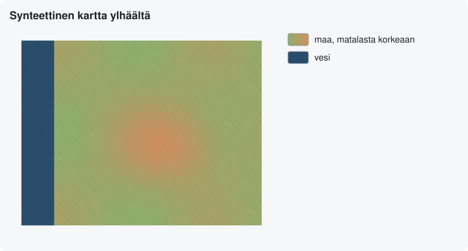

# Tasotiedostot ja kehykset {#the-level-files-and-frames}

`<out>/<map>/<map>.glb` (taso: maaston 3D-malli) ja sen vieressä `<map>.json`.
glb kirjoitetaan tiedostoon `<map>.glb.part` ja nimetään uudelleen, kun se on valmis.

| Osa | Mitä se on |
|---|---|
| `ground:<map>` | maaston korkeuskartta ruudukkona, enintään `--max-grid`-näytettä sivulla (oletus 1024: noin 2 miljoonaa kolmiota) |
| `water:<map>` | joet, järvet ja meri: tasaisia nelikulmioita veden korkeudella, yksi per ruutu, jos riittävän monta sen korkeuskartan näytteistä on veden alla (kolmannes kartan vesimaskilla, puolet ilman) |
| `ground:<map> towns` | kaupunkien ja kylien rakennettujen alueiden pohjapiirrokset, levitettynä 1,5 m maanpinnan yläpuolelle |

JSON sisältää kartan **kulmat ja leveys- ja pituusasteen laatikon** (`corners`, `extent`),
miten ne löydettiin (`georeference`), korkeusasetukset (`heightMul`, `SeaLevel`), pelialueen pelin
metreinä (`playArea`), kehyksen ja sen origon (`frame`, `geo`), kolmiomäärät ja mahdolliset `notes`.

## Kehykset {#frames}

Kaksi kehystä, `--frame`:

- `enu` (oletus): metriä itään, korkeus merenpinnasta ja pohjoinen WGS-84-tangenttitasossa
  olevasta origosta: litteä kartta, johon 3DHeat Watcher sijoittaa IL-2:n Tacview-tallenteen
  (x itään, y korkeus, z pohjoiseen, piirretty z peilattuna). glb tallentaa (itä, korkeus, -pohjoinen).
  Muunna asettamalla `--origin <lat> <lon>` tallenteen `geo`-arvoon (sen istunnon viitepisteeseen),
  jolloin tallenne asettuu tasolle ilman sijoittelua; ilman sitä kartan keskikohta on origo,
  ja JSON-tiedoston `geo` kertoo, mikä se on.
- `game`: pelin omat metrit sellaisina kuin tehtäväntiedostot ne kantavat: x pohjoiseen eteläreunasta,
  y pelin korkeus, z itään länsireunasta (oikeakätisenä sellaisena kuin se on, joten glb = (x, y, z)).
  Kartat, joita ei voi sijoittaa maapallolle, kirjoitetaan tähän kehykseen pyydettiin mitä tahansa,
  huomautuksen kera.

Taso on glTF-binääri, jossa on nimettyjä osia, kuten jokainen 3DHeat-taso; katselimen
[Tasot](https://holdi601.github.io/3DHeat/levels.html)-sivu kertoo, miten ne ladataan.
