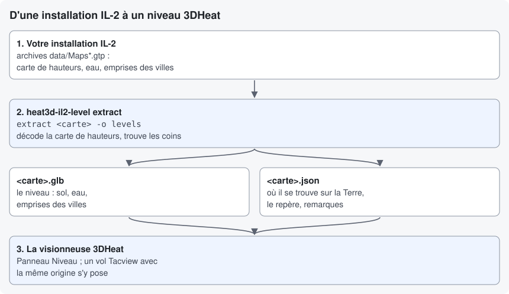

# 3DHeat IL-2 {#dheat-il-2}

**Qu'est-ce que c'est ?** Un petit programme qui transforme les cartes d'**IL-2 Sturmovik :
Great Battles**, lues depuis **votre propre installation**, en modèles 3D - des niveaux -
au-dessus desquels vous pouvez voler dans la visionneuse [3DHeat](https://github.com/Holdi601/3DHeat)
([documentation](https://holdi601.github.io/3DHeat/)) : les collines, les rivières,
les lacs, la mer et les villes, posés là où ils se trouvent sur la Terre. Un second jeu IL-2
dont les archives cachent leur table des fichiers est lu dans la mesure où elles le permettent
([détails](archives-without-table.md)).

**À quoi ça sert ?** À voir vos vols IL-2 sur la carte propre au jeu.

**Exemple :** `heat3d-il2-level extract <carte> -o levels` ->
`levels/<carte>/<carte>.glb` (le niveau) + `<carte>.json` (où il se trouve sur
la Terre). Une carte de hauteurs est une grille de hauteurs, comme une carte en relief ; un
enregistrement Tacview est un fichier de vol écrit par Tacview.

À quoi il sert :

- **Des vols sur la carte propre au jeu.** Un enregistrement Tacview d'IL-2, converti par
  le 3DHeat Watcher avec la même origine, se pose sur le niveau sans étape de placement.
- **Toutes les cartes à la fois.** `extract --all` écrit chaque carte trouvée ; les saisons qui
  partagent une carte de hauteurs ne sont écrites qu'une fois.
- **Où sur la Terre.** Le `.json` de chaque niveau contient ses coins et sa boîte
  latitude/longitude, et la manière dont ils ont été trouvés.



## Démarrage rapide {#quick-start}

Vous débutez avec la ligne de commande ? Lisez d'abord [Avant de commencer](before-you-start.md).
Lancez ces commandes dans le dossier que vous avez cloné ou décompressé :

```bash
python -m pip install -e .                         # installe la commande heat3d-il2-level
python -m pip install -e .[fast]                            # avec numba : décodage 20 à 50 fois plus rapide
heat3d-il2-level list                              # chaque carte trouvée, avec sa boîte latitude/longitude
heat3d-il2-level extract <carte> -o levels         # une carte (noms tels que `list` les affiche, jokers permis)
heat3d-il2-level extract --all -o levels           # toutes les cartes
```

Vous devez voir une ligne par carte avec `list`, et `ok ...` avec `extract`.
Chargez ensuite `levels/<carte>/<carte>.glb` dans le panneau Arrière-plan / niveau de la visionneuse
([Niveaux](https://holdi601.github.io/3DHeat/levels.html)).

Les niveaux écrits sont construits à partir des données du jeu : ils restent **sur votre
ordinateur** ; ne les publiez jamais ([Conditions](terms.md)).

## Pages {#pages}

| Page | Ce qu'elle explique |
|---|---|
| [Avant de commencer](before-you-start.md) | Python, un terminal, un premier essai |
| [Trouver les cartes : list](list.md) | où les installations sont trouvées, ce qu'affiche `list` |
| [Construire les niveaux : extract](extract.md) | chaque option, pas à pas, des exemples |
| [Les fichiers de niveau et les repères](output.md) | les parties `.glb`, le `.json`, les repères `enu` et `game` |
| [Comment les fichiers sont lus](reading.md) | archives, codec des cartes de hauteurs, eau, villes, ajustements par repères |
| [Archives sans table des fichiers](archives-without-table.md) | le second jeu, lu dans la mesure où ses archives le permettent |
| [Vitesse, tests, conditions](terms.md) | numba, les tests, les conditions du jeu, la licence |
| [Référence des commandes](../cli-reference.md) | chaque option, générée depuis le code |
| [Maintenir ces documents](maintaining.md) | la liste de contrôle des versions |

## Voir aussi {#related}

- La visionneuse 3DHeat : [github.com/Holdi601/3DHeat](https://github.com/Holdi601/3DHeat),
  documentation sur [holdi601.github.io/3DHeat](https://holdi601.github.io/3DHeat/).
- Télémétrie pour ces niveaux : le [3DHeat Watcher](https://holdi601.github.io/3DHeat-Watcher/)
  convertit les enregistrements Tacview d'IL-2 ; les formats de fichiers de la visionneuse, dont son
  conteneur d'un fichier par partie, sont décrits dans
  [Un fichier par partie (.3dheat)](https://holdi601.github.io/3DHeat/container.html).

## Les outils 3DHeat {#the-3dheat-tools}

| Outil | Ce qu'il fait | Code | Documentation |
|---|---|---|---|
| Visionneuse 3DHeat | affiche les données : cartes de chaleur, analyse de course, revue de partie | [3DHeat](https://github.com/Holdi601/3DHeat) | [documentation](https://holdi601.github.io/3DHeat/) |
| GameFiles | niveaux et circuits tirés des fichiers du jeu | [3DHeat-GameFiles](https://github.com/Holdi601/3DHeat-GameFiles) | [documentation](https://holdi601.github.io/3DHeat-GameFiles/) |
| GameCapture | télémétrie de tour, et niveaux reconstruits à partir de vidéos de jeu | [3DHeat-GameCapture](https://github.com/Holdi601/3DHeat-GameCapture) | [documentation](https://holdi601.github.io/3DHeat-GameCapture/) |
| Unreal Exporter | un plugin de l'éditeur Unreal : un niveau en un seul `.glb` | [3DHeat-UnrealExporter](https://github.com/Holdi601/3DHeat-UnrealExporter) | [documentation](https://holdi601.github.io/3DHeat-UnrealExporter/) |
| CS2 | démos et cartes de Counter-Strike 2 | [3DHeat-CS2](https://github.com/Holdi601/3DHeat-CS2) | [documentation](https://holdi601.github.io/3DHeat-CS2/) |
| Watcher | enregistre ce que les jeux publient pendant que vous jouez | [3DHeat-Watcher](https://github.com/Holdi601/3DHeat-Watcher) | [documentation](https://holdi601.github.io/3DHeat-Watcher/) |
| Ext-WarThunder | replays de War Thunder | [3DHeat-Ext-WarThunder](https://github.com/Holdi601/3DHeat-Ext-WarThunder) | [documentation](https://holdi601.github.io/3DHeat-Ext-WarThunder/) |
| Ext-WoT | replays de World of Tanks | [3DHeat-Ext-WoT](https://github.com/Holdi601/3DHeat-Ext-WoT) | [documentation](https://holdi601.github.io/3DHeat-Ext-WoT/) |
| Ext-WoWs | replays de World of Warships | [3DHeat-Ext-WoWs](https://github.com/Holdi601/3DHeat-Ext-WoWs) | [documentation](https://holdi601.github.io/3DHeat-Ext-WoWs/) |
| Ext-Squad | démos de serveurs Squad | [3DHeat-Ext-Squad](https://github.com/Holdi601/3DHeat-Ext-Squad) | [documentation](https://holdi601.github.io/3DHeat-Ext-Squad/) |
| Ext-DCS | cartes de DCS World sous forme de niveaux 3D | [3DHeat-Ext-DCS](https://github.com/Holdi601/3DHeat-Ext-DCS) | [documentation](https://holdi601.github.io/3DHeat-Ext-DCS/) |
| Ext-IL2 | cartes d'IL-2 Sturmovik sous forme de niveaux 3D | [3DHeat-Ext-IL2](https://github.com/Holdi601/3DHeat-Ext-IL2) | [documentation](https://holdi601.github.io/3DHeat-Ext-IL2/) |
