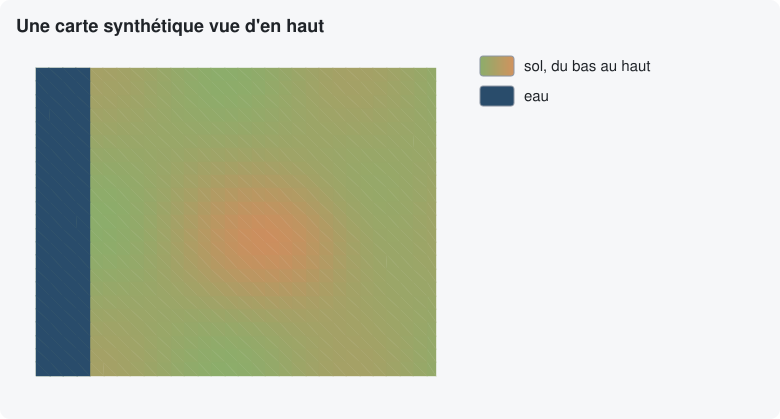

# Les fichiers de niveau et les repères {#the-level-files-and-frames}

`<out>/<carte>/<carte>.glb` (le niveau : un modèle 3D du sol) et `<carte>.json`
à côté. Le glb est écrit dans `<carte>.glb.part`, puis renommé une fois terminé.

| Partie | Ce que c'est |
|---|---|
| `ground:<carte>` | la carte de hauteurs du terrain sous forme de grille, au plus `--max-grid` échantillons par côté (1024 par défaut : environ 2 millions de triangles) |
| `water:<carte>` | rivières, lacs et mer : des quadrilatères plats à la hauteur de l'eau, un par case de grille dont assez d'échantillons de la carte de hauteurs sont sous l'eau (un tiers avec le masque d'eau de la carte, la moitié sans) |
| `ground:<carte> towns` | les emprises bâties des villes et villages, posées à 1,5 m au-dessus du sol |

Le JSON contient les **coins de la carte et sa boîte latitude/longitude** (`corners`,
`extent`), la manière dont ils ont été trouvés (`georeference`), les réglages de hauteur
(`heightMul`, `SeaLevel`), la zone de jeu en mètres du jeu (`playArea`), le repère et son
origine (`frame`, `geo`), le nombre de triangles et les `notes` éventuelles.

## Repères {#frames}

Deux repères, `--frame` :

- `enu` (par défaut) : mètres vers l'est, altitude au-dessus du niveau de la mer, et vers le nord par rapport à une origine,
  sur le plan tangent WGS-84 : la carte plate dans laquelle le 3DHeat Watcher place un enregistrement
  Tacview d'IL-2 (x vers l'est, y altitude, z vers le nord, dessiné avec z en miroir). Le glb
  stocke (est, altitude, -nord). Convertissez avec `--origin <lat> <lon>` défini sur le `geo` d'un
  enregistrement (son point de référence de session) : l'enregistrement se pose sur le niveau sans étape de placement ;
  sans cela, le centre de la carte sert d'origine, et le `geo` du JSON indique laquelle.
- `game` : les mètres propres au jeu, comme dans les fichiers de mission : x vers le nord depuis le bord sud, y la hauteur du jeu,
  z vers l'est depuis le bord ouest (droitier tel quel, donc glb = (x, y, z)). Les cartes qui ne peuvent pas être posées sur la
  Terre sont écrites dans ce repère quoi qu'on demande, avec une note.

Le niveau est un binaire glTF avec des parties nommées, comme tout niveau 3DHeat ; la page
[Niveaux](https://holdi601.github.io/3DHeat/levels.html) de la visionneuse explique comment il les charge.
