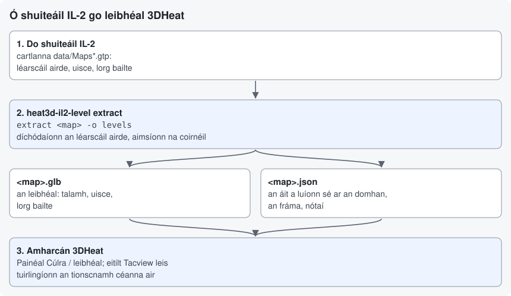

# 3DHeat IL-2 {#dheat-il-2}

**Cad é?** Clár beag a thiontaíonn léarscáileanna **IL-2 Sturmovik:
Great Battles**, léite ó **do shuiteáil féin**, ina samhlacha 3D - leibhéil -
a fhéadann tú eitilt os a gcionn san amharcán [3DHeat](https://github.com/Holdi601/3DHeat)
([doiciméadúchán](https://holdi601.github.io/3DHeat/)): na cnoic, aibhneacha,
locha, farraige agus bailte, curtha san áit a luíonn siad ar an domhan. Léitear dara cluiche IL-2
a bhfolaíonn a chartlanna a dtábla comhad chomh fada agus a ligeann siad
([sonraí](archives-without-table.md)).

**Cén fáth a n-úsáidfinn é?** Chun d'eitiltí IL-2 a fheiceáil thar léarscáil an chluiche féin.

**Sampla:** `heat3d-il2-level extract <map> -o levels` ->
`levels/<map>/<map>.glb` (an leibhéal) + `<map>.json` (an áit a luíonn sé ar an
domhan). Is greille airdí é léarscáil airde (heightmap), cosúil le léarscáil faoisimh; is comhad d'eitilt é taifeadadh Tacview
a scríobhann Tacview.

Cad chuige a bhfuil sé úsáideach:

- **Eitiltí ar léarscáil an chluiche féin.** Tuirlingíonn taifeadadh Tacview IL-2, tiontaithe ag
  3DHeat Watcher leis an tionscnamh céanna, ar an leibhéal gan aon chéim chuir i bhfeidhm.
- **Gach léarscáil in aon turas.** Scríobhann `extract --all` gach léarscáil a aimsítear; scríobhtar séasúir a
  roinneann léarscáil airde uair amháin.
- **An áit ar an domhan.** Iompraíonn `.json` gach leibhéil a choirnéil agus a bhosca
  domhanleithid/domhanfhad, agus conas a aimsíodh iad.



## Tús tapa {#quick-start}

An bhfuil tú nua leis an líne ordaithe? Léigh [Sula dtosaíonn tú](before-you-start.md) ar dtús.
Rith iad seo san fhillteán a chlónáil nó a dhízipeáil tú:

```bash
python -m pip install -e .                         # installs the heat3d-il2-level command
python -m pip install -e .[fast]                            # with numba: decoding 20 to 50 times faster
heat3d-il2-level list                              # every map found, with its latitude/longitude box
heat3d-il2-level extract <map> -o levels           # one map (names as `list` prints them, wildcards allowed)
heat3d-il2-level extract --all -o levels           # every map
```

Ba chóir duit líne in aghaidh na léarscáile a fheiceáil ó `list`, agus `ok ...` ó `extract`.
Ansin lódáil `levels/<map>/<map>.glb` i bpainéal Cúlra / leibhéal an amharcáin
([Leibhéil](https://holdi601.github.io/3DHeat/levels.html)).

Tógtar na leibhéil a scríobhann sé ó shonraí an chluiche: fanann siad **ar do
mheaisín**; ná foilsigh iad choíche ([Téarmaí](terms.md)).

## Leathanaigh {#pages}

| Leathanach | Cad a chlúdaíonn sé |
|---|---|
| [Sula dtosaíonn tú](before-you-start.md) | Python, teirminéal, céad rith |
| [Léarscáileanna a aimsiú: list](list.md) | an áit a n-aimsítear na suiteálacha, cad a phriontálann `list` |
| [Leibhéil a thógáil: extract](extract.md) | gach rogha, céim ar chéim, samplaí |
| [Comhaid agus fráma an leibhéil](output.md) | codanna an `.glb`, an `.json`, na frámaí `enu` agus `game` |
| [Conas a léitear na comhaid](reading.md) | cartlanna, cód na léarscáile airde, uisce, bailte, feistiú tírdhreacha |
| [Cartlanna gan tábla comhad](archives-without-table.md) | an dara cluiche, léite chomh fada agus a ligeann a chartlanna |
| [Luas, tástálacha, téarmaí](terms.md) | numba, na tástálacha, téarmaí an chluiche, ceadúnas |
| [Tagairt orduithe](../cli-reference.md) | gach rogha, ginte ón gcód |
| [Na doiciméid seo a chothabháil](maintaining.md) | an seicliosta eisiúna |

## Gaolmhar {#related}

- An t-amharcán 3DHeat: [github.com/Holdi601/3DHeat](https://github.com/Holdi601/3DHeat),
  doiciméadúchán ag [holdi601.github.io/3DHeat](https://holdi601.github.io/3DHeat/).
- Telemetry do na leibhéil seo: tiontaíonn [3DHeat Watcher](https://holdi601.github.io/3DHeat-Watcher/)
  taifeadtaí Tacview IL-2; tá formáidí comhad an amharcáin, lena n-áirítear a
  choimeádán comhad-amháin-in-aghaidh-an-chluiche, curtha síos in
  [Comhad amháin in aghaidh an chluiche (.3dheat)](https://holdi601.github.io/3DHeat/container.html).

## Uirlisí 3DHeat {#the-3dheat-tools}

| Uirlis | Cad a dhéanann sí | Cód | Doiciméid |
|---|---|---|---|
| Amharcán 3DHeat | taispeánann sé na sonraí: léarscáileanna teasa, anailís rása, athbhreithniú cluiche | [3DHeat](https://github.com/Holdi601/3DHeat) | [docs](https://holdi601.github.io/3DHeat/) |
| GameFiles | leibhéil agus cúrsaí ó chomhaid féin cluiche | [3DHeat-GameFiles](https://github.com/Holdi601/3DHeat-GameFiles) | [docs](https://holdi601.github.io/3DHeat-GameFiles/) |
| GameCapture | telemetry cuarta, agus leibhéil atógtha ó fhíseán cluiche | [3DHeat-GameCapture](https://github.com/Holdi601/3DHeat-GameCapture) | [docs](https://holdi601.github.io/3DHeat-GameCapture/) |
| Unreal Exporter | breiseán d'Unreal Editor: leibhéal mar `.glb` amháin | [3DHeat-UnrealExporter](https://github.com/Holdi601/3DHeat-UnrealExporter) | [docs](https://holdi601.github.io/3DHeat-UnrealExporter/) |
| CS2 | demos agus léarscáileanna Counter-Strike 2 | [3DHeat-CS2](https://github.com/Holdi601/3DHeat-CS2) | [docs](https://holdi601.github.io/3DHeat-CS2/) |
| Watcher | taifeadann sé an méid a fhoilsíonn cluichí agus tú ag imirt | [3DHeat-Watcher](https://github.com/Holdi601/3DHeat-Watcher) | [docs](https://holdi601.github.io/3DHeat-Watcher/) |
| Ext-WarThunder | athsheinmeanna War Thunder | [3DHeat-Ext-WarThunder](https://github.com/Holdi601/3DHeat-Ext-WarThunder) | [docs](https://holdi601.github.io/3DHeat-Ext-WarThunder/) |
| Ext-WoT | athsheinmeanna World of Tanks | [3DHeat-Ext-WoT](https://github.com/Holdi601/3DHeat-Ext-WoT) | [docs](https://holdi601.github.io/3DHeat-Ext-WoT/) |
| Ext-WoWs | athsheinmeanna World of Warships | [3DHeat-Ext-WoWs](https://github.com/Holdi601/3DHeat-Ext-WoWs) | [docs](https://holdi601.github.io/3DHeat-Ext-WoWs/) |
| Ext-Squad | demos freastalaí Squad | [3DHeat-Ext-Squad](https://github.com/Holdi601/3DHeat-Ext-Squad) | [docs](https://holdi601.github.io/3DHeat-Ext-Squad/) |
| Ext-DCS | léarscáileanna DCS World mar leibhéil 3D | [3DHeat-Ext-DCS](https://github.com/Holdi601/3DHeat-Ext-DCS) | [docs](https://holdi601.github.io/3DHeat-Ext-DCS/) |
| Ext-IL2 | léarscáileanna IL-2 Sturmovik mar leibhéil 3D | [3DHeat-Ext-IL2](https://github.com/Holdi601/3DHeat-Ext-IL2) | [docs](https://holdi601.github.io/3DHeat-Ext-IL2/) |
