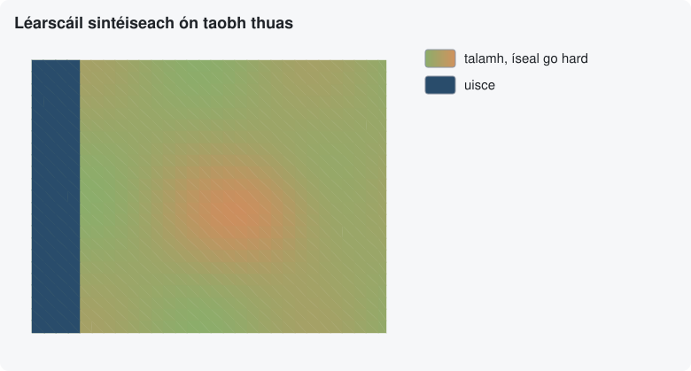

# Comhaid agus fráma an leibhéil {#the-level-files-and-frames}

`<out>/<map>/<map>.glb` (an leibhéal: samhail 3D den talamh) agus `<map>.json`
lena thaobh. Scríobhtar an glb chuig
`<map>.glb.part` agus athainmnítear é nuair a bhíonn sé críochnaithe.

| Cuid | Cad é |
|---|---|
| `ground:<map>` | léarscáil airde an tír-raoin mar ghreille, `--max-grid` sampla in aghaidh an taoibh ar a mhéad (réamhshocrú 1024: thart ar 2 mhilliún triantán) |
| `water:<map>` | aibhneacha, locha agus farraige: ceathairshleasáin chothroma ag airde an uisce, ceann in aghaidh gach cille greille a bhfuil go leor dá samplaí léarscáile airde faoin uisce (tríú cuid le masc uisce na léarscáile, leath gan é) |
| `ground:<map> towns` | lorg thógtha na mbailte agus na sráidbhailte, drapáilte 1.5 m os cionn na talún |

Coinníonn an JSON **coirnéil agus bosca domhanleithid/domhanfhad** na léarscáile (`corners`,
`extent`), conas a aimsíodh iad (`georeference`), socruithe na haird
(`heightMul`, `SeaLevel`), an limistéar súgartha i méadair an chluiche (`playArea`), an
fráma agus a thionscnamh (`frame`, `geo`), líon na dtriantán agus aon `notes`.

## Frámaí {#frames}

Dhá fhráma, `--frame`:

- `enu` (réamhshocrú): méadair soir, airde os cionn leibhéal na farraige, ó thuaidh de thionscnamh ar
  phlána tadhlaí WGS-84: an léarscáil chothrom a chuireann 3DHeat Watcher taifeadadh Tacview IL-2
  ann (x soir, y airde, z ó thuaidh, tarraingthe le z scáthánaithe). Stórálann an glb
  (soir, airde, -ó thuaidh). Tiontaigh le `--origin <lat> <lon>` socraithe do
  `geo` taifeadta (pointe tagartha a sheisiúin) agus tuirlingíonn an taifeadadh ar
  an leibhéal gan aon chéim chuir i bhfeidhm; gan é is é lár na léarscáile an tionscnamh,
  agus deir `geo` an JSON cé acu.
- `game`: méadair an chluiche féin mar atá ag comhaid mhisin: x ó thuaidh ó imeall
  na ndeisceart, y airde an chluiche, z soir ó imeall an iarthair (deaschiallach mar atá,
  mar sin glb = (x, y, z)). Scríobhtar léarscáileanna nach féidir a chur ar an domhan sa
  fhráma seo is cuma cad a iarradh, le nóta.

Is glTF dénártha le codanna ainmnithe é an leibhéal, mar atá gach leibhéal 3DHeat; insíonn leathanach
[Leibhéil](https://holdi601.github.io/3DHeat/levels.html) an lucht féachana conas a lódálann sé iad.
