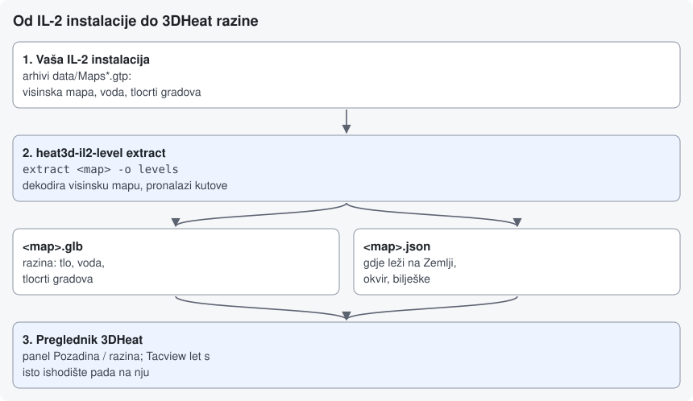

# 3DHeat IL-2 {#dheat-il-2}

**Što je to?** Mali program koji pretvara karte **IL-2 Sturmovik: Great Battles**, čitane iz **vaše vlastite instalacije**, u 3D modele - razine - preko kojih možete letjeti u [3DHeat](https://github.com/Holdi601/3DHeat) pregledniku
([dokumentacija](https://holdi601.github.io/3DHeat/)): brda, rijeke, jezera, more i gradove, postavljene tamo gdje leže na Zemlji. Druga IL-2 igra čiji arhivi skrivaju svoju tablicu datoteka čita se koliko arhivi dopuštaju ([detalji](archives-without-table.md)).

**Zašto bih ga koristio?** Da vidite svoje IL-2 letove preko same igrine karte.

**Primjer:** `heat3d-il2-level extract <map> -o levels` ->
`levels/<map>/<map>.glb` (razina) + `<map>.json` (gdje leži na
Zemlji). Visinska mapa je mreža visina, kao reljefna karta; Tacview snimka je datoteka leta koju piše Tacview.

Za što je korisno:

- **Letovi na igrinoj vlastitoj karti.** IL-2 Tacview snimka, pretvorena programom 3DHeat Watcher s istim ishodištem, pada na razinu bez koraka postavljanja.
- **Sve karte odjednom.** `extract --all` piše svaku pronađenu kartu; sezone koje dijele istu visinsku mapu zapisuju se jednom.
- **Gdje je na Zemlji.** `.json` svake razine nosi njezine kutove i okvir geografske širine/dužine te način na koji su pronađeni.



## Brzi početak {#quick-start}

Ne znate ništa o naredbenom retku? Prvo pročitajte [Prije nego što počnete](before-you-start.md).
Pokrenite ove naredbe u mapi u koju ste klonirali ili raspakirali alat:

```bash
python -m pip install -e .                         # instalira naredbu heat3d-il2-level
python -m pip install -e .[fast]                            # s numbom: dekodiranje 20 do 50 puta brže
heat3d-il2-level list                              # svaka pronađena karta, s okvirom geografske širine/dužine
heat3d-il2-level extract <map> -o levels           # jedna karta (imena kako ih ispisuje `list`, zamjenski znakovi dopušteni)
heat3d-il2-level extract --all -o levels           # svaka karta
```

Trebali biste vidjeti redak po karti iz `list`, a iz `extract` redak `ok ...`.
Zatim učitajte `levels/<map>/<map>.glb` u panel Pozadina / razina preglednika
([Razine](https://holdi601.github.io/3DHeat/levels.html)).

Razine koje alat piše izrađene su iz podataka igre, pa **ostaju na vašem računalu**; nikad ih ne objavljujte ([Uvjeti](terms.md)).

## Stranice {#pages}

| Stranica | Što obuhvaća |
|---|---|
| [Prije nego što počnete](before-you-start.md) | Python, terminal, prvo pokretanje |
| [Pronalaženje karata: list](list.md) | gdje se instalacije nalaze, što ispisuje `list` |
| [Izrada razina: extract](extract.md) | svaka opcija, korak po korak, primjeri |
| [Datoteke razine i okviri](output.md) | `.glb` dijelovi, `.json`, okviri `enu` i `game` |
| [Kako se datoteke čitaju](reading.md) | arhivi, kodek visinske mape, voda, gradovi, prilagodbe prema orijentirima |
| [Arhivi bez tablice datoteka](archives-without-table.md) | druga igra, čitana koliko njezini arhivi dopuštaju |
| [Brzina, testovi, uvjeti](terms.md) | numba, testovi, uvjeti igre, licenca |
| [Referenca naredbi](../cli-reference.md) | svaka opcija, generirano iz koda |
| [Održavanje ovih stranica](maintaining.md) | popis za izdavanje verzije |

## Povezano {#related}

- Preglednik 3DHeat: [github.com/Holdi601/3DHeat](https://github.com/Holdi601/3DHeat),
  dokumentacija na [holdi601.github.io/3DHeat](https://holdi601.github.io/3DHeat/).
- Telemetrija za ove razine: [3DHeat Watcher](https://holdi601.github.io/3DHeat-Watcher/)
  pretvara IL-2 Tacview snimke; formati datoteka preglednika, uključujući spremnik jedne datoteke po meču, opisani su u
  [Jedna datoteka po meču (.3dheat)](https://holdi601.github.io/3DHeat/container.html).

## Alati 3DHeat {#the-3dheat-tools}

| Alat | Što radi | Kod | Dokumentacija |
|---|---|---|---|
| Preglednik 3DHeat | prikazuje podatke: toplinske karte, analizu utrka, pregled meča | [3DHeat](https://github.com/Holdi601/3DHeat) | [dokumentacija](https://holdi601.github.io/3DHeat/) |
| GameFiles | razine i staze iz vlastitih datoteka igre | [3DHeat-GameFiles](https://github.com/Holdi601/3DHeat-GameFiles) | [dokumentacija](https://holdi601.github.io/3DHeat-GameFiles/) |
| GameCapture | telemetrija krugova i razine rekonstruirane iz snimke igranja | [3DHeat-GameCapture](https://github.com/Holdi601/3DHeat-GameCapture) | [dokumentacija](https://holdi601.github.io/3DHeat-GameCapture/) |
| Unreal Exporter | dodatak za Unreal Editor: razina kao jedna `.glb` datoteka | [3DHeat-UnrealExporter](https://github.com/Holdi601/3DHeat-UnrealExporter) | [dokumentacija](https://holdi601.github.io/3DHeat-UnrealExporter/) |
| CS2 | demoi i mape Counter-Strike 2 | [3DHeat-CS2](https://github.com/Holdi601/3DHeat-CS2) | [dokumentacija](https://holdi601.github.io/3DHeat-CS2/) |
| Watcher | bilježi ono što igre objavljuju dok igrate | [3DHeat-Watcher](https://github.com/Holdi601/3DHeat-Watcher) | [dokumentacija](https://holdi601.github.io/3DHeat-Watcher/) |
| Ext-WarThunder | War Thunder replay-i | [3DHeat-Ext-WarThunder](https://github.com/Holdi601/3DHeat-Ext-WarThunder) | [dokumentacija](https://holdi601.github.io/3DHeat-Ext-WarThunder/) |
| Ext-WoT | World of Tanks replay-i | [3DHeat-Ext-WoT](https://github.com/Holdi601/3DHeat-Ext-WoT) | [dokumentacija](https://holdi601.github.io/3DHeat-Ext-WoT/) |
| Ext-WoWs | World of Warships replay-i | [3DHeat-Ext-WoWs](https://github.com/Holdi601/3DHeat-Ext-WoWs) | [dokumentacija](https://holdi601.github.io/3DHeat-Ext-WoWs/) |
| Ext-Squad | demoi Squad servera | [3DHeat-Ext-Squad](https://github.com/Holdi601/3DHeat-Ext-Squad) | [dokumentacija](https://holdi601.github.io/3DHeat-Ext-Squad/) |
| Ext-DCS | DCS World karte kao 3D razine | [3DHeat-Ext-DCS](https://github.com/Holdi601/3DHeat-Ext-DCS) | [dokumentacija](https://holdi601.github.io/3DHeat-Ext-DCS/) |
| Ext-IL2 | karte IL-2 Sturmovik kao 3D razine | [3DHeat-Ext-IL2](https://github.com/Holdi601/3DHeat-Ext-IL2) | [dokumentacija](https://holdi601.github.io/3DHeat-Ext-IL2/) |
