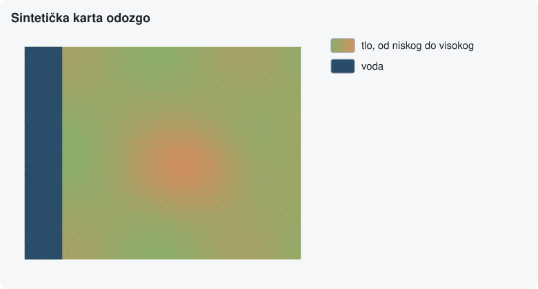

# Datoteke razine i okviri {#the-level-files-and-frames}

`<out>/<map>/<map>.glb` (razina: 3D model tla) i `<map>.json` uz nju. Glb se piše u
`<map>.glb.part` i preimenuje kad je gotov.

| Dio | Što je |
|---|---|
| `ground:<map>` | visinska mapa terena kao mreža, najviše `--max-grid` uzoraka po stranici (zadano 1024: oko 2 milijuna trokuta) |
| `water:<map>` | rijeke, jezera i more: ravni četverokuti na visini vode, jedan po ćeliji mreže čiji uzorci visinske mape leže dovoljno pod vodom (trećina uz masku vode karte, polovica bez nje) |
| `ground:<map> towns` | izgrađeni tlocrti gradova i sela, položeni 1,5 m iznad tla |

`.json` sadrži **kutove i okvir geografske širine/dužine** karte (`corners`,
`extent`), kako su pronađeni (`georeference`), postavke visine (`heightMul`, `SeaLevel`), područje igre u metrima igre (`playArea`), okvir i njegovo ishodište (`frame`, `geo`), brojeve trokuta i sve `notes`.

## Okviri {#frames}

Dva okvira, `--frame`:

- `enu` (zadano): metri istočno, nadmorska visina iznad mora, sjeverno od ishodišta na
  WGS-84 tangencijalnoj ravnini: ravna karta u koju program 3DHeat Watcher stavlja IL-2
  Tacview snimku (x istok, y visina, z sjever, crtano sa zrcaljenim z). Glb
  sprema (istok, visina, -sjever). Postavite `--origin <lat> <lon>` na `geo` snimke (referentnu točku njezine sesije) i snimka pada na razinu bez koraka postavljanja; bez toga je središte karte ishodište, a `geo` u JSON-u kaže koje.
- `game`: vlastiti metri igre kako ih imaju datoteke misija: x sjever od južnog ruba, y visina igre, z istok od zapadnog ruba (desnoruko kakvo jest, pa je glb = (x, y, z)). Karte koje se ne mogu smjestiti na Zemlju zapisuju se u ovom okviru bez obzira na to što je traženo, uz napomenu.

Razina je glTF binarna datoteka s imenovanim dijelovima, kao i svaka 3DHeat razina; stranica preglednika
[Razine](https://holdi601.github.io/3DHeat/levels.html) kaže kako ih učitava.
