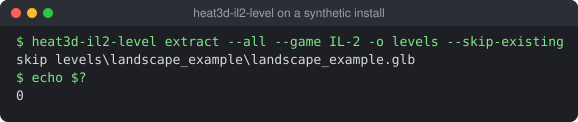

# Pályák építése: `extract` {#building-levels-extract}

```text
heat3d-il2-level extract (<map> ... | --all) -o <folder> [--game FOLDER ...]
                 [--max-grid N] [--frame enu|game] [--origin LAT LON]
                 [--no-water] [--no-towns] [--skip-existing]
```

## Lépésről lépésre {#step-by-step}

Még nem használt parancssort? Előbb olvasd el a [Mielőtt elkezded](before-you-start.md) oldalt.

1. Keresd meg a térkép nevét a [`list`](list.md) paranccsal.
2. Futtasd a `heat3d-il2-level extract <map> -o levels` parancsot. A nevekben lehet helyettesítő karakter,
   idézőjelek között (`"<family>_*"`); az `--all` minden térképet átvesz.
3. Ha egy felvételt elhelyezési lépés nélkül szeretnél a pályára tenni, add meg a kiindulópontját:
   `--origin <lat> <lon>`, a felvétel `geo` értékével (a munkamenetének referenciapontjával). Ennek hiányában
   a térkép közepe lesz a kiindulópont, és a `.json` `geo` mezője mondja meg, melyik.
4. A parancs térképenként egy sort ír ki, ahogy dekódolja, majd `ok <glb> <triangles> (<frame> frame)` vagy
   `failed <map>: <why>` sorokat.
5. Töltsd be a `<folder>/<map>/<map>.glb` fájlt a megjelenítő Háttér / pálya paneljén.


A játék saját méterében, víz nélkül:


Egy második futtatás már megírt térképeken:



## Kapcsolók {#options}

| Kapcsoló | Alapérték | Mit csinál |
|---|---|---|
| `maps` | - | térképnevek, ahogy a `list` kiírja; helyettesítő karakterek megengedettek |
| `--all` | ki | minden térkép; az olyan évszakok, amelyek ugyanazt a magassági- és víztérképet használják, egyszer íródnak ki |
| `-o`, `--out` | kötelező | a kimeneti mappa; minden térkép a `<out>/<map>/` mappába kerül |
| `--game FOLDER` | megtalálva | egy IL-2 mappa (ismételhető) |
| `--max-grid N` | `1024` | a magassági térkép legfeljebb ennyi mintavétele egy oldalon (1024: körülbelül 2 millió háromszög); a térképet minden *k*-adik mintán vesszük, hogy beleférjen |
| `--frame` `enu` vagy `game` | `enu` | `enu`: méter kelet felé, magasság, észak felé a `--origin`-hoz képest, mint a Watcher Tacview-táblázatai; `game`: a játék saját méterei (x észak, y fölfelé, z kelet). Ami nem helyezhető el a földön, az `game` keretben íródik, bármit kér is |
| `--origin LAT LON` | a térkép közepe | az `enu` keret kiindulópontja (egy felvétel `geo` értéke) |
| `--no-water` | ki | a víz kihagyása |
| `--no-towns` | ki | a városok alaprajzának kihagyása |
| `--skip-existing` | ki | azok a térképek, amelyeknek a `.glb` fájlja már létezik, kimaradnak |

Minden kapcsoló úgy, ahogy a program kiírja: [Parancsleírás](../cli-reference.md).

A `HEAT3D_DEBUG` beállításával egy sikertelen térkép teljes hibakövetése kiíródik. A `.glb` a
`<map>.glb.part` fájlba íródik, és amikor kész, átnevezésre kerül.

Kilépési állapot: 0, ha minden térkép megíródott; 1, ha bármelyik nem sikerült (a többi attól még megíródik);
2, ha nincs telepítés, vagy egy térkép sem egyezett.

## Példák {#examples}

```bash
heat3d-il2-level extract <map> -o levels                         # egy térkép, enu keret a középpontja körül
heat3d-il2-level extract <map> --origin <lat> <lon> -o levels    # egy olyan felvétel lapos térképében, amelynek ez a geo
heat3d-il2-level extract "<family>_*" --max-grid 2048 -o levels  # finomabb, több térkép
heat3d-il2-level extract --all --skip-existing -o levels         # minden térkép, csak az újak
heat3d-il2-level extract <map> --frame game -o levels            # a játék saját méterei, ahogy a küldetésfájlok tartják
```

Mi van a fájlokban: [A pályafájlok és a keretek](output.md).
