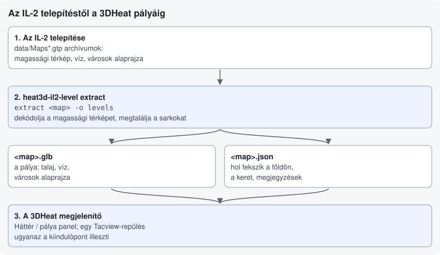

# 3DHeat IL-2 {#dheat-il-2}

**Mi ez?** Egy kis program, amely az **IL-2 Sturmovik: Great Battles** térképeit, amelyeket **az Ön
saját telepítéséből** olvas be, 3D modellekké alakítja – pályákká –, amelyek felett repülni lehet a
[3DHeat](https://github.com/Holdi601/3DHeat) megjelenítőben
([dokumentáció](https://holdi601.github.io/3DHeat/)): a dombok, folyók, tavak, a tenger és a városok,
ott, ahol a földön fekszenek. Egy második IL-2-játék, amelynek archívumai elrejtik a fájltáblázatukat,
annyira olvasódik, amennyire az archívumok engedik ([részletek](archives-without-table.md)).

**Mire jó?** Hogy az IL-2-repüléseit a játék saját térképén lássa.

**Példa:** `heat3d-il2-level extract <map> -o levels` ->
`levels/<map>/<map>.glb` (a pálya) + `<map>.json` (hol fekszik a földön). A magassági térkép
magasságok rácsa, mint egy domborzati térkép; a Tacview-felvétel olyan fájl, amelyet a Tacview ír
egy repülésről.

Mire használható:

- **Repülések a játék saját térképén.** Egy IL-2 Tacview-felvétel, amelyet a 3DHeat Watcher ugyanazzal
  a kiindulóponttal alakít át, illeszkedik a pályára elhelyezési lépés nélkül.
- **Minden térkép egyszerre.** Az `extract --all` minden megtalált térképet kiír; az olyan évszakok, amelyek
  ugyanazt a magassági térképet használják, egyszer íródnak ki.
- **Hol van a földön.** Minden pálya `.json` fájlja tartalmazza a sarkait és a szélességi/hosszúsági fok
  dobozát, és azt, hogyan találták meg őket.



## Gyors kezdés {#quick-start}

Még nem használt parancssort? Előbb olvassa el a [Mielőtt elkezdi](before-you-start.md) oldalt.
Ezeket a mappában futtassa, ahová klónozta vagy kicsomagolta:

```bash
python -m pip install -e .                         # telepíti a heat3d-il2-level parancsot
python -m pip install -e .[fast]                            # numba-val: a dekódolás 20-50-szer gyorsabb
heat3d-il2-level list                              # minden megtalált térkép, a szélességi/hosszúsági fok dobozával
heat3d-il2-level extract <map> -o levels           # egy térkép (a nevek úgy, ahogy a `list` írja, helyettesítő karakterekkel is)
heat3d-il2-level extract --all -o levels           # minden térkép
```

A `list` térképenként egy sort ír ki, az `extract` pedig `ok ...` sorokat. Ezután töltse be a
`levels/<map>/<map>.glb` fájlt a megjelenítő Háttér / pálya paneljén
([Pályák](https://holdi601.github.io/3DHeat/levels.html)).

Az általa írt pályák a játék adataiból készülnek, ezért **az Ön gépén maradnak**; soha ne tegye közzé
([Feltételek](terms.md)).

## Oldalak {#pages}

| Oldal | Mit tartalmaz |
|---|---|
| [Mielőtt elkezdi](before-you-start.md) | Python, egy terminál, az első futtatás |
| [Térképek keresése: list](list.md) | hol találhatók a telepítések, mit ír ki a `list` |
| [Pályák építése: extract](extract.md) | minden kapcsoló, lépésről lépésre, példák |
| [A pályafájlok és a keretek](output.md) | a `.glb` részei, a `.json`, az `enu` és a `game` keret |
| [Hogyan olvasódnak be a fájlok](reading.md) | archívumok, a magassági térkép kódolása, víz, városok, tájékozódó illesztések |
| [Archívumok fájltáblázat nélkül](archives-without-table.md) | a második játék, amennyire az archívumai engedik |
| [Sebesség, tesztek, feltételek](terms.md) | numba, a tesztek, a játék feltételei, licenc |
| [Parancsleírás](../cli-reference.md) | minden kapcsoló, a kódból generálva |
| [A dokumentáció karbantartása](maintaining.md) | a kiadási ellenőrzőlista |

## Kapcsolódó oldalak {#related}

- A 3DHeat megjelenítő: [github.com/Holdi601/3DHeat](https://github.com/Holdi601/3DHeat),
  dokumentáció: [holdi601.github.io/3DHeat](https://holdi601.github.io/3DHeat/).
- Telemetria ezekhez a pályákhoz: a [3DHeat Watcher](https://holdi601.github.io/3DHeat-Watcher/)
  alakítja át az IL-2 Tacview-felvételeket; a megjelenítő fájlformátumait, köztük az egy-fájl-meccs
  tárolót, ebben írjuk le: [Egy fájl meccsenként (.3dheat)](https://holdi601.github.io/3DHeat/container.html).

## A 3DHeat eszközei {#the-3dheat-tools}

| Eszköz | Mit csinál | Kód | Dokumentáció |
|---|---|---|---|
| 3DHeat megjelenítő | megmutatja az adatokat: hőtérképeket, versenyelemzést, meccsáttekintést | [3DHeat](https://github.com/Holdi601/3DHeat) | [dokumentáció](https://holdi601.github.io/3DHeat/) |
| GameFiles | pályák és versenypályák egy játék saját fájljaiból | [3DHeat-GameFiles](https://github.com/Holdi601/3DHeat-GameFiles) | [dokumentáció](https://holdi601.github.io/3DHeat-GameFiles/) |
| GameCapture | körtelemetria, és pályák rekonstruálva játékvideóból | [3DHeat-GameCapture](https://github.com/Holdi601/3DHeat-GameCapture) | [dokumentáció](https://holdi601.github.io/3DHeat-GameCapture/) |
| Unreal Exporter | Unreal Editor bővítmény: egy pálya egyetlen `.glb` fájlban | [3DHeat-UnrealExporter](https://github.com/Holdi601/3DHeat-UnrealExporter) | [dokumentáció](https://holdi601.github.io/3DHeat-UnrealExporter/) |
| CS2 | Counter-Strike 2 demók és pályák | [3DHeat-CS2](https://github.com/Holdi601/3DHeat-CS2) | [dokumentáció](https://holdi601.github.io/3DHeat-CS2/) |
| Watcher | azt rögzíti, amit a játékok közzétesznek játék közben | [3DHeat-Watcher](https://github.com/Holdi601/3DHeat-Watcher) | [dokumentáció](https://holdi601.github.io/3DHeat-Watcher/) |
| Ext-WarThunder | War Thunder visszajátszások | [3DHeat-Ext-WarThunder](https://github.com/Holdi601/3DHeat-Ext-WarThunder) | [dokumentáció](https://holdi601.github.io/3DHeat-Ext-WarThunder/) |
| Ext-WoT | World of Tanks visszajátszások | [3DHeat-Ext-WoT](https://github.com/Holdi601/3DHeat-Ext-WoT) | [dokumentáció](https://holdi601.github.io/3DHeat-Ext-WoT/) |
| Ext-WoWs | World of Warships visszajátszások | [3DHeat-Ext-WoWs](https://github.com/Holdi601/3DHeat-Ext-WoWs) | [dokumentáció](https://holdi601.github.io/3DHeat-Ext-WoWs/) |
| Ext-Squad | Squad-szerverdemók | [3DHeat-Ext-Squad](https://github.com/Holdi601/3DHeat-Ext-Squad) | [dokumentáció](https://holdi601.github.io/3DHeat-Ext-Squad/) |
| Ext-DCS | DCS World térképek 3D pályaként | [3DHeat-Ext-DCS](https://github.com/Holdi601/3DHeat-Ext-DCS) | [dokumentáció](https://holdi601.github.io/3DHeat-Ext-DCS/) |
| Ext-IL2 | IL-2 Sturmovik térképek 3D pályaként | [3DHeat-Ext-IL2](https://github.com/Holdi601/3DHeat-Ext-IL2) | [dokumentáció](https://holdi601.github.io/3DHeat-Ext-IL2/) |
