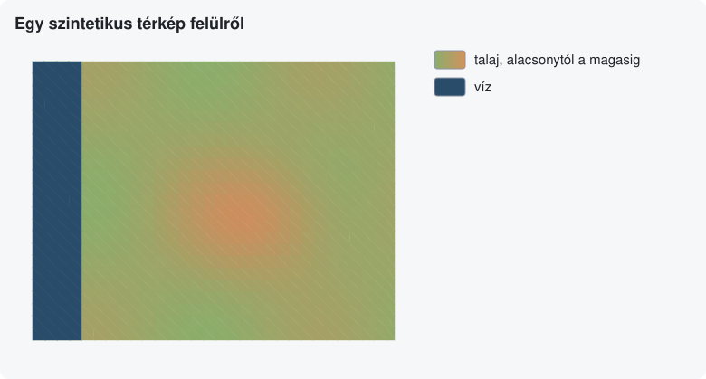

# A pályafájlok és a keretek {#the-level-files-and-frames}

`<out>/<map>/<map>.glb` (a pálya: a talaj 3D modellje), és mellette a `<map>.json`. A glb
`<map>.glb.part` fájlba íródik, és amikor kész, átnevezésre kerül.

| Rész | Mi az |
|---|---|
| `ground:<map>` | a terep magassági térképe rácsként, legfeljebb `--max-grid` mintavétel egy oldalon (alapértelmezés 1024: körülbelül 2 millió háromszög) |
| `water:<map>` | folyók, tavak és a tenger: lapos négyszögek a víz magasságán, cellánként egy, ha elég magassági mintája van a víz alatt (a térkép víz-maszkjával egyharmad, nélküle fele) |
| `ground:<map> towns` | a városok és falvak beépített alaprajza, 1,5 m-rel a talaj fölött |

A JSON tartalmazza a térkép **sarkait és szélességi/hosszúsági fokos dobozát** (`corners`, `extent`),
hogy hogyan találták meg őket (`georeference`), a magasság-beállításokat (`heightMul`, `SeaLevel`), a játékterületet
a játék méterében (`playArea`), a keretet és a kiindulópontját (`frame`, `geo`), a háromszögek számát, és
bármilyen megjegyzést (`notes`).

## Keretek {#frames}

Két keret, a `--frame` szerint:

- `enu` (alapértelmezés): méter kelet felé, tengerszint feletti magasság, észak felé a WGS-84 érintősíkon
  lévő kiindulóponthoz képest: az a lapos térkép, amelybe a 3DHeat Watcher egy IL-2 Tacview-felvételt helyez
  (x kelet, y magasság, z észak, a z tükrözve rajzolva). A glb (kelet, magasság, -észak) értékeket tárol.
  `--origin <lat> <lon>`-nal, a felvétel `geo` értékével (a munkamenete referenciapontjával), a felvétel elhelyezési
  lépés nélkül a pályára kerül; ennek hiányában a térkép közepe a kiindulópont, és a JSON `geo` mezője mondja meg, melyik.
- `game`: a játék saját méterei, ahogy a küldetésfájlok tartják: x észak felé a déli szélétől, y a játék magassága,
  z kelet felé a nyugati szélétől (úgy jobbsodrású, ahogy van, tehát glb = (x, y, z)). Azok a térképek, amelyek nem
  helyezhetők el a földön, bármit kértek is, ebben a keretben íródnak, megjegyzéssel.

A pálya névvel ellátott részekkel rendelkező glTF bináris fájl, ahogy minden 3DHeat-pálya; a megjelenítő
[Pályák](https://holdi601.github.io/3DHeat/levels.html) oldala írja le, hogyan töltődnek be.
