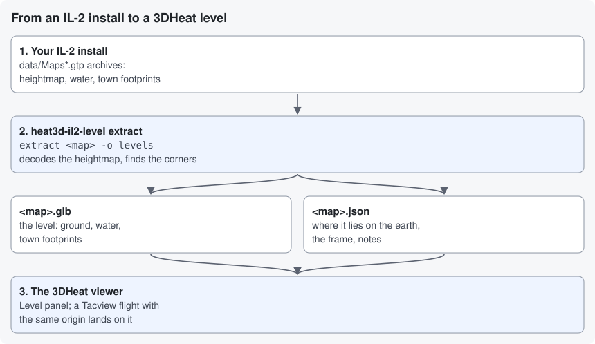

# 3DHeat IL-2

3DHeat IL-2 turns the maps of **IL-2 Sturmovik: Great Battles** into 3D
levels for the [3DHeat](https://github.com/Holdi601/3DHeat) viewer
([documentation](https://holdi601.github.io/3DHeat/)), read from **your own
install**: the terrain, the rivers, lakes and sea, and the towns' footprints,
placed on the earth by the map's own corner coordinates. IL-2 Series: Korea is
read as far as its archives allow ([Korea](korea.md)).

What it is useful for:

- **Flights on the game's own map.** An IL-2 Tacview recording, converted by
  the 3DHeat Watcher with the same origin, lands on the level with no
  placement step.
- **Every map at once.** `extract --all` writes every map found; seasons that
  share a heightmap are written once.
- **Where on the earth.** Each level's `.json` carries its corners and
  latitude/longitude box, and how they were found.



## Quick start

```bash
pip install -e .                                   # installs the heat3d-il2-level command
pip install -e .[fast]                             # with numba: decoding 20 to 50 times faster
heat3d-il2-level list                              # every map found, with its latitude/longitude box
heat3d-il2-level extract <map> -o levels           # one map (names as `list` prints them, wildcards allowed)
heat3d-il2-level extract --all -o levels           # every map
```

Then load `levels/<map>/<map>.glb` in the viewer's Level panel
([Levels](https://holdi601.github.io/3DHeat/levels.html)).

The levels it writes are built from the game's data: they stay **on your
machine**; never publish them ([Terms](terms.md)).

## Pages

| Page | What it covers |
|---|---|
| [Finding maps: list](list.md) | where the installs are found, what `list` prints |
| [Building levels: extract](extract.md) | every option, step by step, examples |
| [The level files and frames](output.md) | the `.glb` parts, the `.json`, the `enu` and `game` frames |
| [How the files are read](reading.md) | archives, the heightmap codec, water, towns, landmark fits |
| [IL-2 Series: Korea](korea.md) | what is different for Korea |
| [Speed, tests, terms](terms.md) | numba, the tests, the game's terms, licence |

## Related

- The 3DHeat viewer: [github.com/Holdi601/3DHeat](https://github.com/Holdi601/3DHeat),
  documentation at [holdi601.github.io/3DHeat](https://holdi601.github.io/3DHeat/).
- Telemetry for these levels: the [3DHeat Watcher](https://holdi601.github.io/3DHeat-Watcher/)
  converts IL-2 Tacview recordings; the viewer's file formats, including its
  one-file-a-match container, are described in
  [One file a match (.3dheat)](https://holdi601.github.io/3DHeat/container.html).
