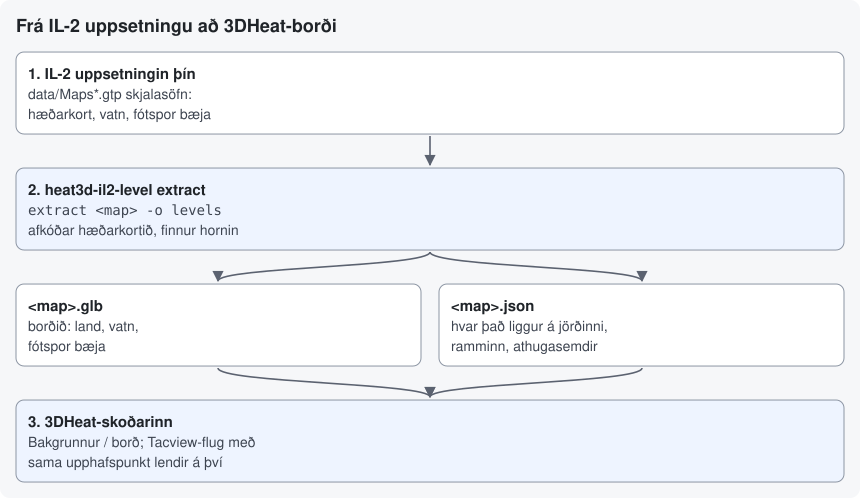

# 3DHeat IL-2 {#dheat-il-2}

**Hvað er þetta?** Lítið forrit sem breytir kortum **IL-2 Sturmovik:
Great Battles**, lesnum úr **þinni eigin uppsetningu**, í 3D líkön - borð -
sem þú getur flogið yfir í [3DHeat](https://github.com/Holdi601/3DHeat)-skoðaranum
([skjöl](https://holdi601.github.io/3DHeat/)): hæðirnar, árnar,
vötnin, sjóinn og bæina, sett þar sem þau liggja á jörðinni. Annar IL-2 leikur
þar sem skjalasöfnin fela skráartöfluna er lesinn eins langt og þau leyfa
([nánar](archives-without-table.md)).

**Hvers vegna ætti ég að nota það?** Til að sjá IL-2 flugin þín yfir eigin korti leiksins.

**Dæmi:** `heat3d-il2-level extract <map> -o levels` ->
`levels/<map>/<map>.glb` (borðið) + `<map>.json` (hvar það liggur á
jörðinni). Hæðarkort er net af hæðum, eins og reliefkort; Tacview-
upptaka er skrá af flugi sem Tacview skrifar.

Til hvers það nýtist:

- **Flug á eigin korti leiksins.** IL-2 Tacview-upptaka, umbreytt af
  3DHeat Watcher með sama upphafspunkt, lendir á borðinu án
  staðsetningarskrefs.
- **Öll kort í einu.** `extract --all` skrifar öll kort sem finnast; árstíðir sem
  deila hæðarkorti eru skrifaðar einu sinni.
- **Hvar á jörðinni.** `.json` hvers borðs ber horn þess og
  breiddar-/lengdargráðukassa, og hvernig þau fundust.



## Fljótleg byrjun {#quick-start}

Hefurðu aldrei notað skipanalínu? Lestu fyrst [Áður en þú byrjar](before-you-start.md).
Keyrðu þetta í möppunni sem þú klónaðir eða pakkaðir upp:

```bash
python -m pip install -e .                         # installs the heat3d-il2-level command
python -m pip install -e .[fast]                            # with numba: decoding 20 to 50 times faster
heat3d-il2-level list                              # every map found, with its latitude/longitude box
heat3d-il2-level extract <map> -o levels           # one map (names as `list` prints them, wildcards allowed)
heat3d-il2-level extract --all -o levels           # every map
```

Þú ættir að sjá línu fyrir hvert kort frá `list`, og `ok ...` frá `extract`.
Hladdu síðan `levels/<map>/<map>.glb` í spjaldið Bakgrunnur / borð í skoðaranum
([Borð](https://holdi601.github.io/3DHeat/levels.html)).

Borðin sem það skrifar eru smíðuð úr gögnum leiksins: þau haldast **á þinni
vél**; birtu þau aldrei ([Skilmálar](terms.md)).

## Síður {#pages}

| Síða | Hvað hún fjallar um |
|---|---|
| [Áður en þú byrjar](before-you-start.md) | Python, skipanalína, fyrsta keyrsla |
| [Að finna kort: list](list.md) | hvar uppsetningarnar finnast, hvað `list` prentar |
| [Að smíða borð: extract](extract.md) | hver valkostur, skref fyrir skref, dæmi |
| [Borðaskrárnar og rammar](output.md) | hlutar `.glb`, `.json`, `enu` og `game` rammarnir |
| [Hvernig skrárnar eru lesnar](reading.md) | skjalasöfn, hæðarkortsmálið, vatn, bæir, kennileitafittun |
| [Skjalasöfn án skráartöflu](archives-without-table.md) | seinni leikurinn, lesinn eins langt og skjalasöfn hans leyfa |
| [Hraði, prófanir, skilmálar](terms.md) | numba, prófanirnar, skilmálar leiksins, leyfi |
| [Skipanayfirlit](../cli-reference.md) | hver valkostur, búið til úr kóðanum |
| [Viðhald þessara skjala](maintaining.md) | gátlisti útgáfu |

## Tengt {#related}

- 3DHeat-skoðarinn: [github.com/Holdi601/3DHeat](https://github.com/Holdi601/3DHeat),
  skjöl á [holdi601.github.io/3DHeat](https://holdi601.github.io/3DHeat/).
- Mælingagögn fyrir þessi borð: [3DHeat Watcher](https://holdi601.github.io/3DHeat-Watcher/)
  umbreytir IL-2 Tacview-upptökum; skráasnið skoðarans, þar á meðal gámurinn
  með eina skrá fyrir hvern leik, eru lýst í
  [Ein skrá fyrir hvern leik (.3dheat)](https://holdi601.github.io/3DHeat/container.html).

## 3DHeat verkfærin {#the-3dheat-tools}

| Verkfæri | Hvað það gerir | Kóði | Skjöl |
|---|---|---|---|
| 3DHeat-skoðari | sýnir gögnin: hitakort, kappakstursgreiningu, leikjayfirlit | [3DHeat](https://github.com/Holdi601/3DHeat) | [skjöl](https://holdi601.github.io/3DHeat/) |
| GameFiles | borð og brautir úr eigin skrám leiks | [3DHeat-GameFiles](https://github.com/Holdi601/3DHeat-GameFiles) | [skjöl](https://holdi601.github.io/3DHeat-GameFiles/) |
| GameCapture | hringtímagögn og borð endurbyggð úr leikmyndbandi | [3DHeat-GameCapture](https://github.com/Holdi601/3DHeat-GameCapture) | [skjöl](https://holdi601.github.io/3DHeat-GameCapture/) |
| Unreal Exporter | viðbót fyrir Unreal Editor: borð sem ein `.glb` | [3DHeat-UnrealExporter](https://github.com/Holdi601/3DHeat-UnrealExporter) | [skjöl](https://holdi601.github.io/3DHeat-UnrealExporter/) |
| CS2 | Counter-Strike 2 demo og kort | [3DHeat-CS2](https://github.com/Holdi601/3DHeat-CS2) | [skjöl](https://holdi601.github.io/3DHeat-CS2/) |
| Watcher | skráir það sem leikir birta meðan þú spilar | [3DHeat-Watcher](https://github.com/Holdi601/3DHeat-Watcher) | [skjöl](https://holdi601.github.io/3DHeat-Watcher/) |
| Ext-WarThunder | War Thunder upptökur | [3DHeat-Ext-WarThunder](https://github.com/Holdi601/3DHeat-Ext-WarThunder) | [skjöl](https://holdi601.github.io/3DHeat-Ext-WarThunder/) |
| Ext-WoT | World of Tanks upptökur | [3DHeat-Ext-WoT](https://github.com/Holdi601/3DHeat-Ext-WoT) | [skjöl](https://holdi601.github.io/3DHeat-Ext-WoT/) |
| Ext-WoWs | World of Warships upptökur | [3DHeat-Ext-WoWs](https://github.com/Holdi601/3DHeat-Ext-WoWs) | [skjöl](https://holdi601.github.io/3DHeat-Ext-WoWs/) |
| Ext-Squad | Squad þjónsdemo | [3DHeat-Ext-Squad](https://github.com/Holdi601/3DHeat-Ext-Squad) | [skjöl](https://holdi601.github.io/3DHeat-Ext-Squad/) |
| Ext-DCS | DCS World kort sem 3D borð | [3DHeat-Ext-DCS](https://github.com/Holdi601/3DHeat-Ext-DCS) | [skjöl](https://holdi601.github.io/3DHeat-Ext-DCS/) |
| Ext-IL2 | IL-2 Sturmovik kort sem 3D borð | [3DHeat-Ext-IL2](https://github.com/Holdi601/3DHeat-Ext-IL2) | [skjöl](https://holdi601.github.io/3DHeat-Ext-IL2/) |
