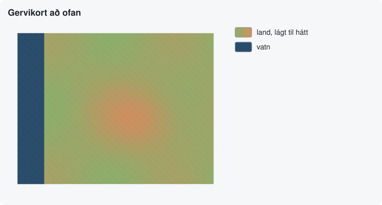

# Borðaskrárnar og rammar {#the-level-files-and-frames}

`<out>/<map>/<map>.glb` (borðið: 3D líkan af landinu) og `<map>.json`
við hliðina. glb-skráin er skrifuð í
`<map>.glb.part` og endurnefnd þegar hún er tilbúin.

| Hluti | Hvað það er |
|---|---|
| `ground:<map>` | hæðarkort landsins sem net, í mesta lagi `--max-grid` sýni á hlið (sjálfgefið 1024: um 2 milljónir þríhyrninga) |
| `water:<map>` | ár, vötn og sjór: flatir ferhyrningar í hæð vatnsins, einn fyrir hvern reit netsins þar sem nógu mörg hæðarkortssýni eru undir vatni (þriðjungur með vatnsgrímu kortsins, helmingur án) |
| `ground:<map> towns` | byggðu fótsporin í bæjum og þorpum, lögð 1,5 m yfir landið |

JSON-skráin geymir **horn kortsins og breiddar-/lengdargráðukassa** (`corners`,
`extent`), hvernig þau fundust (`georeference`), hæðarstillingarnar
(`heightMul`, `SeaLevel`), leiksvæðið í metrum leiksins (`playArea`), rammann
og upphafspunkt hans (`frame`, `geo`), fjölda þríhyrninga og allar `notes`.

## Rammar {#frames}

Tveir rammar, `--frame`:

- `enu` (sjálfgefið): metrar til austurs, hæð yfir sjávarmáli, til norðurs frá upphafspunkti á
  WGS-84 snertifleti: flata kortið sem 3DHeat Watcher setur IL-2 Tacview
  upptöku í (x austur, y hæð, z norður, teiknað með z speglað). glb-skráin
  geymir (austur, hæð, -norður). Umbreyttu með `--origin <lat> <lon>` stillt á
  `geo` upptöku (viðmiðunarpunkt lotu hennar) og upptakan lendir á
  borðinu án staðsetningarskrefs; án þess er miðja kortsins upphafspunkturinn,
  og `geo` í JSON segir hver.
- `game`: eigin metrar leiksins eins og verkefnaskrár hafa þá: x norður frá
  suðurbrún, y hæð leiksins, z austur frá vesturbrún (rétthent eins og það
  er, svo glb = (x, y, z)). Kort sem ekki er hægt að setja á jörðina eru skrifuð í
  þessum ramma hvað sem beðið var um, með athugasemd.

Borðið er glTF tvíundarskrá með nefndum hlutum, eins og öll 3DHeat-borð; síðan
[Borð](https://holdi601.github.io/3DHeat/levels.html) í skoðaranum segir hvernig hann hleður þeim.
