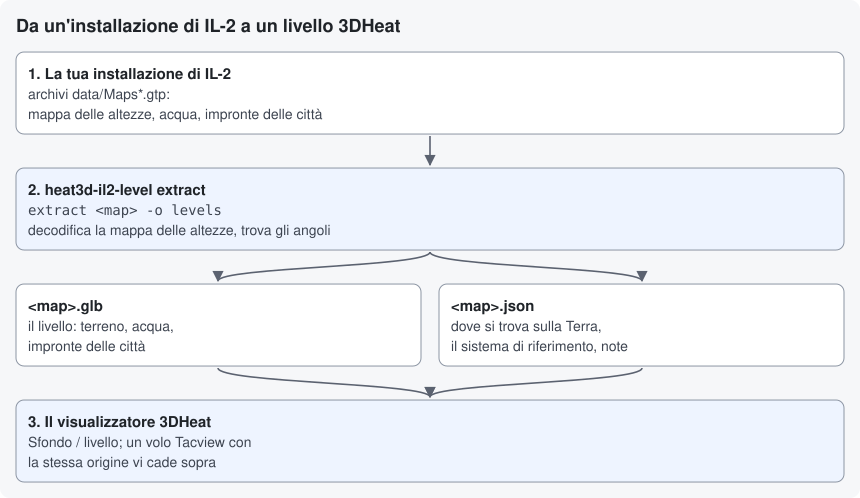

# 3DHeat IL-2 {#dheat-il-2}

**Che cos'è?** Un piccolo programma che trasforma le mappe di **IL-2 Sturmovik: Great Battles**,
lette dalla **tua installazione**, in modelli 3D - livelli - sopra cui puoi volare nel visualizzatore
[3DHeat](https://github.com/Holdi601/3DHeat) ([documentazione](https://holdi601.github.io/3DHeat/)):
le colline, i fiumi, i laghi, il mare e le città, collocati dove si trovano sulla Terra. Un secondo
gioco IL-2, i cui archivi nascondono la tabella dei file, viene letto nei limiti che consentono
([dettagli](archives-without-table.md)).

**A cosa serve?** A vedere i tuoi voli IL-2 sulla mappa del gioco stessa.

**Esempio:** `heat3d-il2-level extract <mappa> -o levels` ->
`levels/<mappa>/<mappa>.glb` (il livello) + `<mappa>.json` (dove si trova sulla Terra). Una mappa
delle altezze è una griglia di quote, come una carta in rilievo; una registrazione Tacview è un file
di un volo scritto da Tacview.

A cosa serve:

- **Voli sulla mappa del gioco.** Una registrazione Tacview di IL-2, convertita da 3DHeat Watcher con
  la stessa origine, cade sul livello senza alcun passaggio di posizionamento.
- **Ogni mappa in una volta.** `extract --all` scrive ogni mappa trovata; le stagioni che condividono
  una mappa delle altezze vengono scritte una volta sola.
- **Dove si trova sulla Terra.** Il `.json` di ogni livello riporta i suoi angoli e il riquadro di
  latitudine/longitudine, e come sono stati trovati.



## Avvio rapido {#quick-start}

Non hai mai usato la riga di comando? Leggi prima [Prima di iniziare](before-you-start.md).
Esegui questi comandi nella cartella in cui hai clonato o decompresso lo strumento:

```bash
python -m pip install -e .                         # installa il comando heat3d-il2-level
python -m pip install -e .[fast]                            # con numba: decodifica da 20 a 50 volte più veloce
heat3d-il2-level list                              # ogni mappa trovata, con il suo riquadro di latitudine/longitudine
heat3d-il2-level extract <mappa> -o levels         # una mappa (nomi come li stampa `list`, sono ammessi i caratteri jolly)
heat3d-il2-level extract --all -o levels           # ogni mappa
```

Dovresti vedere una riga per mappa da `list`, e `ok ...` da `extract`.
Poi carica `levels/<mappa>/<mappa>.glb` nel pannello Sfondo / livello del visualizzatore
([Livelli](https://holdi601.github.io/3DHeat/levels.html)).

I livelli che scrive sono costruiti con i dati del gioco: restano **sul tuo computer**; non
pubblicarli mai ([Condizioni](terms.md)).

## Pagine {#pages}

| Pagina | Cosa contiene |
|---|---|
| [Prima di iniziare](before-you-start.md) | Python, un terminale, una prima esecuzione |
| [Trovare le mappe: list](list.md) | dove vengono trovate le installazioni, cosa stampa `list` |
| [Costruire i livelli: extract](extract.md) | ogni opzione, passo per passo, esempi |
| [I file del livello e i sistemi di riferimento](output.md) | le parti `.glb`, il `.json`, i sistemi `enu` e `game` |
| [Come vengono letti i file](reading.md) | archivi, codec della mappa delle altezze, acqua, città, adattamenti sui punti di riferimento |
| [Archivi senza tabella dei file](archives-without-table.md) | il secondo gioco, letto nei limiti dei suoi archivi |
| [Velocità, test, condizioni](terms.md) | numba, i test, le condizioni del gioco, la licenza |
| [Riferimento dei comandi](../cli-reference.md) | ogni opzione, generata dal codice |
| [Manutenzione di questa documentazione](maintaining.md) | la lista di controllo per ogni rilascio |

## Collegamenti {#related}

- Il visualizzatore 3DHeat: [github.com/Holdi601/3DHeat](https://github.com/Holdi601/3DHeat),
  documentazione su [holdi601.github.io/3DHeat](https://holdi601.github.io/3DHeat/).
- Telemetria per questi livelli: il [3DHeat Watcher](https://holdi601.github.io/3DHeat-Watcher/)
  converte le registrazioni Tacview di IL-2; i formati di file del visualizzatore, incluso il suo
  contenitore con una partita per file, sono descritti in
  [Una partita in un file (.3dheat)](https://holdi601.github.io/3DHeat/container.html).

## Gli strumenti 3DHeat {#the-3dheat-tools}

| Strumento | Cosa fa | Codice | Documentazione |
|---|---|---|---|
| Visualizzatore 3DHeat | mostra i dati: mappe di calore, analisi di gara, revisione della partita | [3DHeat](https://github.com/Holdi601/3DHeat) | [documentazione](https://holdi601.github.io/3DHeat/) |
| GameFiles | livelli e percorsi dai file di un gioco | [3DHeat-GameFiles](https://github.com/Holdi601/3DHeat-GameFiles) | [documentazione](https://holdi601.github.io/3DHeat-GameFiles/) |
| GameCapture | telemetria dei giri, e livelli ricostruiti dai video di gioco | [3DHeat-GameCapture](https://github.com/Holdi601/3DHeat-GameCapture) | [documentazione](https://holdi601.github.io/3DHeat-GameCapture/) |
| Unreal Exporter | un plugin per l'Unreal Editor: un livello come un unico `.glb` | [3DHeat-UnrealExporter](https://github.com/Holdi601/3DHeat-UnrealExporter) | [documentazione](https://holdi601.github.io/3DHeat-UnrealExporter/) |
| CS2 | demo e mappe di Counter-Strike 2 | [3DHeat-CS2](https://github.com/Holdi601/3DHeat-CS2) | [documentazione](https://holdi601.github.io/3DHeat-CS2/) |
| Watcher | registra ciò che i giochi pubblicano mentre giochi | [3DHeat-Watcher](https://github.com/Holdi601/3DHeat-Watcher) | [documentazione](https://holdi601.github.io/3DHeat-Watcher/) |
| Ext-WarThunder | replay di War Thunder | [3DHeat-Ext-WarThunder](https://github.com/Holdi601/3DHeat-Ext-WarThunder) | [documentazione](https://holdi601.github.io/3DHeat-Ext-WarThunder/) |
| Ext-WoT | replay di World of Tanks | [3DHeat-Ext-WoT](https://github.com/Holdi601/3DHeat-Ext-WoT) | [documentazione](https://holdi601.github.io/3DHeat-Ext-WoT/) |
| Ext-WoWs | replay di World of Warships | [3DHeat-Ext-WoWs](https://github.com/Holdi601/3DHeat-Ext-WoWs) | [documentazione](https://holdi601.github.io/3DHeat-Ext-WoWs/) |
| Ext-Squad | demo dei server di Squad | [3DHeat-Ext-Squad](https://github.com/Holdi601/3DHeat-Ext-Squad) | [documentazione](https://holdi601.github.io/3DHeat-Ext-Squad/) |
| Ext-DCS | mappe di DCS World come livelli 3D | [3DHeat-Ext-DCS](https://github.com/Holdi601/3DHeat-Ext-DCS) | [documentazione](https://holdi601.github.io/3DHeat-Ext-DCS/) |
| Ext-IL2 | mappe di IL-2 Sturmovik come livelli 3D | [3DHeat-Ext-IL2](https://github.com/Holdi601/3DHeat-Ext-IL2) | [documentazione](https://holdi601.github.io/3DHeat-Ext-IL2/) |
