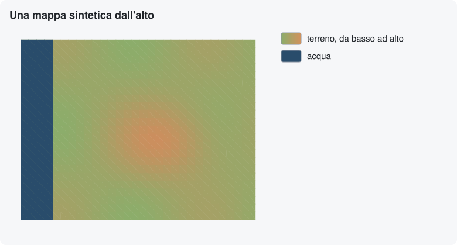

# I file del livello e i sistemi di riferimento {#the-level-files-and-frames}

`<out>/<mappa>/<mappa>.glb` (il livello: un modello 3D del terreno) e `<mappa>.json`
accanto. Il glb viene scritto in `<mappa>.glb.part` e rinominato quando è completo.

| Parte | Cosa è |
|---|---|
| `ground:<mappa>` | la mappa delle altezze del terreno come griglia, al massimo `--max-grid` campioni per lato (predefinito 1024: circa 2 milioni di triangoli) |
| `water:<mappa>` | fiumi, laghi e mare: quadrati piatti all'altezza dell'acqua, uno per cella della griglia in cui basta che una parte dei campioni della mappa delle altezze sia sott'acqua (un terzo con la maschera dell'acqua della mappa, metà senza) |
| `ground:<mappa> towns` | le impronte degli abitati di città e villaggi, appoggiate di 1,5 m sul terreno |

Il JSON contiene gli **angoli e il riquadro di latitudine/longitudine** della mappa (`corners`,
`extent`), come sono stati trovati (`georeference`), le impostazioni dell'altezza (`heightMul`,
`SeaLevel`), l'area di gioco in metri del gioco (`playArea`), il sistema di riferimento e la sua
origine (`frame`, `geo`), il numero di triangoli e le eventuali `notes`.

## Sistemi di riferimento {#frames}

Due sistemi di riferimento, `--frame`:

- `enu` (predefinito): metri a est, altitudine sul livello del mare, nord rispetto a un'origine sul
  piano tangente WGS-84: la mappa piatta in cui 3DHeat Watcher colloca una registrazione Tacview di
  IL-2 (x est, y altitudine, z nord, disegnato con z specchiato). Il glb contiene (est, altitudine,
  -nord). Usa `--origin <lat> <lon>` con il `geo` di una registrazione (il punto di
  riferimento della sua sessione) e la registrazione cade sul livello senza alcun passaggio di
  posizionamento; senza, il centro della mappa è l'origine, e il `geo` del JSON dice quale.
- `game`: le metri del gioco stesso, come le hanno i file di missione: x nord dal bordo sud, y l'altezza
  del gioco, z est dal bordo ovest (destrorso com'è, quindi glb = (x, y, z)). Le mappe che non possono
  essere collocate sulla Terra vengono scritte in questo sistema qualunque cosa sia stata chiesta, con
  una nota.

Il livello è un glTF binario con parti con nome, come ogni livello 3DHeat; la pagina
[Livelli](https://holdi601.github.io/3DHeat/levels.html) del visualizzatore spiega come li carica.
