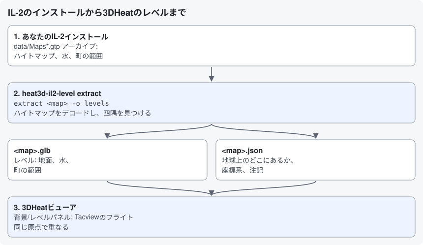

# 3DHeat IL-2 {#dheat-il-2}

**これは何？** **IL-2 Sturmovik: Great Battles** のマップを、**あなた自身のインストール**から読み取り、3Dモデル（レベル）に変える小さなプログラムです。そのモデルは、[3DHeat](https://github.com/Holdi601/3DHeat) ビューア（[ドキュメント](https://holdi601.github.io/3DHeat/)）の中で飛び回れます。丘、川、湖、海、町が、地球上で実際にある場所に置かれます。アーカイブがファイルの表を隠している2つ目のIL-2のゲームも、アーカイブが許す範囲で読みます（[詳細](archives-without-table.md)）。

**何に使うの？** IL-2のフライトを、ゲーム自身のマップの上で見るためです。

**例:** `heat3d-il2-level extract <map> -o levels` →
`levels/<map>/<map>.glb`（レベル）＋ `<map>.json`（地球上のどこにあるか）。ハイトマップとは、地図の起伏のように高さを並べた格子のことです。Tacview の記録とは、Tacview が書き出すフライトのファイルのことです。

役に立つ点:

- **ゲーム自身のマップでのフライト。** IL-2のTacview記録を、3DHeat Watcherが同じ原点で変換すると、配置の手順なしにレベルへ重なります。
- **すべてのマップを一度に。** `extract --all` は見つかったすべてのマップを書き出します。同じハイトマップを共有する季節は、一度だけ書き出されます。
- **地球上のどこか。** 各レベルの `.json` には、その四隅と緯度・経度の範囲、そしてそれらがどう求められたかが入っています。



## クイックスタート {#quick-start}

コマンドラインは初めてですか？ まず [始める前に](before-you-start.md) を読んでください。
クローンまたは展開したフォルダーで、次を実行します:

```bash
python -m pip install -e .                         # heat3d-il2-level コマンドをインストール
python -m pip install -e .[fast]                            # numba を入れる: デコードが20〜50倍速くなる
heat3d-il2-level list                              # 見つかったすべてのマップと、その緯度・経度の範囲
heat3d-il2-level extract <map> -o levels           # 一つのマップ（list が表示する名前。ワイルドカード可）
heat3d-il2-level extract --all -o levels           # すべてのマップ
```

`list` からはマップごとに1行、`extract` からは `ok ...` が表示されるはずです。
その後、`levels/<map>/<map>.glb` をビューアの背景/レベルパネルで読み込みます（[レベル](https://holdi601.github.io/3DHeat/levels.html)）。

書き出されるレベルは、ゲームのデータから作られます。そのため、**あなたのマシンの中に** 置いてください。公開は決してしないでください（[利用条件](terms.md)）。

## ページ {#pages}

| ページ | 内容 |
|---|---|
| [始める前に](before-you-start.md) | Python、ターミナル、最初の実行 |
| [マップを探す: list](list.md) | インストールの場所、`list` が表示するもの |
| [レベルを作る: extract](extract.md) | すべてのオプション、手順ごとの説明、例 |
| [レベルのファイルと座標系](output.md) | `.glb` の部品、`.json`、`enu` と `game` の座標系 |
| [ファイルの読み方](reading.md) | アーカイブ、ハイトマップの符号化、水、町、目印による位置合わせ |
| [ファイル表のないアーカイブ](archives-without-table.md) | 2つ目のゲーム。アーカイブが許す範囲で読みます |
| [速度、テスト、利用条件](terms.md) | numba、テスト、ゲームの利用条件、ライセンス |
| [コマンドリファレンス](../cli-reference.md) | すべてのオプション。コードから生成 |
| [このドキュメントの保守](maintaining.md) | リリースのチェックリスト |

## 関連 {#related}

- 3DHeatビューア: [github.com/Holdi601/3DHeat](https://github.com/Holdi601/3DHeat)。ドキュメントは [holdi601.github.io/3DHeat](https://holdi601.github.io/3DHeat/)。
- これらのレベルのテレメトリ: [3DHeat Watcher](https://holdi601.github.io/3DHeat-Watcher/) がIL-2のTacview記録を変換します。1 マッチを 1 ファイルにまとめたコンテナを含む、ビューアのファイル形式は [1 マッチを 1 ファイルに（.3dheat）](https://holdi601.github.io/3DHeat/container.html) に説明があります。

## 3DHeatのツール {#the-3dheat-tools}

| ツール | 内容 | コード | ドキュメント |
|---|---|---|---|
| 3DHeat viewer | データを表示：ヒートマップ、レース分析、マッチの振り返り | [3DHeat](https://github.com/Holdi601/3DHeat) | [ドキュメント](https://holdi601.github.io/3DHeat/) |
| GameFiles | ゲーム自身のファイルからのレベルとコース | [3DHeat-GameFiles](https://github.com/Holdi601/3DHeat-GameFiles) | [ドキュメント](https://holdi601.github.io/3DHeat-GameFiles/) |
| GameCapture | ラップのテレメトリ、およびゲーム映像から再構築したレベル | [3DHeat-GameCapture](https://github.com/Holdi601/3DHeat-GameCapture) | [ドキュメント](https://holdi601.github.io/3DHeat-GameCapture/) |
| Unreal Exporter | Unreal Editorのプラグイン：レベルを1つの `.glb` として書き出し | [3DHeat-UnrealExporter](https://github.com/Holdi601/3DHeat-UnrealExporter) | [ドキュメント](https://holdi601.github.io/3DHeat-UnrealExporter/) |
| CS2 | Counter-Strike 2のデモとマップ | [3DHeat-CS2](https://github.com/Holdi601/3DHeat-CS2) | [ドキュメント](https://holdi601.github.io/3DHeat-CS2/) |
| Watcher | プレイ中にゲームが公開する情報を記録 | [3DHeat-Watcher](https://github.com/Holdi601/3DHeat-Watcher) | [ドキュメント](https://holdi601.github.io/3DHeat-Watcher/) |
| Ext-WarThunder | War Thunderのリプレイ | [3DHeat-Ext-WarThunder](https://github.com/Holdi601/3DHeat-Ext-WarThunder) | [ドキュメント](https://holdi601.github.io/3DHeat-Ext-WarThunder/) |
| Ext-WoT | World of Tanksのリプレイ | [3DHeat-Ext-WoT](https://github.com/Holdi601/3DHeat-Ext-WoT) | [ドキュメント](https://holdi601.github.io/3DHeat-Ext-WoT/) |
| Ext-WoWs | World of Warshipsのリプレイ | [3DHeat-Ext-WoWs](https://github.com/Holdi601/3DHeat-Ext-WoWs) | [ドキュメント](https://holdi601.github.io/3DHeat-Ext-WoWs/) |
| Ext-Squad | Squadサーバーのデモ | [3DHeat-Ext-Squad](https://github.com/Holdi601/3DHeat-Ext-Squad) | [ドキュメント](https://holdi601.github.io/3DHeat-Ext-Squad/) |
| Ext-DCS | DCS Worldのマップを3Dレベルとして | [3DHeat-Ext-DCS](https://github.com/Holdi601/3DHeat-Ext-DCS) | [ドキュメント](https://holdi601.github.io/3DHeat-Ext-DCS/) |
| Ext-IL2 | IL-2 Sturmovikのマップを3Dレベルとして | [3DHeat-Ext-IL2](https://github.com/Holdi601/3DHeat-Ext-IL2) | [ドキュメント](https://holdi601.github.io/3DHeat-Ext-IL2/) |
