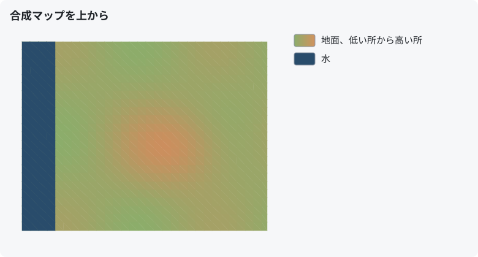

# レベルのファイルと座標系 {#the-level-files-and-frames}

`<out>/<map>/<map>.glb`（レベル: 地面の3Dモデル）と、その隣の `<map>.json`。glb は `<map>.glb.part` に書かれ、完成したら名前が変わります。

| 部品 | 中身 |
|---|---|
| `ground:<map>` | 地形のハイトマップを格子として。一辺は最大 `--max-grid` サンプル（既定 1024: 約200万の三角形） |
| `water:<map>` | 川、湖、海: 水の高さにある平らな四角形。その格子セルのハイトマップのサンプルのうち、十分な数が水面下にあるものごとに1つ（マップの水のマスクがあれば3分の1、なければ半分） |
| `ground:<map> towns` | 町や村の建物の範囲。地面の上 1.5m に被せたもの |

JSONには、マップの**四隅と緯度・経度の範囲**（`corners`、`extent`）、それらがどう求められたか（`georeference`）、高さの設定（`heightMul`、`SeaLevel`）、ゲーム自身のメートルでのプレイ範囲（`playArea`）、座標系とその原点（`frame`、`geo`）、三角形の数、そして `notes` が入っています。

## 座標系 {#frames}

`--frame` の二つの座標系:

- `enu`（既定）: 東へのメートル、海面からの高度、WGS-84の接平面上の原点の北へのメートル。3DHeat WatcherがIL-2のTacview記録を置く平らなマップです（x が東、y が高度、z が北。描くときは z を反転）。glb には（東、高度、-北）が入ります。記録の `geo`（そのセッションの基準点）を `--origin <lat> <lon>` に指定して変換すると、記録は配置の手順なしにレベルへ重なります。指定しなければマップの中心が原点になり、JSON の `geo` がどちらかを示します。
- `game`: ミッションファイルが持つ、ゲーム自身のメートル。x は南端から北へ、y はゲームの高さ、z は西端から東へ（そのままの右手系で、glb = (x, y, z)）。地球上に置けないマップは、何を指定されても、注記とともにこの座標系で書き出されます。

レベルは、名前付きの部品を持つglTFのバイナリです。すべての3DHeatのレベルと同じです。ビューアの[レベル](https://holdi601.github.io/3DHeat/levels.html)のページが、それらの読み込み方を説明しています。
