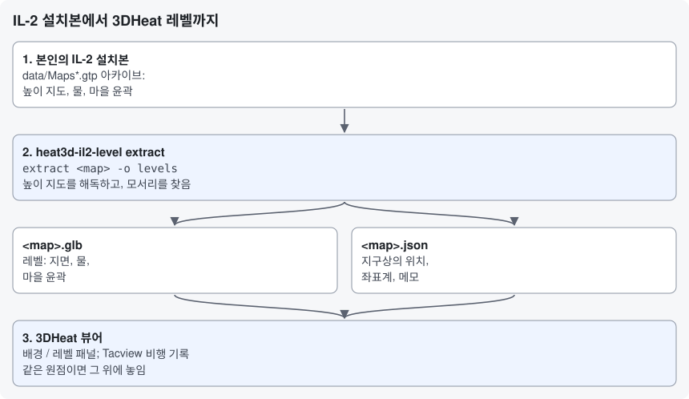

# 3DHeat IL-2 {#dheat-il-2}

**무엇입니까?** **IL-2 Sturmovik: Great Battles**의 맵을, **본인의 설치본**에서 읽어 3D 모델, 즉 레벨로 바꿔 주는 작은 프로그램입니다. 레벨 위를 [3DHeat](https://github.com/Holdi601/3DHeat) 뷰어([문서](https://holdi601.github.io/3DHeat/))에서 날아다닐 수 있습니다. 언덕, 강, 호수, 바다, 마을이 지구상에서 놓인 자리 그대로 나옵니다. 아카이브가 파일 표를 숨기는 두 번째 IL-2 게임도 아카이브가 허락하는 만큼 읽습니다([자세한 내용](archives-without-table.md)).

**왜 씁니까?** 게임 자체의 맵 위에서 IL-2 비행을 보기 위해서입니다.

**예시:** `heat3d-il2-level extract <map> -o levels` ->
`levels/<map>/<map>.glb` (레벨) + `<map>.json` (지구상의 위치). 높이 맵은 부조 지도처럼 높이를 담은 격자이고, Tacview 기록은 Tacview가 쓰는 비행 기록 파일입니다.

이런 일에 쓸 수 있습니다:

- **게임 자체의 맵 위 비행.** 같은 원점으로 3DHeat Watcher가 변환한 IL-2 Tacview 기록은, 위치 맞추기 단계 없이 레벨에 놓입니다.
- **모든 맵을 한 번에.** `extract --all`은 찾은 맵을 모두 씁니다. 높이 맵을 공유하는 계절은 한 번만 씁니다.
- **지구상의 어디인지.** 각 레벨의 `.json`에는 모서리와 위도/경도 상자, 그리고 그것들을 어떻게 찾았는지가 들어 있습니다.



## 빠른 시작 {#quick-start}

명령줄이 처음입니까? 먼저 [시작하기 전에](before-you-start.md)를 읽으세요. 복제하거나 압축을 푼 폴더에서 다음을 실행하세요:

```bash
python -m pip install -e .                         # heat3d-il2-level 명령을 설치합니다
python -m pip install -e .[fast]                            # numba와 함께: 해독이 20~50배 빨라집니다
heat3d-il2-level list                              # 찾은 모든 맵과, 각각의 위도/경도 상자
heat3d-il2-level extract <map> -o levels           # 맵 하나 (`list`가 출력하는 이름, 와일드카드 가능)
heat3d-il2-level extract --all -o levels           # 모든 맵
```

`list`는 맵마다 한 줄을, `extract`는 `ok ...`를 출력해야 합니다.
그다음 뷰어의 배경 / 레벨 패널에서 `levels/<map>/<map>.glb`를 불러오세요 ([레벨](https://holdi601.github.io/3DHeat/levels.html)).

이 도구가 쓰는 레벨은 게임의 데이터로 만든 것입니다. 그러므로 **본인의 컴퓨터에만** 두고, 절대 게시하지 마세요 ([약관](terms.md)).

각 게임 리더는 자체 라이선스 파일, 릴리스, 이슈 트래커를 가진 작은 독립 프로젝트입니다. 그래서 뷰어나 다른 도구에 영향을 주지 않고 따로 설치, 업데이트, 유지 관리하거나 권리자의 요청에 따라 철회할 수 있습니다.

## 페이지 {#pages}

| 페이지 | 내용 |
|---|---|
| [시작하기 전에](before-you-start.md) | Python, 터미널, 첫 실행 |
| [맵 찾기: list](list.md) | 설치본을 찾는 곳, `list`가 출력하는 것 |
| [레벨 만들기: extract](extract.md) | 모든 옵션, 단계별 안내, 예시 |
| [레벨 파일과 좌표계](output.md) | `.glb` 부분들, `.json`, `enu`와 `game` 좌표계 |
| [파일을 읽는 방법](reading.md) | 아카이브, 높이 맵 코덱, 물, 마을, 랜드마크 맞추기 |
| [파일 표가 없는 아카이브](archives-without-table.md) | 두 번째 게임, 아카이브가 허락하는 만큼 읽음 |
| [속도, 테스트, 약관](terms.md) | numba, 테스트, 무엇을 읽고 무엇을 함께 배포하지 않는지, 라이선스 |
| [명령 참조](../cli-reference.md) | 코드에서 만든, 모든 옵션 |
| [문서 관리](maintaining.md) | 릴리스 체크리스트 |

## 관련 자료 {#related}

- 3DHeat 뷰어: [github.com/Holdi601/3DHeat](https://github.com/Holdi601/3DHeat),
  문서는 [holdi601.github.io/3DHeat](https://holdi601.github.io/3DHeat/)에 있습니다.
- 이 레벨들의 텔레메트리: [3DHeat Watcher](https://holdi601.github.io/3DHeat-Watcher/)가 IL-2 Tacview 기록을 변환합니다. 뷰어의 파일 형식, 매치 하나를 파일 하나에 담는 컨테이너 포함, 은 [매치 하나를 파일 하나로 (.3dheat)](https://holdi601.github.io/3DHeat/container.html)에 설명되어 있습니다.

## 3DHeat 도구들 {#the-3dheat-tools}

| 도구 | 하는 일 | 코드 | 문서 |
|---|---|---|---|
| 3DHeat 뷰어 | 데이터를 보여 줍니다: 히트맵, 레이스 분석, 매치 리뷰 | [3DHeat](https://github.com/Holdi601/3DHeat) | [문서](https://holdi601.github.io/3DHeat/) |
| GameFiles | 게임 자체 파일에서 얻는 레벨과 코스 | [3DHeat-GameFiles](https://github.com/Holdi601/3DHeat-GameFiles) | [문서](https://holdi601.github.io/3DHeat-GameFiles/) |
| GameCapture | 랩 텔레메트리, 그리고 게임 영상에서 복원한 레벨 | [3DHeat-GameCapture](https://github.com/Holdi601/3DHeat-GameCapture) | [문서](https://holdi601.github.io/3DHeat-GameCapture/) |
| Unreal Exporter | 레벨을 `.glb` 하나로 내보내는 Unreal 에디터 플러그인 | [3DHeat-UnrealExporter](https://github.com/Holdi601/3DHeat-UnrealExporter) | [문서](https://holdi601.github.io/3DHeat-UnrealExporter/) |
| CS2 | Counter-Strike 2 데모와 맵 | [3DHeat-CS2](https://github.com/Holdi601/3DHeat-CS2) | [문서](https://holdi601.github.io/3DHeat-CS2/) |
| Watcher | 플레이하는 동안 게임이 공개하는 데이터를 기록합니다 | [3DHeat-Watcher](https://github.com/Holdi601/3DHeat-Watcher) | [문서](https://holdi601.github.io/3DHeat-Watcher/) |
| Ext-WarThunder | 워 썬더 리플레이 | [3DHeat-Ext-WarThunder](https://github.com/Holdi601/3DHeat-Ext-WarThunder) | [문서](https://holdi601.github.io/3DHeat-Ext-WarThunder/) |
| Ext-WoT | 월드 오브 탱크 리플레이 | [3DHeat-Ext-WoT](https://github.com/Holdi601/3DHeat-Ext-WoT) | [문서](https://holdi601.github.io/3DHeat-Ext-WoT/) |
| Ext-WoWs | 월드 오브 워십 리플레이 | [3DHeat-Ext-WoWs](https://github.com/Holdi601/3DHeat-Ext-WoWs) | [문서](https://holdi601.github.io/3DHeat-Ext-WoWs/) |
| Ext-Squad | Squad 서버 데모 | [3DHeat-Ext-Squad](https://github.com/Holdi601/3DHeat-Ext-Squad) | [문서](https://holdi601.github.io/3DHeat-Ext-Squad/) |
| Ext-DCS | DCS World 맵을 3D 레벨로 | [3DHeat-Ext-DCS](https://github.com/Holdi601/3DHeat-Ext-DCS) | [문서](https://holdi601.github.io/3DHeat-Ext-DCS/) |
| Ext-IL2 | IL-2 Sturmovik 맵을 3D 레벨로 | [3DHeat-Ext-IL2](https://github.com/Holdi601/3DHeat-Ext-IL2) | [문서](https://holdi601.github.io/3DHeat-Ext-IL2/) |
