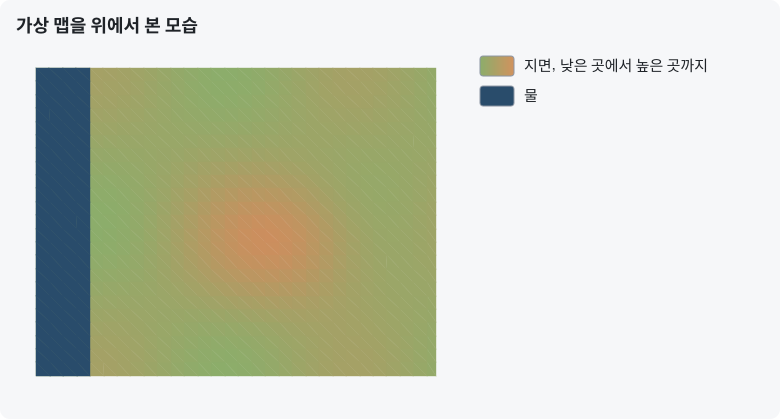

# 레벨 파일과 좌표계 {#the-level-files-and-frames}

`<out>/<map>/<map>.glb`(레벨: 지면의 3D 모델)와 그 옆의 `<map>.json`입니다. glb는 `<map>.glb.part`로 쓰고, 완료되면 이름을 바꿉니다.

| 부분 | 뜻 |
|---|---|
| `ground:<map>` | 지형 높이를 격자로. 한 변의 샘플이 `--max-grid`를 넘지 않음(기본 1024: 약 200만 삼각형) |
| `water:<map>` | 강, 호수, 바다: 물의 높이에 놓인 평평한 사각형. 높이 맵 샘플 중 충분한 수가 물 아래에 있는 격자 칸마다 하나씩(맵의 물 마스크가 있으면 3분의 1, 없으면 절반) |
| `ground:<map> towns` | 마을과 촌락의 건물 밀집 지역 윤곽. 지면 위 1.5m에 덮어 놓임 |

JSON에는 맵의 **모서리와 위도/경도 상자**(`corners`, `extent`), 그것들을 어떻게 찾았는지(`georeference`), 높이 설정(`heightMul`, `SeaLevel`), 게임 미터 단위의 플레이 영역(`playArea`), 좌표계와 그 원점(`frame`, `geo`), 삼각형 수, 그리고 `notes`가 들어 있습니다.

## 좌표계 {#frames}

`--frame`으로 두 좌표계를 고를 수 있습니다:

- `enu`(기본): 원점 기준으로 동쪽 미터, 해수면 위의 고도, 북쪽 미터. WGS-84 접평면 위의 평평한 맵이며, 3DHeat Watcher가 IL-2 Tacview 기록을 놓는 맵과 같습니다(x 동쪽, y 고도, z 북쪽, z를 뒤집어 그림). glb는 (동쪽, 고도, -북쪽)을 저장합니다. `--origin <lat> <lon>`을 기록의 `geo`(세션의 기준점)로 주면 변환할 수 있고, 그러면 기록이 위치 맞추기 단계 없이 레벨에 놓입니다. 주지 않으면 맵의 가운데가 원점이 되며, JSON의 `geo`가 어느 쪽인지 알려 줍니다.
- `game`: 미션 파일이 쓰는 게임 자체의 미터. x는 남쪽 가장자리에서 잰 북쪽, y는 게임의 높이, z는 서쪽 가장자리에서 잰 동쪽입니다(원래 그대로 오른손 좌표계이므로 glb = (x, y, z)). 지구상에 놓을 수 없는 맵은 무엇을 요청하든 이 좌표계로 쓰고, 그 사실을 메모로 남깁니다.

레벨은 모든 3DHeat 레벨과 같이 이름 붙은 부분을 가진 glTF 바이너리입니다. 뷰어의 [레벨](https://holdi601.github.io/3DHeat/levels.html) 페이지가 불러오는 방법을 설명합니다.
