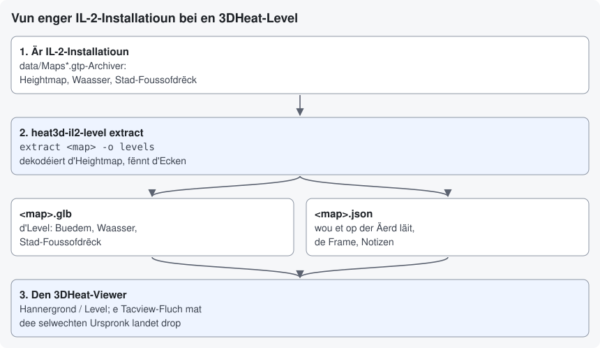

# 3DHeat IL-2 {#dheat-il-2}

**Wat ass et?** E klengt Programm, dat d'Mappe vun **IL-2 Sturmovik:
Great Battles**, gelies aus **Ärer eegener Installatioun**, an 3D-Modeller - Levelen -
verwandelt, iwwer déi Dir am [3DHeat](https://github.com/Holdi601/3DHeat)-Viewer
([Dokumentatioun](https://holdi601.github.io/3DHeat/)) fléie kënnt: d'Hiwwelen, Flëss,
Séien, d'Mier a Stied, placéiert, wou si op der Äerd leien. E zweet IL-2-Spill,
deem seng Archiver hir Dateitabell verstoppen, gëtt gelies, sou wäit si et erlaben
([Detailer](archives-without-table.md)).

**Firwat sollt ech et benotzen?** Fir Är IL-2-Flich iwwer dem Spill seng eegener Map ze gesinn.

**Beispill:** `heat3d-il2-level extract <map> -o levels` ->
`levels/<map>/<map>.glb` (d'Level) + `<map>.json` (wou et op der
Äerd läit). Eng Heightmap ass e Gitter vun Héichten, wéi eng Reliefkaart; eng Tacview-
Opnam ass eng Datei vun engem Fluch, déi Tacview schreift.

Wofir et nëtzlech ass:

- **Flich op dem Spill seng eegener Map.** Eng IL-2-Tacview-Opnam, vum
  3DHeat Watcher mat dem selwechten Urspronk konvertéiert, landet um Level ouni
  Placement-Schrëtt.
- **All Map op eemol.** `extract --all` schreift all Map, déi fonnt gëtt; Joreszäiten, déi
  eng Heightmap deelen, ginn eemol geschriwwen.
- **Wou op der Äerd.** De `.json` vun all Level dréit seng Ecken a seng
  Breeden-/Längtegrad-Këscht, a wéi se fonnt goufen.



## Séier Start {#quick-start}

Nei op der Kommandozeil? Liest fir d'éischt [Ier Dir ufänkt](before-you-start.md).
Féiert dës an dem Dossier aus, deen Dir gekloont oder entzippt hutt:

```bash
python -m pip install -e .                         # installs the heat3d-il2-level command
python -m pip install -e .[fast]                            # with numba: decoding 20 to 50 times faster
heat3d-il2-level list                              # every map found, with its latitude/longitude box
heat3d-il2-level extract <map> -o levels           # one map (names as `list` prints them, wildcards allowed)
heat3d-il2-level extract --all -o levels           # every map
```

Dir sollt eng Zeil pro Map vun `list` gesinn, an `ok ...` vun `extract`.
Dann lued `levels/<map>/<map>.glb` am Panel „Hannergrond / Level“ vum Viewer
([Levelen](https://holdi601.github.io/3DHeat/levels.html)).

D'Levelen, déi et schreift, si vun de Daten vum Spill gebaut: si bleiwen **op Ärem
Rechner**; publizéiert se ni ([Bedingungen](terms.md)).

## Säiten {#pages}

| Säit | Wat se ofdeckt |
|---|---|
| [Ier Dir ufänkt](before-you-start.md) | Python, e Terminal, e éischte Start |
| [Mappen fannen: list](list.md) | wou d'Installatiounen fonnt ginn, wat `list` ausgëtt |
| [Levelen bauen: extract](extract.md) | all Optioun, Schrëtt fir Schrëtt, Beispiller |
| [D'Level-Dateien an d'Frames](output.md) | d'`.glb`-Deeler, den `.json`, d'`enu`- an `game`-Frames |
| [Wéi d'Dateie gelies ginn](reading.md) | Archiver, de Heightmap-Codec, Waasser, Stied, Landmark-Fits |
| [Archiver ouni Dateitabell](archives-without-table.md) | dat zweet Spill, gelies, sou wäit seng Archiver et erlaben |
| [Geschwindegkeet, Tester, Bedingungen](terms.md) | numba, d'Tester, d'Bedingunge vum Spill, Lizenz |
| [Kommando-Referenz](../cli-reference.md) | all Optioun, aus dem Code generéiert |
| [Dës Dokumentatioun ënnerhalen](maintaining.md) | d'Release-Checklëscht |

## Verwandt {#related}

- Den 3DHeat-Viewer: [github.com/Holdi601/3DHeat](https://github.com/Holdi601/3DHeat),
  Dokumentatioun op [holdi601.github.io/3DHeat](https://holdi601.github.io/3DHeat/).
- Telemetrie fir dës Levelen: den [3DHeat Watcher](https://holdi601.github.io/3DHeat-Watcher/)
  konvertéiert IL-2-Tacview-Opnamen; d'Dateiformater vum Viewer, och säi
  Container mat enger Datei pro Match, si beschriwwen an
  [Eng Datei pro Match (.3dheat)](https://holdi601.github.io/3DHeat/container.html).

## Déi 3DHeat-Tools {#the-3dheat-tools}

| Tool | Wat et mécht | Code | Docs |
|---|---|---|---|
| 3DHeat-Viewer | weist d'Daten: Heatmaps, Course-Analys, Match-Iwwerpréiwung | [3DHeat](https://github.com/Holdi601/3DHeat) | [Docs](https://holdi601.github.io/3DHeat/) |
| GameFiles | Levelen a Course aus de Dateie vun engem Spill | [3DHeat-GameFiles](https://github.com/Holdi601/3DHeat-GameFiles) | [Docs](https://holdi601.github.io/3DHeat-GameFiles/) |
| GameCapture | Ronn-Telemetrie, a Levelen aus Gameplay-Video nei opgebaut | [3DHeat-GameCapture](https://github.com/Holdi601/3DHeat-GameCapture) | [Docs](https://holdi601.github.io/3DHeat-GameCapture/) |
| Unreal Exporter | en Unreal-Editor-Plugin: e Level als eng `.glb` | [3DHeat-UnrealExporter](https://github.com/Holdi601/3DHeat-UnrealExporter) | [Docs](https://holdi601.github.io/3DHeat-UnrealExporter/) |
| CS2 | Counter-Strike-2-Demoen a -Mappen | [3DHeat-CS2](https://github.com/Holdi601/3DHeat-CS2) | [Docs](https://holdi601.github.io/3DHeat-CS2/) |
| Watcher | hält fest, wat Spiller wärend dem Spillen publizéieren | [3DHeat-Watcher](https://github.com/Holdi601/3DHeat-Watcher) | [Docs](https://holdi601.github.io/3DHeat-Watcher/) |
| Ext-WarThunder | War-Thunder-Replays | [3DHeat-Ext-WarThunder](https://github.com/Holdi601/3DHeat-Ext-WarThunder) | [Docs](https://holdi601.github.io/3DHeat-Ext-WarThunder/) |
| Ext-WoT | World-of-Tanks-Replays | [3DHeat-Ext-WoT](https://github.com/Holdi601/3DHeat-Ext-WoT) | [Docs](https://holdi601.github.io/3DHeat-Ext-WoT/) |
| Ext-WoWs | World-of-Warships-Replays | [3DHeat-Ext-WoWs](https://github.com/Holdi601/3DHeat-Ext-WoWs) | [Docs](https://holdi601.github.io/3DHeat-Ext-WoWs/) |
| Ext-Squad | Squad-Server-Demoen | [3DHeat-Ext-Squad](https://github.com/Holdi601/3DHeat-Ext-Squad) | [Docs](https://holdi601.github.io/3DHeat-Ext-Squad/) |
| Ext-DCS | DCS-World-Mappen als 3D-Levelen | [3DHeat-Ext-DCS](https://github.com/Holdi601/3DHeat-Ext-DCS) | [Docs](https://holdi601.github.io/3DHeat-Ext-DCS/) |
| Ext-IL2 | IL-2-Sturmovik-Mappen als 3D-Levelen | [3DHeat-Ext-IL2](https://github.com/Holdi601/3DHeat-Ext-IL2) | [Docs](https://holdi601.github.io/3DHeat-Ext-IL2/) |
