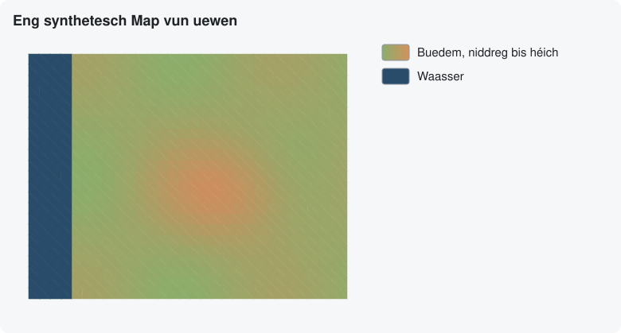

# D'Level-Dateien an d'Frames {#the-level-files-and-frames}

`<out>/<map>/<map>.glb` (d'Level: en 3D-Modell vum Buedem) an `<map>.json`
doniewendrun. D'glb gëtt op
`<map>.glb.part` geschriwwen an ëmbenannt, wann se komplett ass.

| Deel | Wat et ass |
|---|---|
| `ground:<map>` | d'Terrain-Heightmap als Gitter, héchstens `--max-grid` Echantillone pro Säit (Standard 1024: ongeféier 2 Millioune Dräiecker) |
| `water:<map>` | Flëss, Séien a Mier: flaach Quadrate op der Héicht vum Waasser, eent pro Gitterzell, vun där genuch Heightmap-Echantillone ënner Waasser sinn (en Drëttel mat der Waasser-Mask vun der Map, d'Halschent ouni) |
| `ground:<map> towns` | d'Bebauungs-Foussofdrëck vu Stied a Dierfer, 1,5 m iwwer dem Buedem driwwer geluecht |

De JSON hält d'**Ecken an d'Breeden-/Längtegrad-Këscht** vun der Map (`corners`,
`extent`), wéi se fonnt goufen (`georeference`), d'Héicht-Astellungen
(`heightMul`, `SeaLevel`), d'Spillgebitt an de Meter vum Spill (`playArea`), de
Frame a säin Urspronk (`frame`, `geo`), Dräieckszuelen an all `notes`.

## Frames {#frames}

Zwee Frames, `--frame`:

- `enu` (Standard): Meter Ouschten, Héicht iwwer Mieresniveau, Norden vun engem Urspronk op
  der WGS-84-Tangentialebene: déi flaach Map, an déi den 3DHeat Watcher eng IL-2-Tacview-
  Opnam setzt (x Ouschten, y Héicht, z Norden, mat gespigeltem z gezeechent). D'glb
  späichert (Ouschten, Héicht, -Norden). Konvertéiert mat `--origin <lat> <lon>` op dat `geo`
  vun enger Opnam gesat (de Referenzpunkt vun hirer Sessioun), an d'Opnam landet um
  Level ouni Placement-Schrëtt; ouni et ass d'Mëtt vun der Map den Urspronk,
  an dem JSON säi `geo` seet, wéi eng.
- `game`: dem Spill seng eegen Meter, wéi Missiounsdateien se hunn: x Norden vum
  Südrand, y d'Héicht vum Spill, z Ouschten vum Westrand (rechtshändeg wéi et ass,
  also glb = (x, y, z)). Mappen, déi net op der Äerd placéiert kënne ginn, ginn an
  dësem Frame geschriwwen, egal wat gefrot gouf, mat enger Notiz.

D'Level ass eng glTF-Binärdatei mat benannten Deeler, wéi all 3DHeat-Level; d'Säit
[Levelen](https://holdi601.github.io/3DHeat/levels.html) vum Viewer seet, wéi en se lued.
