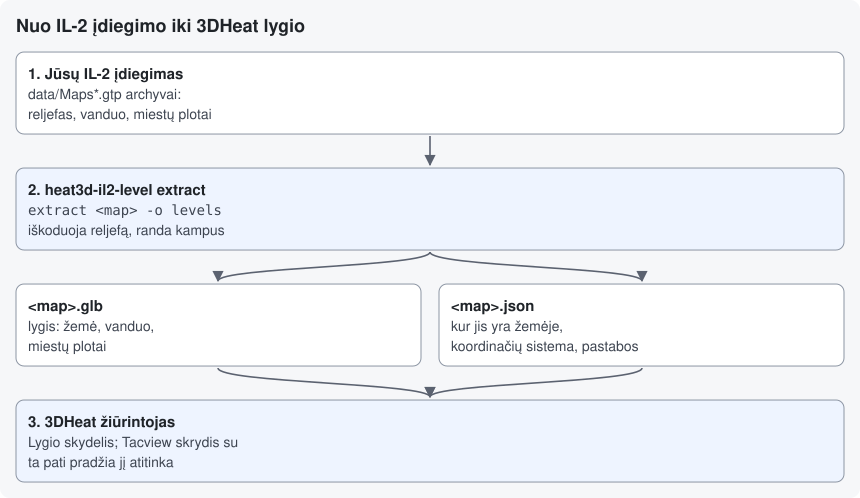

# 3DHeat IL-2 {#dheat-il-2}

**Kas tai?** Nedidelė programa, kuri paverčia **IL-2 Sturmovik: Great Battles** žemėlapius, perskaitytus iš **jūsų pačių
įdiegimo**, į 3D modelius – lygius – virš kurių galima skraidyti [3DHeat](https://github.com/Holdi601/3DHeat) žiūrintuve
([dokumentacija](https://holdi601.github.io/3DHeat/)): kalvas, upes, ežerus, jūrą ir miestus, patalpintus ten, kur jie yra žemės paviršiuje.
Antras IL-2 žaidimas, kurio archyvuose paslėpta failų lentelė, skaitomas tiek, kiek archyvai leidžia
([išsamiau](archives-without-table.md)).

**Kam tai naudoti?** Kad matytumėte savo IL-2 skrydžius ant paties žaidimo žemėlapio.

**Pavyzdys:** `heat3d-il2-level extract <map> -o levels` ->
`levels/<map>/<map>.glb` (lygis) + `<map>.json` (kur jis yra žemės paviršiuje). Reljefo žemėlapis yra aukščių tinklelis,
panašus į reljefo žemėlapį; Tacview įrašas yra skrydžio failas, kurį įrašo Tacview.

Kam tai naudinga:

- **Skrydžiai ant paties žaidimo žemėlapio.** IL-2 Tacview įrašas, konvertuotas 3DHeat Watcher su ta pačia pradžios vieta,
  patenka į lygį be jokio vietos parinkimo.
- **Visi žemėlapiai iš karto.** `extract --all` įrašo kiekvieną rastą žemėlapį; sezonai, kurie dalijasi tuo pačiu reljefo
  žemėlapiu, įrašomi vieną kartą.
- **Kur žemėje.** Kiekvieno lygio `.json` saugo jo kampus ir platumos/ilgumos dėžę bei tai, kaip jie rasti.



## Greita pradžia {#quick-start}

Nesate įpratę prie komandinės eilutės? Pirmiausia perskaitykite [Prieš pradedant](before-you-start.md).
Vykdykite šias komandas aplanke, į kurį klonavote ar išskleidėte įrankį:

```bash
python -m pip install -e .                         # įdiegia komandą heat3d-il2-level
python -m pip install -e .[fast]                            # su numba: dekodavimas 20–50 kartų greitesnis
heat3d-il2-level list                              # visi rasti žemėlapiai su platumos/ilgumos dėže
heat3d-il2-level extract <map> -o levels           # vienas žemėlapis (pavadinimai kaip rodo `list`, pakaitos ženklai leidžiami)
heat3d-il2-level extract --all -o levels           # visi žemėlapiai
```

Iš `list` turėtumėte matyti po eilutę kiekvienam žemėlapiui, o iš `extract` – `ok ...`.
Tada įkelkite `levels/<map>/<map>.glb` žiūrintojo Lygio skydelyje
([Lygiai](https://holdi601.github.io/3DHeat/levels.html)).

Lygiai, kuriuos jis įrašo, sukurti iš žaidimo duomenų, todėl jie lieka **jūsų kompiuteryje**; niekada jų neskelbkite
([Sąlygos](terms.md)).

## Puslapiai {#pages}

| Puslapis | Ką jame rasite |
|---|---|
| [Prieš pradedant](before-you-start.md) | Python, terminalas, pirmas paleidimas |
| [Žemėlapių paieška: list](list.md) | kur randami įdiegimai, ką išveda `list` |
| [Lygių kūrimas: extract](extract.md) | kiekviena parinktis, žingsnis po žingsnio, pavyzdžiai |
| [Lygio failai ir koordinačių sistemos](output.md) | `.glb` dalys, `.json`, `enu` ir `game` koordinačių sistemos |
| [Kaip skaitomi failai](reading.md) | archyvai, reljefo kodekas, vanduo, miestai, orientyrų pritaikymai |
| [Archyvai be failų lentelės](archives-without-table.md) | antrasis žaidimas, skaitomas tiek, kiek leidžia jo archyvai |
| [Greitis, testai, sąlygos](terms.md) | numba, testai, žaidimo sąlygos, licencija |
| [Komandų nuoroda](../cli-reference.md) | kiekviena parinktis, sugeneruota iš kodo |
| [Šių dokumentų priežiūra](maintaining.md) | išleidimo kontrolinis sąrašas |

## Susiję {#related}

- 3DHeat žiūrintojas: [github.com/Holdi601/3DHeat](https://github.com/Holdi601/3DHeat),
  dokumentacija – [holdi601.github.io/3DHeat](https://holdi601.github.io/3DHeat/).
- Šių lygių telemetrija: [3DHeat Watcher](https://holdi601.github.io/3DHeat-Watcher/)
  konvertuoja IL-2 Tacview įrašus; žiūrintojo failų formatai, įskaitant vieno failo rungtynių konteinerį, aprašyti
  [Vienas failas rungtynėms (.3dheat)](https://holdi601.github.io/3DHeat/container.html).

## 3DHeat įrankiai {#the-3dheat-tools}

| Įrankis | Ką daro | Kodas | Dokumentacija |
|---|---|---|---|
| 3DHeat žiūrintojas | rodo duomenis: šilumos žemėlapius, lenktynių analizę, rungtynių apžvalgą | [3DHeat](https://github.com/Holdi601/3DHeat) | [dokumentacija](https://holdi601.github.io/3DHeat/) |
| GameFiles | lygiai ir trasos iš žaidimo pačio failų | [3DHeat-GameFiles](https://github.com/Holdi601/3DHeat-GameFiles) | [dokumentacija](https://holdi601.github.io/3DHeat-GameFiles/) |
| GameCapture | ratų telemetrija ir lygiai, atkurti iš žaidimo vaizdo | [3DHeat-GameCapture](https://github.com/Holdi601/3DHeat-GameCapture) | [dokumentacija](https://holdi601.github.io/3DHeat-GameCapture/) |
| Unreal Exporter | Unreal Editor papildinys: lygis kaip vienas `.glb` | [3DHeat-UnrealExporter](https://github.com/Holdi601/3DHeat-UnrealExporter) | [dokumentacija](https://holdi601.github.io/3DHeat-UnrealExporter/) |
| CS2 | Counter-Strike 2 demo ir žemėlapiai | [3DHeat-CS2](https://github.com/Holdi601/3DHeat-CS2) | [dokumentacija](https://holdi601.github.io/3DHeat-CS2/) |
| Watcher | įrašo, ką žaidimai skelbia, kol žaidžiate | [3DHeat-Watcher](https://github.com/Holdi601/3DHeat-Watcher) | [dokumentacija](https://holdi601.github.io/3DHeat-Watcher/) |
| Ext-WarThunder | War Thunder įrašai | [3DHeat-Ext-WarThunder](https://github.com/Holdi601/3DHeat-Ext-WarThunder) | [dokumentacija](https://holdi601.github.io/3DHeat-Ext-WarThunder/) |
| Ext-WoT | World of Tanks įrašai | [3DHeat-Ext-WoT](https://github.com/Holdi601/3DHeat-Ext-WoT) | [dokumentacija](https://holdi601.github.io/3DHeat-Ext-WoT/) |
| Ext-WoWs | World of Warships įrašai | [3DHeat-Ext-WoWs](https://github.com/Holdi601/3DHeat-Ext-WoWs) | [dokumentacija](https://holdi601.github.io/3DHeat-Ext-WoWs/) |
| Ext-Squad | Squad serverių demo | [3DHeat-Ext-Squad](https://github.com/Holdi601/3DHeat-Ext-Squad) | [dokumentacija](https://holdi601.github.io/3DHeat-Ext-Squad/) |
| Ext-DCS | DCS World žemėlapiai kaip 3D lygiai | [3DHeat-Ext-DCS](https://github.com/Holdi601/3DHeat-Ext-DCS) | [dokumentacija](https://holdi601.github.io/3DHeat-Ext-DCS/) |
| Ext-IL2 | IL-2 Sturmovik žemėlapiai kaip 3D lygiai | [3DHeat-Ext-IL2](https://github.com/Holdi601/3DHeat-Ext-IL2) | [dokumentacija](https://holdi601.github.io/3DHeat-Ext-IL2/) |
