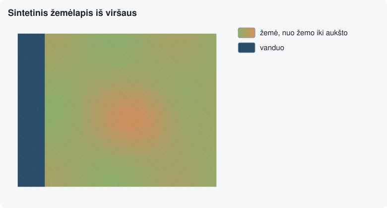

# Lygio failai ir koordinačių sistemos {#the-level-files-and-frames}

`<out>/<map>/<map>.glb` (lygis: 3D žemės modelis) ir šalia jo `<map>.json`.
glb įrašomas į `<map>.glb.part` ir pervadinamas, kai baigtas.

| Dalis | Ką tai yra |
|---|---|
| `ground:<map>` | reljefo aukščio žemėlapis kaip tinklelis, daugiausia `--max-grid` mėginių vienoje pusėje (numatyta 1024: apie 2 milijonai trikampių) |
| `water:<map>` | upės, ežerai ir jūra: plokšti keturkampiai vandens aukštyje, po vieną kiekvienai tinklelio ląstelei, jei pakankamai jos reljefo mėginių yra po vandeniu (trečdalis su žemėlapio vandens kauke, pusė be jos) |
| `ground:<map> towns` | miestų ir kaimų apstatytos vietos, uždėtos 1,5 m virš žemės |

JSON saugo žemėlapio **kampus ir platumos/ilgumos dėžę** (`corners`, `extent`), kaip jie rasti (`georeference`), aukščio
nustatymus (`heightMul`, `SeaLevel`), žaidimo zoną žaidimo metrais (`playArea`), koordinačių sistemą ir jos pradžios tašką
(`frame`, `geo`), trikampių skaičius ir visas `notes`.

## Koordinačių sistemos {#frames}

Dvi sistemos, `--frame`:

- `enu` (numatyta): metrai į rytus, aukštis virš jūros lygio, metrai į šiaurę nuo pradžios taško WGS-84 liestinės plokštumoje:
  plokščias žemėlapis, kuriame 3DHeat Watcher talpina IL-2 Tacview įrašą (x – į rytus, y – aukštis, z – į šiaurę, piešiama
  su veidrodiniu z). glb saugo (rytai, aukštis, -šiaurė). Konvertuokite su `--origin <lat> <lon>`, nustatytu pagal įrašo
  `geo` (jo sesijos nuorodos tašką), ir įrašas patenka į lygį be jokio vietos parinkimo; be jo žemėlapio centras yra pradžios taškas,
  o JSON `geo` parodo, koks jis.
- `game`: paties žaidimo metrai, kaip juos turi misijų failai: x – į šiaurę nuo pietinės ribos, y – žaidimo aukštis,
  z – į rytus nuo vakarinės ribos (dešiniarankė, kaip yra, todėl glb = (x, y, z)). Žemėlapiai, kurių negalima įdėti į žemės
  paviršių, įrašomi šioje sistemoje, kad ir ko būtų prašoma, su pastaba.

Lygis yra glTF dvejetainis failas su pavadintomis dalimis, kaip ir visi 3DHeat lygiai; žiūryklės
[Lygiai](https://holdi601.github.io/3DHeat/levels.html) puslapis aprašo, kaip jie įkeliami.
