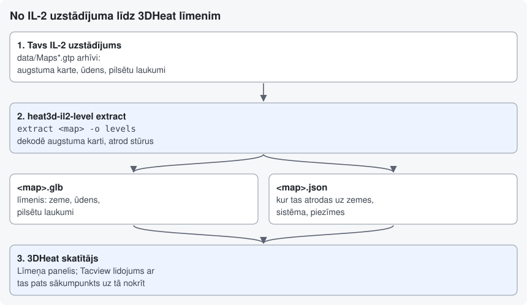

# 3DHeat IL-2 {#dheat-il-2}

**Kas tas ir?** Neliela programma, kas pārvērš **IL-2 Sturmovik: Great Battles** kartes, nolasītas no **jūsu paša uzstādījuma**, 3D modeļos - līmeņos - pār kuriem varat lidot [3DHeat](https://github.com/Holdi601/3DHeat) skatītājā ([dokumentācija](https://holdi601.github.io/3DHeat/)): kalni, upes, ezeri, jūra un pilsētas, novietoti tur, kur tie atrodas uz zemes. Otra IL-2 spēle, kuras arhīvi slēpj savu failu tabulu, tiek nolasīta, cik tālu arhīvi to ļauj ([sīkāk](archives-without-table.md)).

**Kāpēc to lietot?** Lai redzētu savus IL-2 lidojumus pār spēles pašu karti.

**Piemērs:** `heat3d-il2-level extract <map> -o levels` ->
`levels/<map>/<map>.glb` (līmenis) + `<map>.json` (kur tas atrodas uz zemes). Augstuma karte ir augstumu režģis, kā reljefa karte; Tacview ieraksts ir lidojuma fails, ko raksta Tacview.

Kam tas noder:

- **Lidojumi pa spēles pašu karti.** IL-2 Tacview ieraksts, ko 3DHeat Watcher konvertē ar to pašu sākumpunktu, nokrīt uz līmeņa bez novietošanas soļa.
- **Visas kartes vienlaikus.** `extract --all` raksta katru atrasto karti; sezonas, kas kopīgo vienu augstuma karti, tiek uzrakstītas vienreiz.
- **Kur uz zemes.** Katra līmeņa `.json` nes tā stūrus un platuma/garuma kasti un to, kā tie tika atrasti.



## Ātrais sākums {#quick-start}

Nekad neesat strādājis ar komandrindu? Vispirms izlasiet [Pirms sākat](before-you-start.md).
Palaidiet šīs komandas mapē, kurā klonējāt vai izpakojāt rīku:

```bash
python -m pip install -e .                         # uzstāda komandu heat3d-il2-level
python -m pip install -e .[fast]                   # ar numba: dekodēšana 20 līdz 50 reizes ātrāka
heat3d-il2-level list                              # katra atrastā karte ar tās platuma/garuma kasti
heat3d-il2-level extract <map> -o levels           # viena karte (nosaukumi, kā tos izdrukā `list`, aizstājējzīmes atļautas)
heat3d-il2-level extract --all -o levels           # katra karte
```

No `list` vajadzētu redzēt rindu katrai kartei, un no `extract` - `ok ...`.
Pēc tam ielādējiet `levels/<map>/<map>.glb` skatītāja Līmeņa panelī
([Līmeņi](https://holdi601.github.io/3DHeat/levels.html)).

Līmeņi, ko tas raksta, veidoti no spēles datiem, un tie paliek **jūsu datorā**; nekad nepublicējiet tos ([Noteikumi](terms.md)).

Katrs spēles lasītājs ir atsevišķs mazs projekts ar savu licences failu, saviem laidieniem un savu problēmu sekotāju, tāpēc to var instalēt, atjaunināt, uzturēt - vai pēc tiesību īpašnieka lūguma atsaukt - atsevišķi, neietekmējot skatītāju vai citus rīkus.

## Lapas {#pages}

| Lapa | Ko tā aptver |
|---|---|
| [Pirms sākat](before-you-start.md) | Python, termināls, pirmā palaišana |
| [Karšu meklēšana: list](list.md) | kur tiek atrasti uzstādījumi, ko izdrukā `list` |
| [Līmeņu veidošana: extract](extract.md) | katra iespēja, soli pa solim, piemēri |
| [Līmeņa faili un sistēmas](output.md) | `.glb` daļas, `.json`, `enu` un `game` sistēmas |
| [Kā tiek nolasīti faili](reading.md) | arhīvi, augstuma kartes kodeks, ūdens, pilsētas, orientieru pieskaņojumi |
| [Arhīvi bez failu tabulas](archives-without-table.md) | otrā spēle, nolasīta, cik tālu to arhīvi ļauj |
| [Ātrums, testi, noteikumi](terms.md) | numba, testi, ko lasa un ko nepiegādā, licence |
| [Komandu atsauce](../cli-reference.md) | katra iespēja, ģenerēta no koda |
| [Šo lapu uzturēšana](maintaining.md) | izlaides kontrolsaraksts |

## Saistītais {#related}

- 3DHeat skatītājs: [github.com/Holdi601/3DHeat](https://github.com/Holdi601/3DHeat),
  dokumentācija vietnē [holdi601.github.io/3DHeat](https://holdi601.github.io/3DHeat/).
- Telemetrija šiem līmeņiem: [3DHeat Watcher](https://holdi601.github.io/3DHeat-Watcher/)
  konvertē IL-2 Tacview ierakstus; skatītāja failu formāti, tostarp tā viena faila mača konteiners,
  aprakstīti lapā [Viens fails vienam mačam (.3dheat)](https://holdi601.github.io/3DHeat/container.html).

## 3DHeat rīki {#the-3dheat-tools}

| Rīks | Ko tas dara | Kods | Dokumentācija |
|---|---|---|---|
| 3DHeat skatītājs | rāda datus: siltumkartes, sacensību analīzi, maču pārskatu | [3DHeat](https://github.com/Holdi601/3DHeat) | [dokumentācija](https://holdi601.github.io/3DHeat/) |
| GameFiles | līmeņi un trases no spēles pašu failiem | [3DHeat-GameFiles](https://github.com/Holdi601/3DHeat-GameFiles) | [dokumentācija](https://holdi601.github.io/3DHeat-GameFiles/) |
| GameCapture | telemetrija no apļiem un līmeņi, atjaunoti no spēles video | [3DHeat-GameCapture](https://github.com/Holdi601/3DHeat-GameCapture) | [dokumentācija](https://holdi601.github.io/3DHeat-GameCapture/) |
| Unreal Exporter | Unreal Editor spraudnis: līmenis kā viens `.glb` | [3DHeat-UnrealExporter](https://github.com/Holdi601/3DHeat-UnrealExporter) | [dokumentācija](https://holdi601.github.io/3DHeat-UnrealExporter/) |
| CS2 | Counter-Strike 2 demo un kartes | [3DHeat-CS2](https://github.com/Holdi601/3DHeat-CS2) | [dokumentācija](https://holdi601.github.io/3DHeat-CS2/) |
| Watcher | ieraksta to, ko spēles publicē, kamēr jūs spēlējat | [3DHeat-Watcher](https://github.com/Holdi601/3DHeat-Watcher) | [dokumentācija](https://holdi601.github.io/3DHeat-Watcher/) |
| Ext-WarThunder | War Thunder ieraksti | [3DHeat-Ext-WarThunder](https://github.com/Holdi601/3DHeat-Ext-WarThunder) | [dokumentācija](https://holdi601.github.io/3DHeat-Ext-WarThunder/) |
| Ext-WoT | World of Tanks ieraksti | [3DHeat-Ext-WoT](https://github.com/Holdi601/3DHeat-Ext-WoT) | [dokumentācija](https://holdi601.github.io/3DHeat-Ext-WoT/) |
| Ext-WoWs | World of Warships ieraksti | [3DHeat-Ext-WoWs](https://github.com/Holdi601/3DHeat-Ext-WoWs) | [dokumentācija](https://holdi601.github.io/3DHeat-Ext-WoWs/) |
| Ext-Squad | Squad servera demo | [3DHeat-Ext-Squad](https://github.com/Holdi601/3DHeat-Ext-Squad) | [dokumentācija](https://holdi601.github.io/3DHeat-Ext-Squad/) |
| Ext-DCS | DCS World kartes kā 3D līmeņi | [3DHeat-Ext-DCS](https://github.com/Holdi601/3DHeat-Ext-DCS) | [dokumentācija](https://holdi601.github.io/3DHeat-Ext-DCS/) |
| Ext-IL2 | IL-2 Sturmovik kartes kā 3D līmeņi | [3DHeat-Ext-IL2](https://github.com/Holdi601/3DHeat-Ext-IL2) | [dokumentācija](https://holdi601.github.io/3DHeat-Ext-IL2/) |
