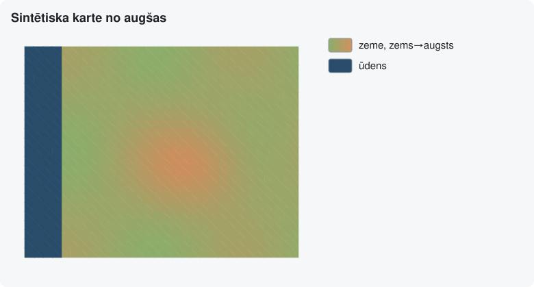

# Līmeņa faili un sistēmas {#the-level-files-and-frames}

`<out>/<map>/<map>.glb` (līmenis: zemes 3D modelis) un blakus `<map>.json`. Glb tiek rakstīts
failā `<map>.glb.part` un pārdēvēts, kad pabeigts.

| Daļa | Ko tā ir |
|---|---|
| `ground:<map>` | reljefa augstuma karte kā režģis, ne vairāk par `--max-grid` paraugiem malā (pēc noklusējuma 1024: apmēram 2 miljoni trijstūru) |
| `water:<map>` | upes, ezeri un jūra: plakani četrstūri ūdens augstumā, viens katrai šūnai, ja pietiekami daudzi tās augstuma kartes paraugi atrodas zem ūdens (trešdaļa ar kartes ūdens masku, puse bez tās) |
| `ground:<map> towns` | pilsētu un ciemu apbūvētie laukumi, pārklāti 1,5 m virs zemes |

`.json` satur kartes **stūrus un platuma/garuma kasti** (`corners`, `extent`), to, kā tie atrasti (`georeference`), augstuma iestatījumus (`heightMul`, `SeaLevel`), spēles laukumu spēles metros (`playArea`), sistēmu un tās sākumpunktu (`frame`, `geo`), trijstūru skaitus un visas `notes`.

## Sistēmas {#frames}

Divas sistēmas, `--frame`:

- `enu` (noklusējums): metri uz austrumiem, augstums virs jūras līmeņa, ziemeļi no sākumpunkta WGS-84 pieskarplaknē: plakanā karte, kurā 3DHeat Watcher ieliek IL-2 Tacview ierakstu (x austrumi, y augstums, z ziemeļi, zīmēts ar apgrieztu z). Glb glabā (austrumi, augstums, -ziemeļi). Pārvērtiet ar `--origin <lat> <lon>`, kas ir ieraksta `geo` (tā sesijas atsauces punkts), un ieraksts nokrīt uz līmeņa bez novietošanas soļa; bez tā kartes centrs ir sākumpunkts, un JSON `geo` norāda, kurš tas ir.
- `game`: spēles pašu metri, kā tos ir misiju failos: x ziemeļi no dienvidu malas, y spēles augstums, z austrumi no rietumu malas (tādā pašā labās rokas sistēmā, kāda tā ir, tātad glb = (x, y, z)). Kartes, ko nevar novietot uz zemes, tiek rakstītas šajā sistēmā neatkarīgi no tā, ko pieprasa, ar piezīmi.

Līmenis ir glTF binārs fails ar nosauktām daļām, kā visi 3DHeat līmeņi; skatītāja lapa [Līmeņi](https://holdi601.github.io/3DHeat/levels.html) apraksta, kā tie tiek ielādēti.
