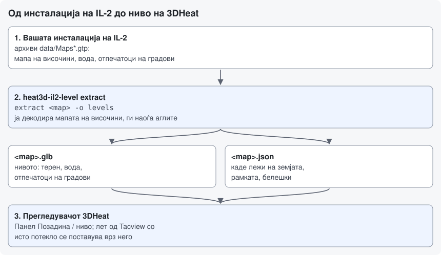

# 3DHeat IL-2 {#dheat-il-2}

**Што е тоа?** Мала програма што ги претвора мапите на **IL-2 Sturmovik:
Great Battles**, прочитани од **вашата сопствена инсталација**, во 3D модели - нивоа -
над кои може да летате во прегледувачот [3DHeat](https://github.com/Holdi601/3DHeat)
([документација](https://holdi601.github.io/3DHeat/)): ридовите, реките,
езерата, морето и градовите, поставени таму каде што лежат на земјата. Втора игра од IL-2
чии архиви ја кријат табелата со датотеки се чита колку што тие дозволуваат
([детали](archives-without-table.md)).

**Зошто би ја користел?** За да ги видите вашите летови во IL-2 над сопствената мапа на играта.

**Пример:** `heat3d-il2-level extract <map> -o levels` ->
`levels/<map>/<map>.glb` (нивото) + `<map>.json` (каде лежи на
земјата). Мапа на височини е мрежа од височини, како релјефна карта; снимка
од Tacview е датотека на лет што ја пишува Tacview.

За што е корисна:

- **Летови на сопствената мапа на играта.** Снимка од Tacview од IL-2, претворена од
  3DHeat Watcher со исто потекло, се поставува на нивото без чекор
  за поставување.
- **Секоја мапа одеднаш.** `extract --all` ја пишува секоја пронајдена мапа; сезоните што
  делат мапа на височини се пишуваат еднаш.
- **Каде на земјата.** `.json` на секое ниво ги носи неговите агли и кутијата за
  географска ширина/должина, и како се најдени.



## Брз почеток {#quick-start}

Нови сте со командната линија? Прво прочитајте [Пред да започнете](before-you-start.md).
Пуштете ги овие во папката што сте ја клонирале или распакувале:

```bash
python -m pip install -e .                         # installs the heat3d-il2-level command
python -m pip install -e .[fast]                            # with numba: decoding 20 to 50 times faster
heat3d-il2-level list                              # every map found, with its latitude/longitude box
heat3d-il2-level extract <map> -o levels           # one map (names as `list` prints them, wildcards allowed)
heat3d-il2-level extract --all -o levels           # every map
```

Од `list` треба да видите по една линија за мапа, а од `extract` `ok ...`.
Потоа вчитајте `levels/<map>/<map>.glb` во панелот Позадина / ниво на прегледувачот
([Нивоа](https://holdi601.github.io/3DHeat/levels.html)).

Нивоата што ги пишува се изградени од податоците на играта: остануваат **на вашата
машина**; никогаш не ги објавувајте ([Услови](terms.md)).

## Страници {#pages}

| Страница | Што опфаќа |
|---|---|
| [Пред да започнете](before-you-start.md) | Python, терминал, прво извршување |
| [Наоѓање мапи: list](list.md) | каде се наоѓаат инсталациите, што печати `list` |
| [Градење нивоа: extract](extract.md) | секоја опција, чекор по чекор, примери |
| [Датотеките на нивото и рамките](output.md) | деловите на `.glb`, `.json`, рамките `enu` и `game` |
| [Како се читаат датотеките](reading.md) | архиви, кодекот на мапата на височини, вода, градови, прилагодувања по знаменитости |
| [Архиви без табела со датотеки](archives-without-table.md) | втората игра, читана колку што дозволуваат нејзините архиви |
| [Брзина, тестови, услови](terms.md) | numba, тестовите, условите на играта, лиценца |
| [Упатство за команди](../cli-reference.md) | секоја опција, генерирано од кодот |
| [Одржување на оваа документација](maintaining.md) | списокот за проверка при издание |

## Поврзано {#related}

- Прегледувачот 3DHeat: [github.com/Holdi601/3DHeat](https://github.com/Holdi601/3DHeat),
  документација на [holdi601.github.io/3DHeat](https://holdi601.github.io/3DHeat/).
- Телеметрија за овие нивоа: [3DHeat Watcher](https://holdi601.github.io/3DHeat-Watcher/)
  ги претвора снимките од Tacview на IL-2; форматите на датотеки на прегледувачот, вклучително и неговиот
  контејнер со една датотека по меч, се опишани во
  [Една датотека по меч (.3dheat)](https://holdi601.github.io/3DHeat/container.html).

## Алатките на 3DHeat {#the-3dheat-tools}

| Алатка | Што прави | Код | Документација |
|---|---|---|---|
| 3DHeat viewer | ги прикажува податоците: топлински мапи, анализа на трки, преглед на мечеви | [3DHeat](https://github.com/Holdi601/3DHeat) | [docs](https://holdi601.github.io/3DHeat/) |
| GameFiles | нивоа и патеки од сопствените датотеки на играта | [3DHeat-GameFiles](https://github.com/Holdi601/3DHeat-GameFiles) | [docs](https://holdi601.github.io/3DHeat-GameFiles/) |
| GameCapture | телеметрија на кругови, и нивоа обновени од видео од игра | [3DHeat-GameCapture](https://github.com/Holdi601/3DHeat-GameCapture) | [docs](https://holdi601.github.io/3DHeat-GameCapture/) |
| Unreal Exporter | приклучок за Unreal Editor: ниво како една `.glb` | [3DHeat-UnrealExporter](https://github.com/Holdi601/3DHeat-UnrealExporter) | [docs](https://holdi601.github.io/3DHeat-UnrealExporter/) |
| CS2 | демоа и мапи од Counter-Strike 2 | [3DHeat-CS2](https://github.com/Holdi601/3DHeat-CS2) | [docs](https://holdi601.github.io/3DHeat-CS2/) |
| Watcher | снима што играта објавува додека играте | [3DHeat-Watcher](https://github.com/Holdi601/3DHeat-Watcher) | [docs](https://holdi601.github.io/3DHeat-Watcher/) |
| Ext-WarThunder | снимки од War Thunder | [3DHeat-Ext-WarThunder](https://github.com/Holdi601/3DHeat-Ext-WarThunder) | [docs](https://holdi601.github.io/3DHeat-Ext-WarThunder/) |
| Ext-WoT | снимки од World of Tanks | [3DHeat-Ext-WoT](https://github.com/Holdi601/3DHeat-Ext-WoT) | [docs](https://holdi601.github.io/3DHeat-Ext-WoT/) |
| Ext-WoWs | снимки од World of Warships | [3DHeat-Ext-WoWs](https://github.com/Holdi601/3DHeat-Ext-WoWs) | [docs](https://holdi601.github.io/3DHeat-Ext-WoWs/) |
| Ext-Squad | демоа од Squad сервери | [3DHeat-Ext-Squad](https://github.com/Holdi601/3DHeat-Ext-Squad) | [docs](https://holdi601.github.io/3DHeat-Ext-Squad/) |
| Ext-DCS | мапи од DCS World како 3D нивоа | [3DHeat-Ext-DCS](https://github.com/Holdi601/3DHeat-Ext-DCS) | [docs](https://holdi601.github.io/3DHeat-Ext-DCS/) |
| Ext-IL2 | мапи од IL-2 Sturmovik како 3D нивоа | [3DHeat-Ext-IL2](https://github.com/Holdi601/3DHeat-Ext-IL2) | [docs](https://holdi601.github.io/3DHeat-Ext-IL2/) |
