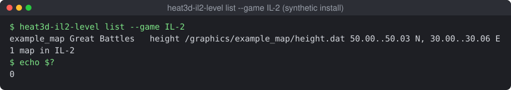

# Наоѓање мапи: `list` {#finding-maps-list}

```text
heat3d-il2-level list [--game FOLDER ...]
python -m heat3d_ext_il2 list ...          the same, without installing
```

Нови сте со командната линија? Прво прочитајте [Пред да започнете](before-you-start.md).

1. Инсталирајте еднаш: `git clone https://github.com/Holdi601/3DHeat-Ext-IL2`, отворете
   терминал во таа папка и пуштете `python -m pip install -e .` (Python 3.10
   или понов; носи numpy; `python -m pip install -e .[fast]` додава numba).
2. Пуштете `heat3d-il2-level list`.
3. Секоја мапа печати по една линија, одделена со табулатори: нејзиното име (името што го зема `extract`),
   играта (`Great Battles`, или `Korea` за [втората игра](archives-without-table.md)), мапата на височини што ја чита, и
   каде лежи на земјата - нејзината кутија за географска ширина/должина од аглите
   на мапата, или прилагодувањето по знаменитости што ја поставува, или „not placed on the earth“.
   Последната линија (на stderr) ги брои мапите и ги именува инсталациите.



Сликата е извршување на инсталација изградена од пишувачите на тестовите
(`tests/synth.py`), а не на играта.

## Каде се наоѓаат инсталациите {#where-the-installs-are-found}

Преку Steam; инаку `--game <folder>` (може да се повтори, по една за инсталација) или
променливата на околината `HEAT3D_IL2_GAME`. Инсталација е папка чија `data`
содржи архиви `Maps*.gtp`.

| Опција | Што прави |
|---|---|
| `--game FOLDER` | папка на IL-2; повторете ја за повеќе инсталации |

Излезен статус: 0 готово, 2 не е пронајдена инсталација.
